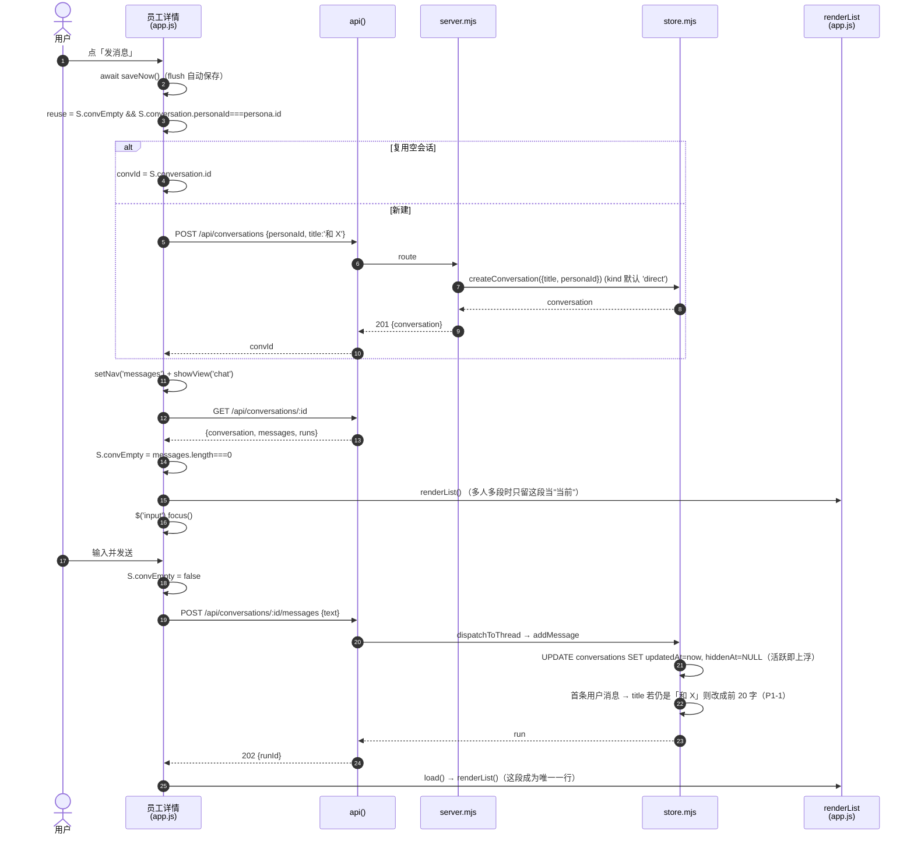
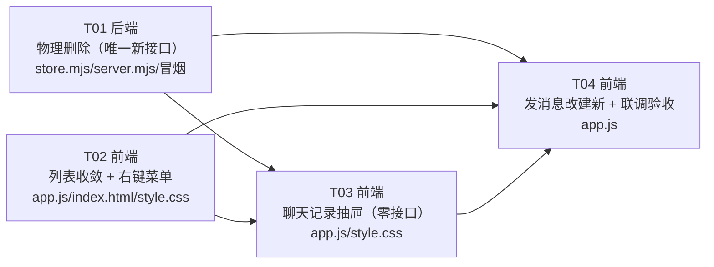

# 会话改造 · 实现方案 + 任务分解

> 版本：2026-10-20（**v1.1 已与 PRD v1.1 对齐**：不新增只读接口、聊天记录不显示条数、错误码改用 E2047/E1050/E4002）
>
> **v1.2（2026-10-20 实现期回改，口径已定死）**：工程师实跑发现 `GET /api/conversations/:id` 的 404 一直是旧码 `E2004`，会让 §5.6.1 的两条路径失效。主理人最终裁定：**`GET` / `PUT` / `DELETE` 三处 404 一律 `E2047`**（「会话不存在」只有一个概念、一个码），`E2004` / `E2003` 一并作废（§4.1.1 / §4.4）。另在 §10 明确**新增函数签名以本文代码块为准**（传对象，不按口头描述收成 id）。
>
> **⚠️ v1.3（2026-10-20 当天用户二次变更：去掉会话归档）—— 优先级高于本文其余章节**：
> 用户实测后要求整段去掉「归档 / 已移除的会话」。以下条款**覆盖**前文对应表述，冲突处以本条为准：
> 1. **「不显示」新语义**：只是不在消息列表占行，**聊天记录抽屉里照样看得到**（数据来源改为
>    `/api/state` 新增的 `hiddenConversations`，前端合并后按 updatedAt 倒序；「条数」仍然不显示）。
>    覆盖 §5.6 / §4.1 中"hide 之后可从已移除会话恢复"的说法。
> 2. **归档功能整段删除**：「已移除的会话」子视图与入口、`GET /api/archived`、`POST /unhide`、
>    `store.listArchivedConversations` / `countArchived` / `unhideConversation` 全部移除；
>    `/api/state`、hide / DELETE / 解散群返回体里的 `archivedCount` 换成 `hiddenConversations`。
> 3. **已删除员工的会话**：不再归档，**留在消息列表里**（`store.deletePersona` 不写 `hiddenAt`，
>    只把名字落进标题）；点进去**只读**——输入框置灰、工具条收起、提示行说明
>    （`setComposerReadonly`，见 app.js）。右键菜单对这类会话给「删除 / **归档**」：
>    归档 = 同一个 hide 接口，因那个人已无聊天记录入口，界面上等于彻底收走（数据留库）。
> 4. **群聊**：右键菜单整段去掉（群的「不显示」已删，群没有聊天记录入口，一藏就再也看不见）；
>    群的下线路径仍是群设置「解散」（解散后从列表消失、数据留库、无入口）。
> 5. **二次确认文案**更新：删除确认不再提「已移除的会话」，改为说明与「不显示」的区别
>    （不显示的还能在聊天记录里找到）。
> 验收：后端冒烟 `smoke-conversation-delete.mjs`（新增 ⑨ 隐藏语义 / ⑩ 删员工不归档 两组断言）全通过；
> 前端 CDP 实测 26 项全 PASS（`tmp/verify-no-archive/`）。
>
> **⚠️ v1.4（2026-10-20 当天用户三次变更，优先级最高）**：
> 1. **零消息会话不进聊天记录**：只点开、一个字没发的会话（「发消息」建出来的空壳、点错又退出的空壳）
>    **不进聊天记录抽屉** —— 抽屉只列 `messageCount > 0` 的会话（`hasAnyMessage()`，`app.js`）。
>    为此 `store.listConversations()` **新增一个字段** `messageCount`（覆盖 §4.2「不改这条 SQL」与
>    §0「零新增字段」的表述；是查询里的派生列，**不是建表字段**，库结构零变化）。
>    老服务端没有该字段时前端回落看 `lastMessage`，不会把抽屉整片清空。
> 2. **「不显示 / 归档」成功后不再 toast**：动作本身零风险、行消失已是反馈，`hideConversationRow`
>    的成功提示整行删除（失败提示不变）。
> 验收：`tmp/verify-empty-conv/verify.mjs`（真实库副本 + 无头 Edge）7 项全 PASS：空会话 `messageCount=0`、
> 不进抽屉、抽屉显示空态；发一条消息后立刻出现在抽屉并带「当前」标；有消息人物的行数与
> 「非空 direct 会话数」一致。
>
> **⚠️ v1.5（2026-10-20 用户四次变更，优先级最高）：群聊也上「删除 / 不显示」**：
> 消息列表的群行右键与单聊同一套菜单。**设计上的两个必须**（不这样做就是错的）：
> 1. 群没有聊天记录入口，所以群的「不显示」= **解散并隐藏**（`dissolveGroup`，带二次确认，
>    文案写明"界面上再也找不到它、记录留库但没有入口"）—— 绝不能只写 `hiddenAt`，
>    那会留下"成员关系还在、界面无入口"的僵尸群。
> 2. 删群删的是**所有成员共享的历史**（`thread_members` / `member_sessions` 一起没），
>    确认文案必须单独写（「永久删除这个群」+ 点明全部消息与成员上下文）。
> 实现落点：`store.deleteConversation` 的 kind 限制从"仅 direct"放开为 direct+group
> （**exec 仍然拒绝**，`why='not-deletable'` / `E1050`，文案改为指向任务卡/流程）；
> 前端 ctx 菜单群分支复用 `removeConversationForever` / `dissolveGroup`；
> `dissolveGroup` 的成员数改为 `members?.length ?? memberCount`（列表行没有 members 数组）。
> 跑中保护不变：群的 run 一样触发 409 + `E4002`，「删除」置灰。
> 验收：冒烟 ⑦b（群删除：消息/成员关系/成员会话/运行/运行事件清零、别群不受影响、exec 仍拒绝）
> + CDP `tmp/probe-group-menu/verify.mjs` 11 项全 PASS（菜单两项、群专用确认文案、真删、
> 解散真解除成员关系）。
>
> **⚠️ v1.6（2026-10-20 用户五次变更，优先级最高）：群的「不显示」≠ 解散**：
> 用户实测纠正——「不显示」对群与单聊**同一个动作、同一个接口**（只写 `hiddenAt`，
> 不弹确认）：成员关系、群助手、记录全都不动；群里再有新消息它**自动回到列表**
> （`addMessage` 的取消隐藏对群同样生效）。上一版把它实现成解散是理解过头了，已回退；
> 「解散」仍是群设置里的独立操作（解除成员关系，带确认）。v1.5 第 1 条作废。
> 验收：`tmp/probe-group-hide/verify.mjs` 6 项全 PASS（无确认直接隐藏、群与成员关系完好、
> `dissolvedAt` 仍为空、隐藏后进 `hiddenConversations`、再来一条消息自动回列表）。
>
> **v1.7（2026-10-20 用户六次变更）：群聊天记录抽屉**：
> 群的聊天头部加「聊天记录」按钮（在「群设置」左边），打开同一个 `#drawer`（`drawerKind='log'`）。
> 取数口径按 `S.logGroupId`：只列**这个群自己**的会话（群 = 一条线程，通常 1 条，**含被「不显示」的**）；
> 标题「聊天记录 群名」（没有「和」字）、不画"还没有更早的会话"提示；点一条 `openConversationSafe` 回看/续聊。
> 这条链路同时补上"群被「不显示」后的找回入口"：通讯录 → 群详情 → 发消息 → 聊天记录，照样能看到那段。
> 验收：`tmp/probe-group-log/verify.mjs` 7 项全 PASS。
> **v1.8（2026-10-20 用户七次变更）：群 = 容器，会话 = 片段 —— 群支持「每次开新会话」**：
> 群从「一条线程」拆成「`groups` 群身份 + 多段 `conversations` 会话」，跟单聊一个口径：
>   · **新表** `groups(id, title, assistantPersonaId, createdAt, updatedAt, dissolvedAt)` 与
>     `group_members(groupId, personaId, joinedAt)`（群级真源）；`conversations.groupId`（空 = 单聊/工单）。
>     幂等迁移：老群会话 → 建群行（**复用会话 id 当群 id**）、`thread_members` 拷成 `group_members`、回填 `groupId`。
>   · **新接口**：`GET/PATCH/DELETE /api/groups/:id`（详情/改名换助手/解散）、
>     `POST /api/groups/:id/sessions`（开新会话，`E2048` 群不存在 / `E2049` 已解散；
>     **E2016/E2017 归技能用，不得复用**）、`POST|DELETE /api/groups/:id/members…`。
>     群级加人/踢人会同步**每一段**会话的 `thread_members`（老会话保持当时的成员快照）。
>   · **删除语义（同日用户改口径）**：消息列表一行 = 一个群，但右键「删除」删的是
>     **这一段会话**，不是整个群 —— 用户原话「这个删除不是删除群，是删除这次会话」。
>     `deleteConversation` 对 `kind='group'` 直接 `purgeConversation` 这一段；
>     群行、成员名单、其他段的记录全不动。**删到零段群也留着**（见下条：
>     通讯录读 groups 表，容器不因片段删光而消失，再发消息就开新的一段）。
>     原先的 `store.deleteGroup`（整群连删）已删除；整个群不要了走「解散」。
>     前端确认框正文收敛成**一句**（同日用户定稿）：
>     「本次会话删除后，消息内容不可恢复。请确认是否操作？」
>     群与单聊同一句（标题区分「永久删除这段群会话 / 这段会话」）。
>     这是对 PRD P0-3 / P1-5（"讲清 ①找不回来 ②与不显示的差别"）的收敛：
>     确认框的作用是让人停一秒，不是讲设计；与「不显示」的差别在右键菜单里看得见。
>   · **通讯录的群列表读 `groups` 表（用户实报「在通讯录里，群为什么也没了」）**：
>     以前通讯录是从 `conversations` 里 `kind='group'` 去重推出来的 —— 会话删光（或删到零段）
>     群就凭空消失，用户看到的是"群被删了"。现在 `/api/state` 直接给 `groups`
>     （`store.listGroups()`：未解散、`memberCount` 取 `group_members` 真源、
>     `lastActiveAt` 给排序），通讯录按它画，会话只用来补"最近说了什么 / 状态"。
>     零段的群照样列出来（副标题「还没聊过」），点进群详情「发消息」就能开新的一段。
>     消息列表则继续只认 `conversations`（没会话就没消息，不该占行）。
>   · **「不显示」语义**：群会话隐藏 = **整群一起隐**（只隐一段的话，列表把上一段顶上来，
>     用户看就是"没生效"）。群里再来新消息，那一段自动取消隐藏、整行回列表。
>   · **解散语义（同日用户定稿：解散后消息仍留在消息列表里、只读）**：
>     `dissolveGroup` 只做三件事 —— 删 `group_members`、清每段的 `thread_members` /
>     `member_sessions`、群与各段打 `dissolvedAt`（群助手一并置空）；
>     **不再写 `hiddenAt`**（旧实现把会话一起藏了，记录在库里却没有任何入口 = 等于删档）。
>     前端按 `dissolvedAt` 画只读：行副标题「已解散 · 最后一句」、头部标「已解散」
>     且不给群设置入口、输入框置灰 + 「这个群已解散，只能查看聊天记录」。
>     后端兜底：发消息接口对带 `dissolvedAt` 的会话回 `409 + E2049`
>     （不拦的话 dispatcher 找不到人，表现成"点了没反应"，比报错更难查）。
>     通讯录的群列表（`listGroups`）仍只列未解散的群 —— 那边是"还能用的群"。
>     「已归档」不收解散的群：那个入口的语义是"员工已删的 1:1"，别混。
>   · **前端**：群详情「发消息」→ `POST /api/groups/:id/sessions`（连点保护同单聊：
>     当前这段空着就复用，`S.convEmpty`；**被「不显示」收着的空段不复用**——
>     复用既不建段也不发消息，群永远回不了列表，见下方"发起即回列表"）；
>     群设置一律群级接口（`gidOf()` 统一取群 id，`refreshGroup` 三处同步：详情页 / 抽屉 / 正在聊的会话）；
>     列表按 `groupId` 收敛一行/群；聊天记录抽屉按 `groupId` 取该群会话，
>     **零消息的段与单聊同一口径不进抽屉**（统一走 `hasAnyMessage`，2026-10-20 用户定）；
>     抽屉里**不再画**「还没有更早的会话 / 每次点『发消息』都会开一段新的」提示
>     （2026-10-20 用户要求去掉，群与单聊一并：只有一条就是事实本身，别再解释）。
>   · **「已归档」= 左栏子视图（2026-10-20 用户三轮定稿）**：删员工后右键「归档」收走的
>     单聊，过去没有任何入口（员工没了，连聊天头部都进不去）——记录留库却是死数据。
>     第一版做成抽屉，用户改版：左栏换成归档列表（`S.archivedView`），
>     入口 = 左栏**底部固定条**（`#listFoot`，`.list-panel` 第四行 grid：`auto auto 1fr auto`，
>     `:empty` 时整体隐藏）上的一行「**已归档 N**」（N>0 才出现）。
>     入口位置用户三次调整：抽屉 → 置顶 → **固定底部**（原话「已归档固定再底部是不是更好」——
>     它是"被收起来的东西"的收件箱，用得少但要一眼能找到；放底部像回收站，不与「消息」抢平级感）。
>     点它 → **左栏整个换成归档列表**（面包屑「消息 › 已归档」，
>     行与消息列表同一套 `.item`：标题 / 归档时间 / 条数 · 员工已删除）；
>     点一行 → 右侧打开对话面板（员工已删 → 输入框置灰 + 只能查看提示；
>     聊天头部名字用会话自己的标题，**不能回落 S.persona**——那是上一个人的名字）；
>     头部「聊天记录」能翻这个人跟自己的全部历史（抽屉标题在员工已删时用会话标题，
>     不再拼「和」）。底部固定条换成「← 返回消息」（进/出同一位置，不用滚回顶部）；
>     面包屑「消息」/ 左栏「消息」也都能退出；
>     归档行右键只有「删除」（物理删 + 二次确认），不给"不显示/归档"废话项。
>     `renderList()` 每次重画都先清空 `#listFoot`（它挂的是**跨列表**的入口，归属谁由当前分支决定）。
>     正常员工的「不显示」**不算**归档（还能从聊天记录翻回来），不进这个列表 ——
>     那条边界是 2026-10-20 用户明确划下的：「不显示 ≠ 归档」。
>   · **发起即回列表（用户实报：发起群聊会话后列表里不出现）**：群被「不显示」收着时再点
>     「发消息」，旧逻辑复用了那段被收着的空段 —— 不建段不发消息，群卡在列表外。
>     修法：`createGroupSession` 落新段后整群 `hiddenAt = NULL`（与群级隐藏对称：
>     一起藏、一起回）；前端复用判据加"这段还在列表里"，群与单聊同一口径。
>   · **参数顺序陷阱（真踩过）**：`insertGroupSession` 的 INSERT 把 `ownerUserId` 与
>     `assistantPersonaId` 写反过一次 —— 每段新群会话的群助手变成 `local-user`，
>     一发言就「群里没有群助手」，建群那一刻看不出来。列名与占位符必须逐位核对。
> 验收：26 个冒烟全绿（`smoke-conversation-delete` 已入 `run-smokes` 清单）+
> `tmp/probe-group-sessions/verify.mjs`（连点复用 / 说过话开新段 / 一群一行 / 抽屉只列说过话的段 /
> 不显示整群消失而通讯录在 / 删除连群行一起没）+ `tmp/probe-group-reappear/verify.mjs`
> 6 项全 PASS（不显示 → 发消息 → 群回列表）。
> **v1.9（2026-10-20 用户八次变更）：已删员工的单聊，删除 = 「删除并清空聊天记录」**：
> 用户原话：「这个删除只会删除一个会话，如果有多个历史记录，那这个操作就会造成看不到的冗余数据。」
> 病根与解散的群完全同构 —— 删员工**保留会话**（记录可能有用），而列表是**一人一行**
> （只摆这个人最新那段），于是那一行代表的是"这个人的**全部历史**"；
> 只删一段，剩下的段还躺在「已归档」/ 抽屉里，而他已经没有任何入口 —— 纯冗余。
>   · **服务端**：`deleteConversation` 的 SELECT 加取 `personaId`，`kind='direct'` 且
>     **personas 里已经没有这个人**时，分派到新函数 `purgePersonaHistory(personaId)`：
>     他名下**所有** direct 会话（含被「不显示」的）在**一个事务**里全清
>     （消息 / 运行 / 运行事件 / 成员状态）；任何一段还在跑 → 整体拒绝（409 + `E4002`）。
>     人还活着就不走这条路（那是正常单聊的"删这一段"）；判据在 store 层再验一遍（接口可被直调）。
>   · **前端**：抽 `wipeScopeOf(c)` 统一判"删的是这一段还是一整档"
>     （`'group'` = 已解散的群 / `'persona'` = 员工已删的单聊），三处共用（两个右键菜单 + 确认框）：
>     菜单标签「删除并清空聊天记录」；确认框标题同名、正文
>     「这个员工已删除。删除后会清空他的全部聊天记录，不可恢复。请确认是否操作？」
>     （沿用一句话口径，只换清档句式）；toast「已删除。他的聊天记录都清掉了」；
>     删完复位按 `personaId` 命中 —— 正在看的是这个人的**另一段**也要复位。
>     活着的员工照旧「删除 / 不显示」+ 原确认文案，不受影响。
>     「已归档」里的行（本来就只有"员工已删 + 解散群"两种）标签同步改。
> 验收：`smoke-conversation-delete` 新增 ⑪（13 项：三段全清含隐藏段、跑中整体拒绝且零写入、
> 别人的单聊一比一未动）+ CDP `tmp/probe-persona-wipe/verify.mjs` 20 项全 PASS。
>
> 上游：`docs/prd/2026-10-20-会话改造.md`（产品：许清楚，v1.1）
> 架构：高见远 · 仓库：`E:\02CodeSpace\github\bandi`
> 本文件只出**设计 + 任务**，不含实现代码。

---

## 0. 一页纸结论

| 项 | 结论 |
| --- | --- |
| 改动范围 | 5 个文件：`apps/web/app.js`、`apps/web/style.css`、`apps/web/index.html`、`apps/server/src/server.mjs`、`apps/server/src/store.mjs`（+1 个冒烟脚本） |
| 新增接口 | **1 个**：`DELETE /api/conversations/:id`。聊天记录**不新增接口**——前端从 `S.conversations` 过滤直出（§4.2） |
| 新增表/字段 | **零**。`hiddenAt` / `updatedAt` / `kind` 三者已够 |
| 物理删除涉及表 | `run_events` → `runs` → `messages` → `member_sessions` → `thread_members` → `conversations`；另把 `workflow_steps` / `workflow_tasks` / `workflow_runs` / `project_tasks` 的会话引用置 `NULL` |
| 列表收敛位置 | **前端** `renderList()`（不动 `store.listConversations`，它是 `/api/state` 的热路径，也是工作台/通讯录的数据源） |
| 聊天记录承载 | 复用现有 `#drawer`（右侧抽屉），新增 `S.drawerKind = 'group' \| 'log'` 两种内容，**不新造浮层** |
| 右键菜单 | 单例 DOM `#ctxMenu` + `contextmenu` **事件委托**在 `#listBody` 上（一次性注册，随列表重建继续有效） |
| 任务数 | **4 个**（T01 后端 / T02 列表+菜单 / T03 聊天记录 / T04 发消息+验收） |

### 与 PRD 的交涉结果（已在 PRD v1.1 定稿，本设计照此执行）

| # | 事项 | 结论 |
| --- | --- | --- |
| 1 | 我提的「新增只读接口 `GET /api/personas/:id/conversations`」（为拿 `messageCount`） | **产品否决，砍掉**：聊天记录只要「预览 + 时间 + 当前标记」，这四样 `S.conversations` 全有；「条数」是产品自加的装饰，不在用户原始需求里。零新接口优先。**只有将来要做「按条数排序/筛选」才回头补** |
| 2 | PRD 原建议错误码 `E1041` / `E1042` | **产品采纳我的**：`E2047`（404）/ `E1050`（400）/ `E4002`（409）。取证见 §4.4 |
| 3 | 我补出的三处引用：`workflow_runs.threadId` / `node_jobs.runId` / `schedule_jobs.config.conversationId` | **产品采纳**：`workflow_runs.threadId` 一并置 NULL；后两个**明确不动**（PRD 写明「可接受，别为它加级联」） |
| 4 | 「P1-1 标题自动命名」 | 收进 T01，但**标注可裁**（非 P0 验收项，工期紧可摘） |
| 5 | 看板「聊天派活」一人多行 | 产品**升格为 PRD 规则 9**（已知副作用、接受）：一段会话一段活，反而补回原来丢的信息；将来行数挤了在**看板层按 persona 归并**，不限制会话数 |
| 6 | 三个新错误码的 toast 文案 | **产品要求说人话**：不能只弹 `E码：服务异常`。本功能加 `toastConvErr` 做三行映射（`E2047/E1050/E4002` → 具体原因），映射不到才回落通用；**不动全局 `api()`**（那会改掉全站每个错误提示）。见 §4.1 双列表 + §5.6 |

> 另两条产品提醒已并入本设计：聊天记录打开前**先 `load()`** 再渲染（§5.4）、`E4002` 不能只靠前端置灰（§5.6 + §11 验收 6）。

---

## 1. 实现思路

### 1.1 难在哪里

| 难点 | 本质 | 本设计的应对 |
| --- | --- | --- |
| 物理删除不能删出孤儿 | `conversations.id` 被 **9 张表**引用，其中 4 处是「留着的那张卡」引了「要删的那段会话」 | 先摘引用再删，全程一个事务（§3） |
| 一人一行的收敛不能动后端 | `listConversations()` 同时喂 `/api/state`、工作台、通讯录、`project-tasks.chatRows`、hide/unhide 的返回体 | 只在 `renderList()` 里收敛；服务端一行不改 |
| 列表每次 `innerHTML` 重建 | 逐个绑事件必漏（本仓库踩过多轮） | 右键菜单走 **`#listBody` 上的 contextmenu 委托**，boot 时注册一次 |
| 抽屉只有一个 DOM | 群设置已占用 `#drawer` + `S.drawerOpen/drawerThreadId/drawerThread` | 加 `S.drawerKind` 分流渲染，不新建浮层、不改 CSS 布局 |
| 「发消息」的连点保护 | 不能为一句「是不是空会话」再打一次接口 | 用 `openConversation()` **本来就取到的** `d.messages.length` 判断（零额外请求） |
| 跑中保护 | 前端可以被绕过 | 前端灰显 + 后端 `activeRun()` 兜底拒绝（新错误码，非 500） |

### 1.2 选型

| 方面 | 选择 | 理由 |
| --- | --- | --- |
| 框架 | **无**（原生 JS SPA，沿用现状） | 仓库零依赖是红线（`docs/审阅经验.md` 第 2 条），`package.json` 出现即打回 |
| 浮层 | 自建 `#ctxMenu`（`position:fixed`） | 与既有 `.hero-more-menu`（`style.css:1574`）同一套写法，不引库 |
| 抽屉 | 复用 `#drawer` / `#scrim` | 已有 `transform` 动画、Esc、scrim 点击三件套，白拿 |
| 事务 | `db.exec('BEGIN'/'COMMIT'/'ROLLBACK')` | `node:sqlite` 的 `DatabaseSync` **没有** `db.transaction()`（见 `store.mjs:1089` 的既有注释），全仓都这么写 |
| 架构模式 | 三层：路由（`server.mjs`）/ 数据（`store.mjs`）/ 视图（`app.js` 单文件 + 集中 `S` 状态） | 沿用现状，不额外抽象 |

### 1.3 明确**不做**的事

- 不加「置顶 / 当前会话」字段（PRD 规则 1 已定：`updatedAt` 就是活跃度）。
- 不改 `store.listConversations()` 的 SQL；**不新增任何只读接口**（聊天记录数据从 `S.conversations` 现成过滤）。
- 不动 `ensureConversationForPersona()`（保留给内部/旧调用方，见 §6.3）。
- 不做触屏长按（P2-2）、聊天记录搜索/分页（P2-3）、聊天记录显示「条数」。
- 不清理 `node_jobs`（远程执行台账，见 §3.4 决策；PRD v1.1 已写明可接受）。
- 不动 `schedule_jobs.config.conversationId`（JSON 内字段，`persona-task.mjs:47` 自带重建）。

---

## 2. 文件清单

```
apps/
├─ web/
│  ├─ index.html      ✎ 加 1 行：<div id="ctxMenu" hidden></div>（#drawer 之后）
│  ├─ style.css       ✎ 删 .item-x 三块 + 「.item:hover .line1 span」；加 .ctx-menu / .chatlog 样式
│  └─ app.js          ✎ 主要改动（详见 §5、§9）
└─ server/
   └─ src/
      ├─ server.mjs   ✎ handleConversation 加 DELETE 路由（唯一新增接口；handlePersona 不动）
      ├─ store.mjs    ✎ 新增 deleteConversation；addMessage 加标题自命名（+ 4 处引用置空）
      ├─ project-tasks.mjs  ✎ **仅 1 行注释对齐**（「归到手上的活」→「不进消息列表」），无逻辑改动
      ├─ workflows.mjs      ✎ **同上**（1 行注释，同一句表述）
      └─ smoke-conversation-delete.mjs   ✚ 新建：本次验收的自动化脚本（临时库，不碰真账）
docs/
└─ design/2026-10-20-会话改造-设计.md   ✚ 本文件
```

`docs/design/class-diagram.mermaid`、`docs/design/sequence-diagram.mermaid`：§7、§8 两张图的独立文件（方便贴进 mermaid 预览）。

---

## 3. 数据层

### 3.1 引用实况（已逐个核对 `store.mjs` 的 `CREATE TABLE` 与 `ensureColumn`，不采信 PRD 转述）

| 表 | 列 | 定义方式 | 指向 | 处理 |
| --- | --- | --- | --- | --- |
| `messages` | `conversationId` | `TEXT NOT NULL`（`store.mjs:44`） | 会话 | **DELETE** |
| `runs` | `conversationId` | `TEXT NOT NULL`（`store.mjs:53`） | 会话 | **DELETE** |
| `run_events` | `runId` | `TEXT NOT NULL`（`store.mjs:117`），PK `(runId, seq)` | 运行 | **DELETE**（按 runId 子查询，**必须在删 runs 前**） |
| `member_sessions` | `threadId` | `TEXT NOT NULL`（`store.mjs:80`），PK `(threadId, personaId, scope)` | 会话 | **DELETE** |
| `thread_members` | `threadId` | `TEXT NOT NULL`（`store.mjs:65`） | 会话 | **DELETE**（1:1 本无，删了无害） |
| `workflow_steps` | `conversationId` | `TEXT`（`store.mjs:320`） | 会话 | **SET NULL**（流程实例要留） |
| `workflow_tasks` | `conversationId` | `TEXT`（`store.mjs:356`） | 会话 | **SET NULL**（办理记录要留） |
| `workflow_runs` | `threadId` | `TEXT`（`store.mjs:406` ensureColumn） | 会话 | **SET NULL**（实测恒为 `NULL`：`createWorkflowRun` 从不传 `threadId`，见 `workflows.mjs:241`；仍写一条防御） |
| `project_tasks` | `conversationId` | `TEXT`（`store.mjs:672`） | 会话 | **SET NULL**（卡要留，只是不再指向一段不存在的会话） |
| `node_jobs` | `runId` | `TEXT NOT NULL`（`store.mjs:1901`） | 运行 | **不处理**（见 §3.4；PRD v1.1 已写明「可接受，别为它加级联」） |
| `schedule_jobs` | `config.conversationId`（JSON 内） | `TEXT`（`store.mjs:2635`，JSON） | 会话 | **不处理**（`persona-task.mjs:47-52` 自带兜底：取不到就重开一条并写回；PRD v1.1 同口径） |

> 结论：**没有第十张表**。`project_tasks.runId`、`workflow_tasks.agentRunId`、`workflow_steps.agentRunId` 指向 `runs.id`，但它们只在 **exec 会话**（流程/任务卡）里产生（`store.ensureExecConversation` 是唯一入口，见 `store.mjs:557`），而本接口只删 `kind='direct'`，够不着。

### 3.2 最终 SQL 清单（顺序即事务内顺序，不可调换）

```sql
-- ① 先摘外部引用（这些行必须留着）
UPDATE workflow_steps SET conversationId = NULL WHERE conversationId = ?;
UPDATE workflow_tasks SET conversationId = NULL WHERE conversationId = ?;
UPDATE workflow_runs  SET threadId       = NULL WHERE threadId       = ?;
UPDATE project_tasks  SET conversationId = NULL WHERE conversationId = ?;

-- ② 运行侧：run_events 靠 runId 子查询，必须在 ③ 之前跑（否则 runs 没了，子查询永远空）
DELETE FROM run_events WHERE runId IN (SELECT id FROM runs WHERE conversationId = ?);
DELETE FROM runs       WHERE conversationId = ?;

-- ③ 会话自己的从属行
DELETE FROM messages        WHERE conversationId = ?;
DELETE FROM member_sessions WHERE threadId       = ?;
DELETE FROM thread_members  WHERE threadId       = ?;

-- ④ 最后删会话本身
DELETE FROM conversations WHERE id = ?;
```

> ⚠️ 顺序陷阱：`DELETE FROM run_events WHERE runId IN (SELECT … FROM runs WHERE conversationId = ?)` 与 `DELETE FROM runs …` 若写反，`run_events` 一行都删不掉，且**不报错**——是最容易漏测的一条。

### 3.3 事务边界

```
[事务外] ① 取会话（不存在 → 返回 not-found）
        ② kind 校验（≠ direct → not-direct，不写库）
        ③ activeRun(id) 校验（有跑中 → running，不写库）
[BEGIN]
        ④ §3.2 的 10 条语句
[COMMIT]    （catch → ROLLBACK，异常原样抛给路由层 → 500 E5xxx）
[事务外] 返回 { ok:true, changes }
```

- 三个前置校验全在事务外：拒绝路径**零写入**，不留半拉状态。
- 校验靠 `store` 层自己再判一遍（不止路由层判），因为接口可以被直接调（同 `deletePersona` 的两道关，见 `server.mjs:495-502` 注释）。

### 3.4 `node_jobs` 为什么不删（已定：不删）

- 它是**远程节点的执行台账**（`node.mjs` 按 `nodeId + status` 领活，终态行只用于节点详情展示），**没有任何代码按 `runId` 反查会话**。
- 删掉它换不来「更干净」——反而会让节点那边出现过「这台机器跑过的活从记录里消失」，排查跨机问题时会断线索。
- 验收（PRD 3.4 第 5 条）也只要求 `messages / runs / run_events` 无残留。
- **风险**：删会话后节点详情里可能有一条指向已消失运行的记录。**产品已确认接受**（PRD v1.1 §3.2：「可接受，别为它加级联」）。

---

## 4. 接口设计

### 4.1 `DELETE /api/conversations/:id`

**语义**：把这个 1:1 会话连同它的消息、运行记录**永久**抹掉，不可恢复，**不进「已移除的会话」**。

**落点**：`server.mjs` 的 `handleConversation()`，紧跟 `unhide` 块之后（`server.mjs:415` 与 `422` 之间）。`detail` 正则 `/^\/api\/conversations\/([^/]+)$/` **已存在**（`server.mjs:398`），不用新加正则。

**校验顺序与返回**：

| 顺序 | 条件 | HTTP | 错误码 | 服务端 `error`（明细，进 console / `err.detail`） | **前端 toast 显示**（人话，产品定稿） |
| --- | --- | --- | --- | --- | --- |
| 1 | 会话不存在 | 404 | `E2047` | 这段会话已经不在了（可能刚被删过） | 这段会话已经不在了，列表已刷新（E2047） |
| 2 | `kind !== 'direct'` | 400 | `E1050` | 只有 1:1 会话能这样删 —— 群请在群设置里解散，工单会话属于任务卡/流程 | 只有 1:1 会话能删，群请去群设置解散（E1050） |
| 3 | 存在 `status='跑中'` 的 run | 409 | `E4002` | 这段还在跑，等它跑完或先终止再删 | 这段还在跑，等它跑完或先终止再删（E4002） |

> **`E2047` 不只属于删除——`GET` / `PUT` / `DELETE` 三处 404 都是它**：`GET` 是"回看一段已被别人删掉的会话"、`PUT` 是"要改的那段已经没了"，本质上和 `DELETE` 是**同一个概念**：「这段会话已经不在了」。完整对照与理由见 **§4.1.1**。

> **为什么"服务端 error"和"前端 toast"分两列**：`api()`（`app.js:895-915`）把**所有** HTTP 错误统一成 `E码：服务异常`，真正的中文原因只放在 `err.detail` 和 console 里。产品要求这三个码必须**当着用户的面说清原因**（尤其 E2047 最常见于"两个窗口同时开着、另一个已经删了"，说"服务异常"他就以为出 bug 了）。
> 做法：**不改全局 `api()`**（那会改动全站每个错误提示，超出本次范围），只在本功能里加一张三行的映射表（§5.6 `toastConvErr`）。

**成功返回体**（200）：

```json
{
  "deleted": true,
  "id": "c_xxx",
  "conversations": [ /* store.listConversations() —— 前端直接换 S.conversations，不用再 load() */ ],
  "archivedCount": 3
}
```

- 回整份 `conversations` 是**跟 hide/unhide 保持一致**（`server.mjs:407`、`414`）：同一个界面、同一套前端流程，前端一行 `S.conversations = r.conversations` 就够。
- 与 `DELETE /api/personas/:id`（只回结果、让前端 `load()`）不同，是因为那边整页要重画；这边只需要列表。
- `archivedCount` 一并回：删除**不会**改变它（被删的本来就是未隐藏的），但前端逻辑上需要一个可信值，别靠 `-1` 猜。
- 失败走 `fail()`，带 `extra` 时把 `runId` 捎上（`fail` 支持第 5 参，见 `server.mjs:114`）。

**为什么 409 而不是 400**：「这段正在跑」是**当前状态冲突**，不是请求格式错。且文件顶部已有分段约定：`E1xxx=400 / E2xxx=404 / E3xxx=403 / E4xxx=409`（`server.mjs:107-111`），`store.mjs` 的 busy 在别处也是 409（`server.mjs:472`）。

### 4.1.1 「会话不存在」：`GET` / `PUT` / `DELETE` 三处 404 一律 `E2047`（v1.2 修，工程师实跑发现）

**问题**：§5.6.1 的路径 2/3 靠"`GET` 返回 `E2047`"来认「这段没了」，但代码里 `GET /api/conversations/:id` 的 404 一直是 **`E2004`**（改前 `server.mjs:495` 附近）、`PUT` 是 **`E2003`**。**这是 §4.4 台账只核了"新占码是否撞车"、没核"同一概念是否已有旧码"漏出来的**，设计缺陷记在这里，不推给实现。

**结论（主理人最终裁定）**：`PUT` 的 404 只可能来自一个事实——**你要改的那段会话不存在了**，和 `GET` / `DELETE` 是**同一个概念**。既然刚因为"同一概念两个码"导致 §5.6.1 三条路径静默失效，就不能在 `PUT` 上再留一个同概念异码。所以 **三处 404 一律 `E2047`**，`E2004` / `E2003` 一并作废：

| 接口 | 原 404 码 | 现在 | 说明 |
| --- | --- | --- | --- |
| `DELETE /api/conversations/:id` | —（本次新增） | `E2047` | 基准 |
| `GET /api/conversations/:id` | `E2004` | **`E2047`** | `openConversationSafe` 只认 `err.code === 'E2047'`；不改则 §5.6.1 路径 2/3 全废（实跑会弹「E2004：服务异常」）。`E2004` 全仓仅剩桌面壳 `runtime` 冻结副本与注释，无调用方依赖 |
| `PUT /api/conversations/:id` | `E2003` | **`E2047`** | 它是**会话级覆盖**（`sandbox` / `model`）的入口，404 只可能来自"这段会话不存在"——与 `GET` / `DELETE` 同概念，所以就同码。`E2003` 全仓仅此一处、前端零解析、零测试依赖，改的风险等于 0 |

**为什么最终三处一起改**：`PUT` 的 404 只可能来自一个事实——**你要改的那段会话不存在了**，和 `GET` / `DELETE` 是同一个概念。上一次正是"同一概念两个码"（`E2004` vs `E2047`）让 §5.6.1 三条人话路径**静默失效**，在 `PUT` 上再留一个同概念异码，等于把同一个坑留着等下次踩。「最小改动」在这里的代价是**语义分裂**，不划算；而改 `E2003` 的回归风险是 0（全仓一处、前端不解析）。

**边界**：`E2004` / `E2003` 的**状态码（404）不变**，改的只是码；`PUT` 的 404 文案与 `GET` 对齐成「这段会话已经不在了（可能刚被删过）」（原来 `PUT` 是「会话不存在」）；`PUT` 的前端 catch **不**接 `toastConvErr`（那是「改权限 / 模型」的界面，不在本次范围，行为与今天一致）。`E2004` / `E2003` **一并作废**（见 §4.4）。

> 验收口径（避免"注释算不算命中"的口水）：**代码字面量**用 `grep -rn "'E2003'\|'E2004'" apps/server/src` → 零命中；`server.mjs` 里**注释**保留"原码是 E2003/E2004、为什么改"的历史说明，那是唯一的决策记录，**不许为了凑零命中把它删掉**。

> **验 `PUT` 的 404 必须带合法 body**（工程师实现时发现，QA 会踩）：`PUT` 的校验顺序是"先说清要改哪一项（否则 `E1037` 400）→ 再查会话在不在（`E2047` 404）"，所以测 404 时要发 `-d '{"sandbox":"read-only"}'`；**空 body 测到的是 400 而不是 404**，别据此判失败。`GET` / `DELETE` 没有这层，直接打即可。

> 给将来的提醒：**新增码之前不光要 grep「有没有被占」，还要 grep「这个概念是不是已经有码」**。这次漏的就是后者——`E2047` 定义写的是"会话不存在"，而 `GET` 早就有一个表示同一件事的 `E2004`。

### 4.2 聊天记录：**不新增接口**，前端从 `S.conversations` 过滤直出（PRD v1.1 定稿）

**数据来源**：`GET /api/state` 已返回的 `S.conversations`，每条含 `id / title / personaId / kind / status / createdAt / updatedAt / lastMessage / personaName`（`store.mjs:1162-1174`）——聊天记录要的「预览 + 时间 + 当前标记」全在里面。

**过滤规则**（前端一处，服务端零改动）：

```js
// 聊天记录 = 这个人的 direct 且未隐藏的全部会话（S.conversations 本来就只有未隐藏的），
// 已按 updatedAt DESC 排好，直接用，不排序。
const rows = S.conversations.filter((c) => c.kind === 'direct' && c.personaId === personaId);
```

**明确放弃的东西**：

| 放弃项 | 原因 | 反悔条件 |
| --- | --- | --- |
| 列表项「N 条」 | `messageCount` 只有 `listArchivedConversations`（`store.mjs:1437`）算了；`listConversations` 是热路径，不为其加 COUNT 子查询；也不为一句装饰拉 N 次 `GET /api/conversations/:id` | 将来做「按消息条数排序/筛选」时再补（产品原话：别提前付利息） |
| 服务端排序/分页 | 一个人几十段会话的量级，前端全量过滤足够 | P2-3（搜索/滚动加载）时再说 |

**代价与边界**：`S.conversations` 可能是旧快照（轮询间隔内新起的会话不在里面）→ 抽屉打开前**先 `await load()`**（§5.4），这一步比多养一条接口便宜得多，也顺带解决「聊天记录里看不到刚建的空会话」。

### 4.3 复用（不新增接口；唯一的例外是 §4.1.1 把 404 的**错误码**统一成 `E2047`）

| 接口 | 用途 | 位置 |
| --- | --- | --- |
| `POST /api/conversations` | 「发消息」新建 1:1 | `server.mjs:287-294` |
| `POST /api/conversations/:id/hide` | 「不显示」 | `server.mjs:404-408` |
| `POST /api/conversations/:id/unhide` | 「已移除的会话」恢复 | `server.mjs:411-415` |
| `GET /api/archived` | 「已移除的会话」列表 | `server.mjs:221-223` |
| `GET /api/conversations/:id` | 回看/继续聊（**唯一改动**：404 的码 `E2004`→`E2047`，语义/返回体/状态码都不变，见 §4.1.1） | `server.mjs:439` 起 |
| `PUT /api/conversations/:id` | 会话级沙箱/模型覆盖（**唯一改动**：404 的码 `E2003`→`E2047` + 文案对齐，见 §4.1.1） | `server.mjs:464` 起 |

### 4.4 错误码台账（本次新占 3 个，均已核过全仓未被占用）

| 码 | HTTP | 含义 | 写在哪 |
| --- | --- | --- | --- |
| `E2047` | 404 | **会话不存在（`GET` / `PUT` / `DELETE` 三处共用，见 §4.1.1）** | `server.mjs` `handleConversation()` 的三个 404 分支 |
| `E1050` | 400 | 只有 1:1 能删 | `server.mjs` DELETE 分支 |
| `E4002` | 409 | 这段还在跑 | 同上 |

**本次作废的两个旧码**（「会话不存在」统一到 `E2047`，见 §4.1.1）：

| 码 | 曾表示 | 现在 | 处理 |
| --- | --- | --- | --- |
| `E2004` | `GET /api/conversations/:id` 的 404「会话不存在」 | **已废 → `E2047`** | 全仓仅剩桌面壳 `apps/desktop/runtime|target/` 的冻结副本（gitignore 的构建产物，重新打包即同步）与注释；前端不解析、无调用方依赖。**不算可回收空位**，新代码别再用 |
| `E2003` | `PUT /api/conversations/:id` 的 404「会话不存在」 | **已废 → `E2047`** | 全仓仅此一处，前端零解析、零测试依赖。**不算可回收空位**，新代码别再用 |

**同类不一致：本次明确「不做」，不是因为漏了**（工程师收尾时报告，我核过代码，留痕以免下次被当成漏改翻出来）

| 落点 | 现状的码/文案 | 与 `E2047` 的关系 | 本次处理 |
| --- | --- | --- | --- |
| `POST /api/conversations/:id/hide`（`server.mjs:406`） | `E2001` + 「会话不存在」 | 同一句人话，另一个码 | **不做**。「不显示」是**可恢复**动作（进「已移除的会话」），它的失败语义是"这条收不起来"，与"这段彻底没了"的补救动作不同（前者刷列表即可，后者还要 `resetChatPane()`）；混用一个码会让 `openConversationSafe` 那套善后逻辑被误触发 |
| `POST /api/conversations/:id/unhide`（`server.mjs:413`） | `E2002` + 「会话不存在」 | 同上 | **不做**，理由同上（恢复失败的补救是"刷新已移除列表"，不是"收拾当前对话"） |
| `dispatch.mjs:207` | `throw fail('会话不存在')`（**内部抛错，无码**；不是 HTTP 响应） | 不涉及 HTTP 码 | **不做**：它在派活链路里，最终由上层包成各自的接口错误；本次不碰派活 |

> 判据（写下来供将来参照）：**「同概念同码」的前提是"补救动作也相同"。** `hide`/`unhide` 的 404 与 `E2047` 的人话补救不同（一个只要刷新、一个要清空对话区），所以它们保留各自的码**不算**分裂；真正的分裂是 `GET`/`PUT`/`DELETE` 那样——三个入口、同一个"这段没了"、同一套善后。哪天有人要给 `hide` 也加人话文案，**先加进 `CONV_ERR_ZH` 再评估是否并码**，别直接改码。

**取证命令**（谁都能复现，2026-10-20 实跑）：
```
grep -roh "E[0-9]\{4\}" apps/server/src apps/web | sort -u | tr '\n' ' '
→ E1001…E1049 | E1061…E1075 | E1081…E1087
  E2001…E2043 | E2045 | E2046
  E4001 | E4010 | E4011 | E4030
```

| 段 | 实测占用 | 本次取的 | 说明 |
| --- | --- | --- | --- |
| E1xxx | `E1001-E1049`、`E1061-E1075`、`E1081-E1087` | **`E1050`** | `E1050-E1060` 整段空闲，取段首 |
| E2xxx | `E2001-E2043`、`E2045`、`E2046` | **`E2047`** | 紧接最大号往后取。**不要**用 `E2044`（那是历史空缺，用它会让人以为漏看了一段） |
| E4xxx | `E4001`、`E4010`、`E4011`、`E4030` | **`E4002`** | `E4002-E4009` 空闲 |

**PRD 建议的 `E1041` / `E1042` 不能用**：`E1041` 已被 `server.mjs:850` 与 `1402` 占用（同一个码出现在两处，说明既有台账已有先例），`E1042` 被 `server.mjs:862` 占用。

---

## 5. 前端设计

### 5.1 `S` 新增字段（`app.js:4-84` 的 `S` 对象内，紧贴现有 `archived*` 三项之后）

```js
drawerKind: null,      // null | 'group' | 'log'  —— 同一个 #drawer 两种内容，谁开谁置
logPersonaId: null,    // 聊天记录抽屉看的是谁（渲染时从 S.conversations 现算，不缓存列表）
logLoading: false,     // 抽屉「正在拉…」瞬时标记，取完 / 关闭都置 false
convEmpty: false,      // 当前打开的这段会话一条消息都没有（「发消息」复用它，别堆空壳）
```

- `convEmpty` 由 `openConversation()` 写、`send()` 清，**不落盘、不进路由**（刷新后重新判断，语义不变）。
- **不设 `S.logList`**：聊天记录的行直接从 `S.conversations` 过滤（§4.2），多存一份就等于多一个会过期的副本——这正是「抽屉里看到旧列表」的病根。
- 不加 `S.ctxMenu*`：菜单内容是一次性的闭包，不跨渲染存活。

### 5.2 右键菜单

**DOM**：`index.html:146` 之后加一行 `<div id="ctxMenu" class="ctx-menu" role="menu" hidden></div>`（静态节点，全局唯一）。

**为什么是单例**：每次右键换内容 + 换位置，不动节点本身 → 挂在 `#ctxMenu` 上的那一个 `mousedown/click/keydown` 监听永远有效，不用重绑。

**打开**：`function openCtxMenu(x, y, items)`（`items: [{ label, danger?, disabled?, why?, run }]`）

```
1. 用 items 生成 <button class="ctx-item [danger]" role="menuitem" [disabled] [title=why]>label</button>
2. menu.hidden = false；先 left=x / top=y，再 getBoundingClientRect() 量真实尺寸
3. 越界翻转：x + w > innerWidth - 8 → left = max(8, x - w)
              y + h > innerHeight - 8 → top  = max(8, y - h)
4. 焦点落到第一个**可用**项（键盘可达，P1-4 主体白拿）
```

**关闭**（六个时机，缺一个就会「菜单跟着你到处跑」）：

| 时机 | 实现 |
| --- | --- |
| 点任一项 | 项自己的 `onclick` 里：先 `closeCtxMenu()`，再 `await item.run()` |
| 点空白 / 点别的行 | boot 时注册的 `document.addEventListener('mousedown', e => !e.target.closest('#ctxMenu') && closeCtxMenu())`（用 `mousedown` 而非 `click`，避免和项自身的 click 抢顺序） |
| `Esc` | 在 `app.js:12321` 那个全局 keydown 里加一行（与抽屉同一个处理块） |
| 滚动 | `window.addEventListener('scroll', closeCtxMenu, true)` —— **必须 capture**，列表在 `#listBody` 内滚，不冒泡到 window |
| 窗口失焦 / 缩放 | `window.addEventListener('blur', closeCtxMenu)`、`resize` 同 |
| 列表重画 | `renderList()` 第一行 `closeCtxMenu()` —— 覆盖 hide/删除/轮询/openConversation 等全部重建路径 |

键盘上下：`#ctxMenu` 上挂一个 keydown，`ArrowDown/ArrowUp` 在 `[role=menuitem]:not([disabled])` 之间轮转焦点；`Enter/Space` 由 `<button>` 原生负责。

**绑定位置（关键）**：`contextmenu` **不进 `renderList()`**，而是 boot 区（`app.js:12300` 附近，`$('scrim').onclick = closeDrawer` 旁边）注册一次：

```js
$('listBody').addEventListener('contextmenu', (e) => {
  const row = e.target.closest?.('[data-conv]');
  if (!row) return;            // 空白处 /「已移除的会话」入口 / 已归档行：保留浏览器原生菜单
  e.preventDefault();          // 行内右键不再弹原生菜单
  const c = (S.conversations || []).find((x) => x.id === row.dataset.conv);
  if (!c) return;
  const isGroup = c.kind === 'group';
  const running = c.status === '跑中';
  openCtxMenu(e.clientX, e.clientY, [
    ...(isGroup ? [] : [{
      label: '删除', danger: true,
      disabled: running,
      why: running ? '这段还在跑，等它跑完或先终止再删' : '',
      run: () => removeConversationForever(c),
    }]),
    { label: '不显示', run: () => hideConversationRow(c) },
  ]);
});
```

- 群只给「不显示」（主理人已拍板）：`isGroup` 时数组里只有一项。
- `e.target.closest` → 点的是行内头像/文字都命中。
- 右键**不打开会话**：不触发 `click`，无需额外阻止。
- 「已移除的会话」那行是 `id="openArchived"` 而非 `data-conv`，天然不命中 → 归档条目保持原样。

**样式**（`style.css`，放在 `.item-x` 原先那段位置附近）：

```css
.ctx-menu { position: fixed; z-index: 60; min-width: 148px; padding: 4px;
            background: var(--panel); border: 1px solid var(--line); border-radius: 10px;
            box-shadow: 0 8px 24px var(--shadow); }
.ctx-menu[hidden] { display: none; }
.ctx-item { display: block; width: 100%; text-align: left; padding: 7px 10px; border: 0;
            background: none; color: var(--text); font-size: 13px; border-radius: 6px; cursor: pointer; }
.ctx-item:hover:not([disabled]) { background: var(--hover); }
.ctx-item.danger { color: var(--bad); }
.ctx-item[disabled] { color: var(--dim); opacity: .55; cursor: default; }
```

`z-index: 60` > `#drawer(41)` > `#scrim(40)`（`style.css:1768-1775`）。

**同时要删掉的旧样式**（容易漏，漏了会有「时间戳凭空消失」的 bug）：

| 行 | 内容 | 为什么必须删 |
| --- | --- | --- |
| `style.css:391` | `.item:hover .line1 span { opacity: 0; }` | 它只在「× 浮上来盖住时间」时有意义；× 没了，这行会让**悬停时时间戳静默消失** |
| `style.css:399-409` | `.item-x { … }` / `.item:hover .item-x` / `.item-x:hover` 三块 | × 已移除 |
| —— | `--chip-x-hover`（48、160 行） | **不要删**，`button.danger:hover`（1491）与 `.chip-x`（1884）还在用 |

### 5.3 列表收敛（一人一行）

落点：`renderList()` 的 `S.nav === 'messages'` 分支，把 `app.js:3389` 那一行 `const rows = …` 换成分两步（收敛 → 过滤）：

```js
/* 一人一行：direct 只留这个人的**当前会话**（updatedAt 最大的那条），其余进「聊天记录」。
   不在这层加排序 —— 输入 S.conversations 已由 listConversations 按 updatedAt DESC 排好，
   用 filter 天然保住全局顺序（群、人混在一起按最后活跃时间排，跟今天一样）。 */
const currentOf = new Map();
for (const c of S.conversations) {
  if (c.kind === 'exec' || c.kind === 'group') continue;      // exec 不进列表；群本来就一条
  if (!currentOf.has(c.personaId)) currentOf.set(c.personaId, c);   // 第一条即最新
}
const rows = S.conversations.filter((c) =>
  c.kind === 'exec' ? false
  : c.kind === 'group' ? true
  : currentOf.get(c.personaId)?.id === c.id,
).filter((c) => match(c.personaName) || match(c.title));
```

**`exec`（工单会话）是整组排除，不是"没排上用场"**：`kind === 'exec'` 的会话**既不分组、也不平铺** —— 上面两处（`currentOf` 循环里的 `continue`、`rows` 过滤里的 `? false`）都把它挡在外面。「手上的活」那一组的**分组头也一并没了**：`secCollapsed.exec` 不再被消息分支读取（通用 `secCollapsed` 折叠机制仍服务**通讯录**的分组，`app.js:3734` / `3776` 一行未动）。

这是**上一轮「工单会话不进消息列表」需求的既定结果**（同一轮里 `project-tasks.mjs:500`、`workflows.mjs:394` 的注释也已改成「不进消息列表 / 消息列表里不出现」），本次改动只是**不相干地保持**：exec 会话的入口仍是工作台 / 任务卡 / 流程页，从那儿进去照样能聊。

| 决策 | 结论 | 理由 |
| --- | --- | --- |
| 排序依据 | **全局按 `updatedAt` 倒序**（不是"人一组、群一组"） | 现状就是全局混排（`store.mjs:1171` 的 `ORDER BY c.updatedAt DESC`），改成分组排会动到用户已经习惯的顺序 |
| 收敛 vs 搜索的先后 | **先收敛，再按名字/标题过滤** | 先过滤的话，搜到一个**历史会话的标题**就会把它单独摆成一行，破坏「一人一行」 |
| 副作用 | 搜历史会话标题搜不到列表行 | 可接受：历史归「聊天记录」。P2-3 会在抽屉里加搜索，那儿才是搜历史的地方 |
| 高亮（`active`） | 改为**按 personaId 命中**：`S.conversation.id === c.id \|\| (c.kind === 'direct' && S.conversation.personaId === c.personaId)` | 正在看某人的历史会话时，该行不作高亮会让左栏像"什么都没选中"。按人高亮才对得上左栏语义（跟通讯录 `S.persona.id === p.id` 一个口径） |

**同时删掉的两处 ×**：`app.js:3419` 的 `<button class="item-x" data-hide="…">×</button>`，以及 `app.js:3443-3455` 整段 `[data-hide]` 绑定。

### 5.4 聊天记录（右侧抽屉，复用 `#drawer`）

**为什么是抽屉、且复用现有 `#drawer`**：入口在聊天头部（右侧），打开不打断当前对话；`#drawer` + `#scrim` 已经把动画、Esc、点遮罩关闭、`grid-template-rows: auto 1fr` 都做好了。新造浮层要再写一遍这些，且和「已移除的会话」这个**左栏子视图**不冲突（一个在左、一个在右，互不遮蔽）。

**与群设置抽屉的共存**：加 `S.drawerKind` 分流，`paintDrawer()` 顶部：

```js
function paintDrawer() {
  if (S.drawerKind === 'log') return paintChatLogDrawer();
  /* …以下原 group 逻辑一字不动… */
}
```
`closeDrawer()`（`app.js:12024`）加三行：`S.drawerKind = null; S.logPersonaId = null; S.logLoading = false;`（照着它现有的「清干净，别留旧 DOM」注释写）。

**函数**（放在 `openGroupDrawer`（`app.js:10947`）同一段，群设置抽屉之后）：

```js
/** 聊天记录：这个人的全部未隐藏 1:1 会话（含当前这条），新的在上。
 *  数据直接从 S.conversations 过滤（不新增接口）——但打开前先 load() 一次，
 *  否则可能看到轮询间隔内的旧快照（产品 v1.1 明确要求）。 */
async function openChatLogDrawer(conv) {
  S.drawerKind = 'log';
  S.drawerOpen = true;
  S.drawerThreadId = conv.id;      // 沿用"换会话就关抽屉"的判断，同时用来标「当前」
  S.logPersonaId = conv.personaId;
  S.logLoading = true;
  paintDrawer();                   // 先画「正在拉…」
  $('drawer').classList.add('open');
  $('scrim').classList.add('open');
  try {
    await load();                  // ← 只刷 /api/state（含 conversations），成本远低于一条新接口
    S.logLoading = false;
    if (S.drawerKind === 'log') paintDrawer();
  } catch (err) {
    S.logLoading = false;
    toastConvErr(err);               // 严格说这不是「会话域」错误（是 /api/state 失败），
    closeDrawer();                   // 映射表里查不到 → 原样回落 err.message，行为与今天一致
  }
}
```

> `S.logLoading` 是**瞬时**渲染标记（取完就置 false），不属于持久状态；也可以用一个局部 flag + 直接 `paintDrawer()` 两次来避开它——两者等价，工程师任选，别为此新增第 5 个 `S` 字段（若用局部 flag，`paintChatLogDrawer()` 需要能读到它，故推荐放 `S` 上并在 `closeDrawer()` 里复位）。

**`paintChatLogDrawer()` 渲染规则**（PRD v1.1：预览 + 时间 + 当前标记，**不显示条数**）：

| 元素 | 规则 |
| --- | --- |
| 头部 | `<b>聊天记录</b>` + 右侧 `×`（沿用 `.drawer-head`，照 `app.js:11036-11038`） |
| 行数据 | `S.conversations.filter(c => c.kind === 'direct' && c.personaId === S.logPersonaId)` —— **不排序**（`listConversations` 已 `ORDER BY updatedAt DESC`） |
| 会话行 | `.chatlog-row`（单行即可）：左侧 `<b>${cut(plain(lastMessage), 28) || esc(title) || '还没聊过'}</b>`（预览粗体，空会话回落标题）+ 右侧时间（今天 `hhmm(updatedAt)`，更早 `MM-DD`） |
| 时间分组（P1-3） | `今天 / 昨天 / 更早` 三个小标题（`dayBucket(iso)` 按本地日期算），分组内无行则不画标题 |
| 「当前」标记 | `c.id === S.drawerThreadId` 加一枚 `<i class="chatlog-cur">当前</i>`。抽屉从聊天头部打开，所以它=你正在看的这段；从历史会话打开时标记跟着你走（更符合直觉） |
| 空态 | 只有当前这一段时（`rows.length <= 1`）：`还没有更早的会话` + 小字 `从员工详情页点「发消息」，每次都会开一段新的` |
| 点击任一行 | `closeDrawer(); await openConversationSafe(id);` —— 抽屉先关再开，避免 `app.js:9642` 的「换会话就关抽屉」与这里抢状态；用 `openConversationSafe` 是因为这段会话可能刚被另一个窗口删掉（E2047，见 §5.6.1 路径 3） |
| Esc / 点遮罩 | 白拿（`app.js:12321`、`12301`） |

`chatHead` 的接线（`app.js:9671-9687`）：把占位提示换成

```js
$('toChatLog').onclick = () => openChatLogDrawer(d.conversation);
```
并把按钮 `title` 从「还没做，点了会说一声」改成「聊天记录」。

**为什么不需要「防御性 unhide」**：数据源 `S.conversations` 本身只含 `hiddenAt IS NULL`（`store.mjs:1170`），点不到隐藏会话。若将来抽屉加搜索/直达链接，再补。

### 5.5 详情页「发消息」= 新建一段

落点 `app.js:10587-10601`：

```js
/* 「发消息」= **开一段新的 1:1 会话**（一次任务一段，上下文不串味）。
   连点保护（P1-2，主理人已拍板"复用"）：当前就停在这个人一段**一条消息都没有**的会话上
   → 复用它，不再堆空壳。判断依据是 openConversation 本来就取到的 d.messages —— 零额外请求、零新字段。 */
const toMessages = async () => {
  try {
    const reuse = S.conversation && S.conversation.kind === 'direct'
      && S.conversation.personaId === persona.id && S.convEmpty;
    const convId = reuse
      ? S.conversation.id
      : (await post('/api/conversations', { personaId: persona.id, title: `和 ${persona.name}` })).conversation.id;
    setNav('messages');
    showView('chat');
    await openConversation(convId);
    await load();
    $('input').focus();
  } catch (err) { toastConvErr(err); }   // 复用分支里 openConversation 可能撞 E2047（那段刚被别人删）→ 说人话
};
```

- **不再调** `POST /api/personas/:id/open`（那是 `ensureConversationForPersona` 的入口，语义是"复用最近一段"）。
- 配套两行：
  - `openConversation()`（`app.js:9629`）里 `S.convEmpty = (d.messages || []).length === 0;`
  - `send()`（`app.js:9798`）开头 `S.convEmpty = false;`（发出第一条就不再是空会话）
- 「先 flush 自动保存」保留：`$('dMsg').onclick`（`app.js:10601`）里的 `await saveNow?.()` 不动。
- **取舍说明（前端判 vs 服务端判）**：选前端判。服务端判就意味着「详情页点一次要再打一次接口问最新一段空不空」，而 `d.messages` 本来就是 `openConversation()` 从服务端取回的真数据（不是本地猜测），空会话判定准确。唯一的边界：刷新后 `convEmpty` 重新按库里算，结论一致。

### 5.6 「删除」与「不显示」的前端流程

**不显示**（复用 `app.js:3445-3455` 的既有逻辑，只是换个触发源）：

```js
async function hideConversationRow(c) {
  try {
    const r = await post(`/api/conversations/${encodeURIComponent(c.id)}/hide`, {});
    S.conversations = r.conversations;          // 服务端已剔除它 → 收敛自动换下一条（规则 6）
    S.archivedCount = (S.archivedCount || 0) + 1;
    renderList();
  } catch (err) { toastConvErr(err); }          // E2001 不在映射表里 → 自动回落，行为与今天一致
}
```
不加二次确认（可恢复、零风险，PRD P0-2）。

**删除**：

```js
async function removeConversationForever(c) {
  // 标题别写成 `和 ${c.title}` —— 老会话的 title 本身可能已经是「和 张三」，会拼出「和 和 张三」
  const label = c.personaName ? `和 ${c.personaName}` : (c.title || '这段会话');
  const ok = await confirmDo(
    `删除「${label}」？\n\n` +
    `· 这段会话里的消息会被**永久**删除，找不回来\n` +
    `· 它也不会出现在「已移除的会话」里\n\n` +
    `（「不显示」只是从列表收起来 —— 那条还能在「已移除的会话」里找回。）`,
    { title: '永久删除这段会话', ok: '永久删除', danger: true },
  );
  if (!ok) return;
  try {
    const r = await api(`/api/conversations/${encodeURIComponent(c.id)}`, { method: 'DELETE' });
    S.conversations = r.conversations;
    S.archivedCount = r.archivedCount ?? S.archivedCount;
    if (S.drawerKind === 'log') closeDrawer();                       // 抽屉里可能正列着它
    if (S.conversation?.id === c.id) resetChatPane();                // 正在看的就是它 → 回空态
    renderList();
    toast('已删除。这段已经彻底没了，不在「已移除的会话」里', 'info');
  } catch (err) {
    /* E2047 = 另一个窗口刚把它删了。**列表要刷、"眼前这段"也要收拾**：
       只刷列表的话，左栏没这行了、右边聊天区还开着，用户一打字又撞第二个错。 */
    if (err.code === 'E2047') {
      if (S.conversation?.id === c.id) resetChatPane();   // 正在看的就是它 → 回空态、收输入区
      if (S.drawerKind === 'log') closeDrawer();          // 抽屉里那行已经不存在了
      await load().catch(() => {});
      renderList();
    }
    toastConvErr(err);
  }
}

/** 清掉主聊天区（照 dissolveGroup 的复位段抄，app.js:12096-12102） */
function resetChatPane() {
  S.conversation = null;
  $('chat').innerHTML = '<div class="empty">还没有对话</div>';
  $('chatHead').innerHTML = '<span class="dim" style="padding:6px 0">左边选一个人，开始说话</span>';
  setComposer(false);
}
```

**这三个码必须说人话（产品口径，别只弹「服务异常」）**：`api()` 把所有 HTTP 错误统一成 `E码：服务异常`，原因只进 `err.detail` 与 console；而这三个码正是用户**卡住时最需要知道原因**的场景，所以在本次改动范围内加一张三行映射（**不动全局 `api()`**，那会改掉全站每个错误提示）：

```js
/* 会话操作的错误人话。三个码之外一律回落 api() 给的「E码：服务异常」——
   新增码在这里查不到就走通用，不需要维护一张会跟源码漂移的大表。 */
const CONV_ERR_ZH = {
  E2047: '这段会话已经不在了，列表已刷新',
  E1050: '只有 1:1 会话能删，群请去群设置解散',
  E4002: '这段还在跑，等它跑完或先终止再删',
};
function toastConvErr(err) {
  const zh = CONV_ERR_ZH[err?.code];
  // 有专属文案 → 「人话（E码）」；没有 → 保持现状（api() 已经 console.error 过完整一行）
  toast(zh ? `${zh}（${err.code}）` : err.message, 'error');
}
```

- 用 `err.code` 直接映射，**不解析 `err.message`**（message 里只有"服务异常"）。
- `hideConversationRow` 的 catch 也改成 `toastConvErr`（hide 的失败码是 `E2001`，映射表里没有 → 自动回落通用文案，行为与今天一致）。
- **`CONV_ERR_ZH` 全仓只留这一份**：将来别的功能（比如群删除）要用人话，往这张表里加一行，**别再抄一份**；哪天真要做"全站说人话"，把这张表搬进 `api()` 即可，调用点不用重写。

**会话域动作的 catch 一览（统一口径，别各处写各的）**

本次改动触及的**每一个**会话域 catch 都走 `toastConvErr`；表里没有的码（如 hide 的 `E2001`、`/api/state` 的 `E5xxx`）**自动回落 `err.message`**，即"行为与今天完全一致"。反过来：**不许再出现 `toast(err.message, 'error')` 这种裸写法**——那正是「结论写 `toastConvErr`、代码块写 `toast(err.message)`」的自相矛盾来源。

| 动作 | 函数 | catch 里做什么 |
| --- | --- | --- |
| 删除会话 | `removeConversationForever`（§5.6） | `toastConvErr`；`E2047` 时先 `resetChatPane()` + `closeDrawer()` + `load()` + `renderList()` |
| 不显示会话 | `hideConversationRow`（§5.6） | `toastConvErr`（`E2001` 查不到 → 回落原样） |
| 详情页「发消息」 | `toMessages`（§5.5） | `toastConvErr`（复用分支的 `openConversation` 可能撞 `E2047`） |
| 打开会话（列表行 / 聊天记录行） | `openConversationSafe`（§5.6.1） | `toastConvErr`；`E2047` 时 `closeDrawer()` + `resetChatPane()` + `load()` + `setNav('messages')` |
| 打开聊天记录抽屉（先 `load()`） | `openChatLogDrawer`（§5.4） | `toastConvErr` + `closeDrawer()`（非会话域错误，原样回落） |

> 不接管的入口（工作台卡片、任务卡、流程实例里的 `openConversation`，共 15 处）**保持现状**——它们不在本次界面范围内，改它们=超范围。

### 5.6.1 `E2047` 有**三条**触发路径，一条都不能漏

「列表已刷新」这句话必须在三种路径上都成立，否则又变成空话。三个窗口两个人都可能删同一段——这是本功能最容易出"界面和精神分裂"的地方。

| # | 路径 | 现状 | 处理 | 落点 |
| --- | --- | --- | --- | --- |
| 1 | **删除时**发现已被删（`DELETE` 返回 E2047） | 只刷了列表，`S.conversation` 还死着 → 右边输入框还能打字，一打又撞一个错 | 刷列表 + `resetChatPane()` + 关抽屉 | `removeConversationForever` 的 catch（§5.6） |
| 2 | **点列表行**打开一段已被删的会话（`GET` 返回 **`E2047`**，`app.js:3440`；`GET` 的 404 原本是 `E2004`，本次统一，见 §4.1.1） | 弹通用「服务异常」，左栏还高亮着、右边空着 | 走统一入口 `openConversationSafe` | `renderList` 里 `[data-conv]` 的 click（原 `app.js:3440`） |
| 3 | **点聊天记录抽屉的行**打开一段已被删的会话 | 弹通用「服务异常」，抽屉还开着、那行还在 | 同上 | `paintChatLogDrawer` 的行 click（§5.4） |

统一入口（**只给这两处列表入口用**，不接管全站 `openConversation` 的 15 个调用点，否则就是超范围改动）：

```js
/* 打开会话的统一入口（消息列表行 / 聊天记录行）。
   E2047 = 这段已经被别人删了（两个窗口同时开时最常见）。
   这里必须把"眼前这段"一起收拾干净：只刷列表，用户就会对着一具尸体打字。 */
async function openConversationSafe(id) {
  try {
    await openConversation(id);
  } catch (err) {
    if (err.code !== 'E2047') return toastConvErr(err);
    closeDrawer();                 // 抽屉里那行已经不存在了（没开就是空操作）
    resetChatPane();               // 右边回空态、收输入区
    await load().catch(() => {});  // 列表刷成真的
    setNav('messages');            // 回列表；顺带把 S.route 清掉（setNav 会置 null），
                                   // 否则刷新时 restorePlace 还会照着死 id 再撞一次
    toastConvErr(err);
  }
}
```

> 为什么用 `setNav('messages')` 而不是只 `renderList()`：`S.route` 停在 `{view:'conversation', id:死的}` 时，**下次刷新会自动重放这条路**（`restorePlace` → `ROUTES.conversation`），用户会以为"刷新都修不好"。`setNav` 会把 `S.route` 置 null（`app.js:1001-1005`），落到 `ROUTES.messages`。

**除这三条之外的入口（工作台卡片、任务卡、流程实例）不接管**：它们不属于本次改动的界面，仍显示通用文案——行为与今天完全一致，不算回归。

文案要点（PRD 3.3③ + P1-5）：**含「永久」「不可恢复」语义**；**说清与「不显示」的区别**；成功后 toast 再点一次「不在已移除里」，防止用户跑去那儿翻。

> 排版说明：`askDialog` 的正文走 `rich()`（`app.js:2128`）——先 `esc` 再把 `**x**` 转成 `<b>`，配合 `#askBody` 的 `white-space: pre-line`（`index.html:340`），所以文案里的 `\n` 换行和 `**永久**` 加粗都生效；**别用 markdown 的其它语法**（不解析）。

**条数不写**：消息列表返回里**没有** `messageCount`（`store.mjs:1166` 只给 `memberCount`），不为一句文案加接口（PRD v1.1 已明确）。

**跑中保护是「两道」，前端置灰只是第一道**（产品 v1.1 特别强调）：
- 第一道（体验）：右键菜单里 `disabled` + `title` 说明，点不动；
- 第二道（权威）：接口直调必须拿到 **409 + `{code:'E4002', runId}`**，不是 500、不是静默成功。前端 catch 到 `E4002` 时按 §5.6 的映射表说人话：`这段还在跑，等它跑完或先终止再删（E4002）`——**不是**"服务异常"。
- 校验在 `store.deleteConversation` 里（不在路由），所以**绕过 HTTP 直接调 store 也删不掉**——同 `deletePersona` 的两道关（`server.mjs:495-502` 注释）。

---

## 6. 兼容与回归风险

### 6.1 依赖「一人一 direct」假设的调用方（逐条核过）

| # | 调用方 | 现状 | 变成多段后 | 处理 |
| --- | --- | --- | --- | --- |
| 1 | `store.listPersonas()` 的 4 个子查询（`store.mjs:991-1004`） | 每个 persona 取 `updatedAt DESC LIMIT 1` | **天然正确**：多段时取最新那段 | 不改 |
| 2 | `S.personas` → 通讯录（`app.js:3534` 调 `personSubtitle`） | 用 `lastConversationId/lastMessage/lastAt` | 正确 | 不改 |
| 3 | `store.ensureConversationForPersona`（`store.mjs:1015`） | 复用最新 direct | 仍复用**最新那段**（可能是一条历史会话） | **保留不动**；详情页不再调它（§5.5）。它现在只剩 `POST /api/personas/:id/open`（`server.mjs:631`）一个入口，PRD 要求保留以免影响其它潜在调用方 |
| 4 | 工作台/流程/任务卡 | 全部走 `kind='exec'`（`ensureExecConversation`，`store.mjs:557`） | **完全不受影响** | 不改；这是本次改动最舒服的地方 |
| 5 | `project-tasks.chatRows`（`project-tasks.mjs:231`） | 遍历非隐藏会话，一会话一行「聊天派活」 | 一个人可能贡献**多行**（每段有一段活） | **不改，且这是更准的**：一段会话就是一段活。副作用是看板行数变多、`MAX_ROWS` 可能截断，记入待明确 |
| 6 | 删员工 `store.deletePersona`（`store.mjs:1099`） | 把这个人的**全部** direct 会话归档 + 改名 | 天然支持多段（`for` 循环） | 不改 |
| 7 | 详情页删员工确认文案（`app.js:10714`） | 数 `S.conversations` 里该人的 direct 条数 →「和他的 N 段对话」 | 天然正确（N 会 >1） | 不改（只数未隐藏的，是既有口径） |
| 8 | 搜索（`app.js:3389` 的 `match`） | 按 `personaName`/`title` 过 | 历史会话标题搜不到 | 见 §5.3 决策 |
| 9 | 未读数/角标 | **不存在**（只有 `archivedCount`） | 无影响 | 不改 |
| 10 | `hide/unhide` 返回体 | 回整份 `listConversations()` | 无影响 | 不改 |
| 11 | `getConversation()` 详情 | 按 id 取，与数量无关 | 无影响 | 不改 |
| 12 | 定时任务（`persona-task.mjs:47-52`） | `config.conversationId` 取不到就重开一条并写回 | **删掉定时任务的会话不会崩**，下次自动新建 | 不改（已自带兜底，实测代码如此） |
| 13 | 群聊 | `kind='group'` 一个群一条 | 无影响 | 右键只给「不显示」 |
| 14 | 消息列表的 **exec 折叠分组**（`renderList` 里的 `secCollapsed.exec`） | **上一轮已把 `kind='exec'` 整组移出消息列表**，分组头也不再渲染 | 不受影响：本次收敛只处理 direct / group | **不相干地保持**：`exec` 既不分组也不平铺，`rows` 直接过滤掉（§5.3）；exec 会话仍可从**工作台 / 任务卡 / 流程页**进入；通用 `secCollapsed` 机制继续服务通讯录折叠（`app.js:3734` / `3776` 未动） |

### 6.2 其它回归点

| 风险 | 应对 |
| --- | --- |
| 悬停时时间戳静默消失 | 必须删 `style.css:391`（§5.2） |
| 菜单跟着列表跑 / 点了没反应 | 菜单关闭时机 6 条 + `renderList()` 首行关闭（§5.2） |
| 抽屉被群设置抢 | `S.drawerKind` 分流；`closeDrawer` 清 kind |
| 删完正在看的会话，输入框还能打字 | `resetChatPane()`（照 `dissolveGroup` 的既有复位） |
| 删完左栏还高亮一个不存在的人 | `S.conversation = null` + `renderList()` |
| `E1041/E1042` 与既有码撞车 | 用 `E2047/E1050/E4002`（§4.4） |
| `GET`/`PUT` 的 404 码由 `E2004`/`E2003` 改成 `E2047`，会不会惊到别的调用点 | 会「变」的只有 `err.code` 这个字符串，HTTP 状态码（404）不变；前端没有任何地方按这两个旧码分支（`grep "E2003\|E2004" apps/web` 零命中）。**`GET` 这边唯一受影响的正是我们要的**：`openConversationSafe` 现在能认出它；其余 `openConversation` 调用点（15 处）弹的仍是通用「E2047：服务异常」，与今天「E2004：服务异常」体验等价。**`PUT` 这边**：它只有「会话级沙箱/模型」一个调用方，catch 不接 `toastConvErr`，失败仍弹通用文案，用户可见变化只是括号码不同（`E2003`→`E2047`），无功能影响 |
| 前端改了但页面没生效 | 后端改动要重启服务；前端刷新即可（`/api/web-version` 会亮提示条） |
| 删了会话，`messages` 里 `taskId` 标记的流程往来 | 一并删除（流程侧的 `workflow_tasks` 只留 `conversationId=null`，`result`/`note` 都在，流程面板照样能看结论；往来明细随会话消失——这正是"彻底删除"的语义） |

### 6.3 `ensureConversationForPersona` 的去留

**保留，且不改一行**。理由：
1. `POST /api/personas/:id/open`（`server.mjs:628-634`）还在调它，外部脚本/旧前端可能用；
2. 它的语义（"复用这个人最近一段"）在**内部派活**场景仍是对的；
3. 本次只需把**详情页**切走（§5.5），不需要动服务端。删掉反而是超范围改动。

---

## 7. 程序调用流程

### 7.1 删除（右键 → 确认 → 物理删）

```mermaid
sequenceDiagram
  autonumber
  actor U as 用户
  participant L as listBody<br/>(app.js)
  participant M as ctxMenu<br/>(app.js)
  participant C as confirmDo<br/>(app.js)
  participant A as api()<br/>(app.js)
  participant H as handleConversation<br/>(server.mjs)
  participant S as store<br/>(store.mjs)
  participant DB as SQLite

  U->>L: 右键某行
  L->>L: contextmenu 委托命中 [data-conv]
  L->>M: openCtxMenu(clientX, clientY, items)
  M-->>U: 弹出「删除 / 不显示」（跑中则「删除」置灰+title）
  U->>M: 点「删除」
  M->>M: closeCtxMenu()
  M->>C: removeConversationForever(c) → confirmDo(文案, "永久删除")
  C-->>U: 模态确认（.danger）
  U->>C: 确认
  C->>A: DELETE /api/conversations/:id
  A->>H: fetch(带 X-Bandi)
  H->>S: deleteConversation(id)
  S->>DB: SELECT conversations WHERE id=?
  alt 不存在
    S-->>H: {ok:false, why:'not-found'}
    H-->>A: 404 {code:'E2047'}
  else kind≠direct
    S-->>H: {ok:false, why:'not-direct'}
    H-->>A: 400 {code:'E1050'}
  else 有跑中 run
    S->>DB: SELECT runs WHERE conversationId=? AND status='跑中'
    S-->>H: {ok:false, why:'running', runId}
    H-->>A: 409 {code:'E4002'}
  else 可删
    S->>DB: BEGIN
    S->>DB: UPDATE workflow_steps/workflow_tasks/workflow_runs/project_tasks SET …=NULL
    S->>DB: DELETE run_events (runId IN runs of conv)
    S->>DB: DELETE runs
    S->>DB: DELETE messages / member_sessions / thread_members
    S->>DB: DELETE conversations
    S->>DB: COMMIT
    S-->>H: {ok:true}
    H->>S: listConversations() + countArchived()
    H-->>A: 200 {deleted:true, id, conversations, archivedCount}
  end
  A-->>M: 结果
  M->>M: S.conversations = r.conversations; S.archivedCount = r.archivedCount
  M->>M: 若正在看它 → resetChatPane()
  M->>M: renderList()（首行 closeCtxMenu）
  M-->>U: toast「已删除。不在「已移除的会话」里」
```

### 7.2 「发消息」→ 新建一段 → 说话 → 它成为当前会话



### 7.3 聊天记录（抽屉）

```mermaid
sequenceDiagram
  autonumber
  actor U as 用户
  participant CH as chatHead<br/>#toChatLog
  participant DR as #drawer
  participant A as api()/load()
  participant H as server.mjs<br/>(routes, 不新增)
  participant S as store.mjs

  U->>CH: 点「聊天记录」
  CH->>DR: openChatLogDrawer(S.conversation)
  DR->>DR: S.drawerKind='log'; S.drawerThreadId=conv.id; S.logPersonaId=conv.personaId
  DR->>DR: S.logLoading=true; paintDrawer() → 「正在拉…」; .open + scrim.open
  DR->>A: await load()   %% 不走新接口，只刷新 /api/state
  A->>H: GET /api/state
  H->>S: listConversations() + countArchived() + listPersonas()
  S-->>H: conversations[]（未隐藏，ORDER BY updatedAt DESC）
  H-->>A: 200 {conversations, archivedCount, …}
  A-->>DR: S.conversations 已刷新
  DR->>DR: S.logLoading=false; paintChatLogDrawer()
  Note over DR: rows = S.conversations.filter(kind==='direct' && personaId===S.logPersonaId)<br/>今天/昨天/更早 分组 + 预览(粗体) + 时间 + 「当前」标记（无条数）
  U->>DR: 点某条历史会话
  DR->>DR: closeDrawer()（drawerKind/logPersonaId/logLoading 复位）
  DR->>CH: openConversation(id)
  Note over CH: 说话后 addMessage 刷 updatedAt → 它回到列表成为唯一一行，原「当前」降级
```

---

## 8. 模块与函数视图

> 本项目不用 class（原生 JS + 模块函数），下图用 classDiagram 表达**模块 / 导出函数 / 状态字段**的关系与调用方向。

```mermaid
classDiagram
  direction LR

  class store {
    <<module store.mjs>>
    +listConversations() Conversation[]
    +getConversation(id) Conversation
    +createConversation({title, personaId}) Conversation
    +deleteConversation(id) DeleteResult
    +hideConversation(id) bool
    +unhideConversation(id) bool
    +addMessage({conversationId, role, text}) Message
    +activeRun(conversationId) Run
    +countArchived() int
    +ensureConversationForPersona(personaId) Conversation
  }

  class DeleteResult {
    +bool ok
    +string why  %% not-found | not-direct | running
    +string runId
  }

  class server {
    <<module server.mjs>>
    +fail(res, status, code, error, extra)
    -handleConversation(req,res,url)
    -handlePersona(req,res,url)
  }

  class app {
    <<module app.js>>
    +S
    +api(path, opts)
    +post(path, body)
    +toast(msg, kind)
    +confirmDo(text, opts)
    +renderList()
    +openConversation(id)
    +paintDrawer()
    +closeDrawer()
    -openCtxMenu(x, y, items)
    -closeCtxMenu()
    -removeConversationForever(c)
    -hideConversationRow(c)
    -openChatLogDrawer(conv)
    -paintChatLogDrawer()
    -resetChatPane()
    -toMessages(persona)
    -send()
  }

  class S {
    +string nav
    +Conversation[] conversations
    +Conversation conversation
    +int archivedCount
    +bool archivedView
    +string drawerKind  %% null | group | log
    +bool drawerOpen
    +string drawerThreadId
    +string logPersonaId
    +bool logLoading
    +bool convEmpty
  }

  class ctxMenu {
    <<DOM #ctxMenu>>
    +render(items)
    +open(x, y)
    +close()
  }

  app --> S : 读写全局状态
  app --> ctxMenu : openCtxMenu/closeCtxMenu
  app --> server : HTTP (api/post)
  server --> store : 调用
  store --> DeleteResult : 返回
  app --> store : 间接（经 HTTP）
```

---

## 9. 任务分解（4 个，按依赖排序）

> 说明：仓库这次只动 5 个文件，无法满足「每任务 ≥3 文件」的通用粒度建议；这里按**可独立验证的层次**切，T03/T04 是 2 文件任务，已在备注里说明原因。

### T01 · 后端：物理删除会话（唯一新增接口）

| 项 | 内容 |
| --- | --- |
| 依赖 | 无（**可与 T02 并行**） |
| 优先级 | P0 |
| 涉及文件 | `apps/server/src/store.mjs`、`apps/server/src/server.mjs`、`apps/server/src/smoke-conversation-delete.mjs`（新建） |

**改动点**

1. `store.mjs`，紧跟 `hideConversation`（`:1387-1389`）/ `unhideConversation`（`:1392`）之后加 `export function deleteConversation(id)`：
   - 事务外三步校验（存在 / `kind==='direct'` / `activeRun(id)` 为空，`activeRun` 在 `:1718` 已导出，函数声明提升，位置无所谓）；
   - 事务内按 §3.2 的 **10 条语句**顺序执行（注意 `run_events` 必须早于 `runs`）；
   - 返回 `{ ok, why, runId }`，`BEGIN/COMMIT/ROLLBACK` 照 `dissolveGroup`（`:1411-1430`）的写法（注释里那句「`DatabaseSync` 没有 `db.transaction()`」沿用同一语境）。
2. `store.mjs` `addMessage`（`:1360-1380`），在刷 `updatedAt` 之后加 **6 行**标题自命名（P1-1，**可裁**）：
   ```
   仅当 role==='user' 且这条是该会话的第一条 user 消息 且 现有 title 以「和 」开头
   → UPDATE conversations SET title = 该消息压空白后前 20 字
   ```
   三条件缺一不可（`exec`/群/定时会话的标题不许被覆盖）。
3. `server.mjs` `handleConversation()`（`:397-477`）：在 `unhide` 块（`:415`）之后、`PUT`（`:422`）之前加 `if (req.method === 'DELETE' && detail)` 分支 → 映射 `E2047/E1050/E4002`，成功回 §4.1 的返回体。**注释必须写清"群走解散、exec 归任务卡，都不从这儿删"的原因**。
3b. **同函数内 `GET` / `PUT` 两处旧 404 码改 `E2047`（§4.1.1，主理人最终裁定）**：`GET` 的 `fail(res,404,'E2004','会话不存在')` → `'E2047'` + 文案「这段会话已经不在了（可能刚被删过）」；`PUT` 的 `fail(res,404,'E2003','会话不存在')` → `'E2047'` + 同一句文案（**文案也与 GET 对齐**）。只改码与文案，状态码仍 404，前端 `PUT` 的 catch **不**接 `toastConvErr`。
   - 自查（**可执行代码零命中，注释留痕除外**）：<br>`grep -rn "E2003\|E2004" apps/server/src` → 只应剩 `server.mjs` 的 **4 行注释**（约 476 / 494 / 501 / 503，内容是"原码是什么、为什么改"的历史说明）；<br>`grep -rn "'E2003'\|'E2004'" apps/server/src` → **零命中**（带引号只匹配代码里的字符串字面量，用它当硬判据）。<br>那 4 行注释**保留**，别为了凑字面零命中把它删掉——它是这次踩坑的唯一决策记录。
   - ⚠️ 三处 404 同码是**最终口径、不再变更**：若发现代码或文档里又出现 `E2003`，按本节改回 `E2047` 并说明原因。
   - `handlePersona()` **一行不动**（PRD v1.1 已砍掉只读接口）。
4. 新建 `smoke-conversation-delete.mjs`，**照 `smoke-project-tasks.mjs` 的骨架**：`fs.mkdtempSync` 临时目录 → 先设 `BANDI_DATA`/`BANDI_DB` → **动态 import**（静态 import 会写进真库，那段警告注释沿用同一写法）→ 隔离自检 → 造数据 → `check(...)` 断言。断言清单：
   - 删 direct 会话后：`messages` / `runs` / `run_events` 计数为 0；`member_sessions`、`thread_members` 无该 threadId；`conversations` 无该 id；
   - 引用它的 `project_tasks` / `workflow_tasks` / `workflow_steps` / `workflow_runs.threadId` **行还在**且对应列为 null；
   - 删 `kind='exec'` / `kind='group'` → `why==='not-direct'`，库内行数不变；
   - 有 `status='跑中'` 的 run → `why==='running'`，库内行数不变；
   - 起服务（照 `smoke-project-tasks.mjs:212` 的 `spawn` + 轮询 `/api/projects` 那段）后 `DELETE` 三类会话，断言 HTTP 码与 `code` 分别是 200 / 400+`E1050` / 409+`E4002`，**都不是 500**；
   - 200 的返回体里 `conversations` 已剔除该 id、`archivedCount` 与删除前**相等**。

**验收**：`node apps/server/src/smoke-conversation-delete.mjs` 全绿；输出里带隔离自检那行。

---

### T02 · 前端：列表收敛 + 右键菜单（去掉 ×）

| 项 | 内容 |
| --- | --- |
| 依赖 | 无（**可与 T01 并行**；T02 里"删除"调 T01 的接口，但可以先按接口契约写死，T01 落地后联调） |
| 优先级 | P0 |
| 涉及文件 | `apps/web/app.js`、`apps/web/index.html`、`apps/web/style.css` |

**改动点**

1. `index.html:146` 之后：`<div id="ctxMenu" class="ctx-menu" role="menu" hidden></div>`（一行）。
2. `style.css`：
   - **删** `:391` 的 `.item:hover .line1 span { opacity: 0; }`；
   - **删** `:399-409` 的 `.item-x` 三块（含那段注释）；
   - **加** `.ctx-menu` / `.ctx-menu[hidden]` / `.ctx-item` / `.ctx-item.danger` / `.ctx-item[disabled]`（§5.2 的 CSS，变量复用 `--panel/--line/--shadow/--hover/--bad/--dim`）。
3. `app.js` `renderList()`（`:3336`）：
   - 第一行 `closeCtxMenu();`；
   - messages 分支（`:3389`）换成 §5.3 的「先收敛再过滤」两段式；
   - `:3419` 删掉 `.item-x` 那个 `<button>`；
   - `:3443-3455` 删掉整段 `[data-hide]` 绑定（改由菜单调 `hideConversationRow`）；
   - `:3413` 的 `active` 判断改成 §5.3 的「按人命中」。
4. `app.js` 新函数（放在 `renderList` 之前或 `toast` 之后，属于"列表区"）：`openCtxMenu` / `closeCtxMenu` / `toastConvErr`（+ `CONV_ERR_ZH` 常量）/ `hideConversationRow` / `removeConversationForever` / `resetChatPane`（§5.2、§5.6）。
   - `resetChatPane()` 必须与 `dissolveGroup`（`:12096-12102`）里那段复位**逐字一致**，别写第二套。
   - `removeConversationForever` 用 `confirmDo(…, { title:'永久删除这段会话', ok:'永久删除' })`；文案见 §5.6（含「永久」「找不回来」+ 与「不显示」的区别）。
   - **`toastConvErr` 是产品口径的硬要求**：三个码说具体原因（`这段还在跑…（E4002）`），映射不到才回落到 `err.message`；**不要改全局 `api()`**；`CONV_ERR_ZH` 全仓只留这一份。
   - **`E2047` 的三条路径都要收拾干净**（§5.6.1）：delete 的 catch 里除刷列表还要 `resetChatPane()` + 关抽屉；另加一个 `openConversationSafe(id)` 给"列表行 / 聊天记录行"两处点击用（其余 15 个 `openConversation` 调用点不动）。
5. `app.js` `renderList()` 里 `[data-conv]` 的点击（原 `app.js:3439-3441`）：`openConversation(...).catch(...)` 换成 `openConversationSafe(...)`（§5.6.1 路径 2）。
6. `app.js` boot 区（`:12300` 附近，`$('scrim').onclick = closeDrawer` 旁）：
   - `$('listBody').addEventListener('contextmenu', …)` 委托（§5.2 代码）；
   - `document.addEventListener('mousedown', …)` 点外部关闭；
   - `window.addEventListener('scroll', closeCtxMenu, true)`（**capture**）、`blur`、`resize`；
   - `#ctxMenu` 上的 `keydown`（ArrowUp/Down 轮转、Esc）。
   - `:12321` 的全局 Esc 里加 `closeCtxMenu();`。
   - ⚠️ 这一段**必须放在 boot 区**，不许写进 `renderList()`：列表每次重建，写进去就会重复绑定。

**验收**：右键任一行弹菜单、右键不打开会话；「不显示」后列表少一行且原「当前」换成上一条；群聊菜单只有一项；跑中会话的「删除」灰且悬停有说明；悬停行时时间戳**仍然可见**；点空白/Esc/滚动都能关。后端未就绪时「删除」会 toast `这段会话已经不在了，列表已刷新（E2047）`——那是预期（联调见 T04），**不该是"服务异常"**；且此时右边聊天区已回空态、输入框已收起。

---

### T03 · 前端：聊天记录抽屉

| 项 | 内容 |
| --- | --- |
| 依赖 | T02（共用 `app.js`/`style.css`，避免冲突请**在 T02 之后**做）。**不依赖 T01**（不调新接口）；联调留到 T04 |
| 优先级 | P0 |
| 涉及文件 | `apps/web/app.js`、`apps/web/style.css`（2 文件；本层只有这两个文件要动） |

**改动点**

1. `app.js` `S`（`:4-84`）：加 `drawerKind` / `logPersonaId` / `logLoading` / `convEmpty` 四个字段（§5.1），带一行注释说明各自什么时候被谁写。
2. `app.js` `openConversation()`（`:9629`）：加 `S.convEmpty = (d.messages || []).length === 0;`（T04 要用，先在这里埋）。
3. `app.js` 群设置抽屉那段（`:10943-11053`）之后加 `openChatLogDrawer` / `paintChatLogDrawer`（§5.4）——数据源是 `S.conversations` 过滤，**不发新请求、不新增接口**；`openChatLogDrawer` 里先 `await load()` 再画（产品 v1.1 要求：别让用户看到旧快照）；`load()` 失败的 catch 用 `toastConvErr(err)` + `closeDrawer()`（`toastConvErr` 由 T02 建好，这里只是复用；`/api/state` 的 `E5xxx` 查不到映射 → 回落原样）。
4. `app.js` `paintDrawer()`（`:11029`）：**首行**加 `if (S.drawerKind === 'log') return paintChatLogDrawer();`；`openGroupDrawer`（`:10947`）里加 `S.drawerKind = 'group';`。
5. `app.js` `closeDrawer()`（`:12024`）：加 `S.drawerKind = null; S.logPersonaId = null; S.logLoading = false;`。
6. `app.js` `chatHead` 的 direct 分支（`:9671-9687`）：按钮 `title` 改为「聊天记录」，`onclick` 改为 `openChatLogDrawer(d.conversation)`（删掉那段 4 秒占位提示）。
7. `style.css`：加 `.chatlog-row` / `.chatlog-row:hover` / `.chatlog-sec`（今天/昨天/更早）/ `.chatlog-cur`（「当前」小标）——字号 12–13px，颜色走 `--dim`/`--text`，与 `.dcard`（`:1781` 附近）观感一致。

**验收**：聊天头部「聊天记录」开右侧抽屉；列表按 `updatedAt` 倒序、**不显示条数**、预览粗体、当前那段标「当前」；刚在别处新建的空会话打开抽屉就能看见（证明 `load()` 生效）；点历史会话 → 关抽屉进对话、说完一句它回到左栏唯一一行、原「当前」降级；Esc/点遮罩可关；群聊头部**没有**这个按钮（现状即如此）。

---

### T04 · 前端：详情页「发消息」改建新会话 + 全量验收

| 项 | 内容 |
| --- | --- |
| 依赖 | T01（新建接口本来就有，但联合验收要后端在）、T02、T03（同一文件 `app.js`，串行做） |
| 优先级 | P0 |
| 涉及文件 | `apps/web/app.js`、`docs/design/2026-10-20-会话改造-设计.md`（回填验收记录，若有偏差同步改本文） |

**改动点**

1. `app.js` `toMessages`（`:10587-10601`）整体替换为 §5.5 版本：去掉 `POST /api/personas/:id/open` 调用，改 `POST /api/conversations`；保留 `await saveNow?.()`（在 `$('dMsg').onclick` 里，不用动）；保留 `setNav`→`showView('chat')`→`openConversation`→`load()`→`$('input').focus()` 这个顺序；catch 换成 `toastConvErr(err)`（**保留原来那句 `toast(err.message, 'error')` 就是漏网**：复用分支里 `openConversation` 可能撞 `E2047`）。
2. `app.js` `send()`（`:9798`）：首行加 `S.convEmpty = false;`。
3. 逐条跑 §11 的验收表（前端用 CDP/DevTools 断言，后端用 curl + 冒烟脚本），把「命令 + 输出 + 基准」贴进开发报告（契约「七、纪律」，`docs/契约.md:162`）。
4. 若实现与本文有任何偏差（行数、字段名、文案），**回改本文**，别让文档与代码打架（`docs/审阅经验.md` 第 5 条）。

**验收**：§11 七条全过。

### 任务依赖图



**并行建议**：T01 与 T02 完全独立（一个后端一个前端，无共享文件）→ 可两人同时开工。T03 必须等 T02 的菜单落地（共享 `app.js`，串行避免冲突）；它**不再依赖 T01**（不调新接口），但联调要在 T01 之后。T04 收尾。
**共享知识**：见 §10，两人开工前都要读。

---

## 10. 共享知识（交给工程师的横切约定）

1. **错误一律「错误码 + 人话」**：服务端 `fail(res, status, code, error)`（`server.mjs:114`）；前端 `api()` 把所有 HTTP 错误统一成 `E码：服务异常`，**原因在 `err.detail` 与 console**（`app.js:896-915`）。本功能涉及的三个码（`E2047/E1050/E4002`）用 `toastConvErr` 说具体原因（§5.6），**不改全局 `api()`**（会改掉全站每个错误提示）。**会话域动作的每个 catch 都走 `toastConvErr`（一览表见 §5.6），不许再出现 `toast(err.message, 'error')` 裸写法**。**禁 `alert` / 原生 `confirm`**。
2. **破坏性操作必须二次确认**，用 `confirmDo(text, { title, ok, danger })`（`app.js:2183`），`await`。
3. **列表项事件一律用委托**（`listBody.addEventListener`）或"每次重建后统一重绑"；`innerHTML` 之后就逐个 `querySelectorAll` 绑的老写法只允许出现在本次未改动的代码里。
4. **不动 `store.listConversations()` 的 SQL**（`/api/state` 热路径 + 工作台/通讯录数据源）。
5. **不新增只读接口**：需要某个人的会话列表/预览，从 `S.conversations` 过滤；**要求先 `load()` 再渲染**，别缓存副本。
6. **物理删除只能走一个事务**，`node:sqlite` 没有 `db.transaction()`，手写 `BEGIN/COMMIT/ROLLBACK`。
7. **时间戳**：库里一律 ISO 8601（`nowIso()`）；展示用 `hhmm()`（`app.js:854`）/ `stampOf()`（`:9701`）。
8. **零依赖**：不许出现 `package.json` / 锁文件 / `node_modules`；不许引第三方 CDN（红线）。
9. **冒烟脚本必须自带 fixture**：临时 `BANDI_DATA` + `BANDI_DB` + **动态 import**（静态 import 会写进真库，`smoke-project-tasks.mjs:38-46` 有血泪注释）。
10. **改完自测口径**：前端刷新即可；后端要重启 `node apps/server/src/server.mjs`。
11. **状态只存在 `S` 一个地方**，不许往 DOM 上藏状态（项目已统一到 `S` + `setRoute`）。
12. **错误码写在各调用点**，不集中登记（`server.mjs:97-113` 的理由）；新增码前先 `grep` 全仓确认没被占用，**还要确认"这个概念是不是已经有码了"**（`E2004`/`E2003` 就是这么漏出来的，§4.1.1）。
13. **本功能新增函数的签名以 §5.4 / §5.6 / §5.6.1 的代码块为准**：`openChatLogDrawer(conv)`、`hideConversationRow(c)`、`removeConversationForever(c)` **收对象**（要用 `c.personaName`、`c.id`）；只有 `openConversationSafe(id)` 收 id（它只是转调 `openConversation`）。口头描述里的 `(personaId)` / `(id)` 是简称，别据此改签名。

---

## 11. 验收对照表（PRD 3.4 的 7 条）

> 前置：`$B=http://127.0.0.1:<port>`；库文件 `%APPDATA%\bandi\bandi.db`（可 `BANDI_DB` 指到临时库）；直查库用 `node --input-type=module -e "…new DatabaseSync(process.env.BANDI_DB)…"`。

| # | 验收标准 | 验证方式（命令/操作 + 判据） |
| --- | --- | --- |
| 1 | 列表一人一行；聊天记录含他全部未隐藏会话，行数对得上 | ① `curl $B/api/state \| jq '[.conversations[]\|select(.kind=="direct")] \| group_by(.personaId) \| map(length)'` → 记下某人 N（测试前先造两段，应 =2）；② 界面左栏只有他一行（CDP：`[...document.querySelectorAll('#listBody [data-conv]')].map(e=>e.dataset.conv)` 里属于该 `personaId` 的只 1 个）；③ 点「聊天记录」→ 抽屉 `.chatlog-row` 的条数 == N（**新口径：行数 = 会话数，不再要求"N 条消息"**） |
| 2 | 连点两次「发消息」→ 两段独立会话；中间没说话则复用 | ① 先在某段里说一句 → 详情页点两次「发消息」（第二次前不要说话）→ `curl $B/api/state \| jq '[.conversations[]\|select(.personaId=="<pid>" and .kind=="direct")]\|length'` 增 1；② 清空后连点两次（都不说话）→ 长度只增 1（复用）。基准：点之前的长度要记下来；③ **新建不许"顶"旧会话的时间**（产品补，用户过两天就会发现没聊过的会话跑到聊天记录最上面）：点之前先落一份快照 `curl $B/api/state \| jq -r '.conversations[]\|"\(.id)\t\(.updatedAt)"' \| sort > /tmp/before.tsv`，点完再落 `after.tsv`，`diff before.tsv after.tsv` **只应新增新那一段的一行**，原有各行（含他上一段 direct）的 `updatedAt` **一字不动**。判据：`diff` 里不许出现任何 `-` 行（老行被改时间 = 不通过） |
| 3 | 旧会话在聊天记录里说一句 → 它回到列表成唯一一行，原当前降级 | 界面操作：开「聊天记录」→ 点第 2 条 → 输入「继续」发送 → `curl $B/api/state \| jq '[.conversations[]\|select(.personaId=="<pid>")] \| sort_by(.updatedAt) \| reverse \| .[0].id'` 应等于刚说话那段；左栏该人仍只有一行，且预览/时间变了 |
| 4 | 「不显示」：列表少一行、`/api/archived` 多一条、可在「已移除的会话」恢复、聊天记录里看不到 | ① 记 `curl $B/api/state \| jq .archivedCount` 为 A、某人的 direct 数为 N；② 右键该行「不显示」；③ `archivedCount == A+1`；④ `curl $B/api/state \| jq '[.conversations[]\|select(.personaId=="<pid>" and .kind=="direct")]\|length'` == N-1（`/api/state` 的 `conversations` 只含未隐藏的 → **同时证明聊天记录里没有它**，因为抽屉数据源就是它）；⑤ 点「已移除的会话」→「恢复」→ 回到列表 |
| 5 | 「删除」：确认文案含「永久」「不可恢复」→ 确认后列表/聊天记录/已移除都查不到；库内 `messages`/`runs`/`run_events` 无残留；引用它的任务卡还在且 `conversationId` 变空 | ① 文案：CDP 断言弹层正文含 `永久` 与 `找不回来`（`confirmDo` 的 body 在 `#askBody`，`await` 前先断言）；② 删除后 `curl` 三个接口 → 该 id 均不出现；③ 直查库（把 `<cid>` 换掉）：<br>`SELECT COUNT(*) FROM messages WHERE conversationId='<cid>';` → 0<br>`SELECT COUNT(*) FROM runs WHERE conversationId='<cid>';` → 0<br>`SELECT COUNT(*) FROM run_events WHERE runId IN (SELECT id FROM runs WHERE conversationId='<cid>');` → 0（更好：删前先存 runId 清单，删后按清单查 → 0）<br>④ `SELECT id,conversationId FROM project_tasks WHERE conversationId IS NULL;` → 有那张卡且行还在（或删前记下卡 id，删后 `SELECT title,conversationId FROM project_tasks WHERE id='<tid>';` → 行在、值为 NULL）<br>⑤ **删除不许动「已移除的会话」角标**（产品补）：删前记 `curl $B/api/state \| jq .archivedCount` = A、`curl $B/api/archived \| jq '.conversations\|length'` = M；删后两个数**必须还是 A 和 M**。被删的本来就是未隐藏会话，`-1` 会让角标和实际条数对不上，而这错要等用户点进「已移除的会话」才暴露 |
| 6 | 跑中会话的「删除」是灰的；接口直调返回错误码非 500；库内数据完整 | ① 界面对一个 `status='跑中'` 的行右键 → 「删除」带 `disabled` 且有 `title`（CDP 断言）；② `curl -X DELETE -H 'X-Bandi: 1' $B/api/conversations/<cid> -i` → `HTTP/1.1 409` + `{"code":"E4002",…}`（**不是 5xx**）；③ 直查库：`messages`/`runs`/`run_events` 行数与删除前一致；④ **拒绝必须是"一点没碰"**（产品补，防"先 hide 再校验"或事务里写了半截）：拒绝后 `curl $B/api/state \| jq '[.conversations[]\|select(.id=="<cid>")]\|length'` → **1**（`/api/state` 只含未隐藏的，出现 1 就证明没被 hide），并直查库 `SELECT hiddenAt FROM conversations WHERE id='<cid>';` → **NULL**；`archivedCount` 与 `/api/archived` 长度同样不变（复用第 5 条 ⑤ 的两个数） |
| 7 | 全程无 `alert` / 原生 `confirm`；失败提示为「错误码 + 中文」 | ① `grep -rn "alert(\|[^.a-zA-Z]confirm(" apps/web/app.js` → 无命中；② CDP 里 `window.alert`/`window.confirm` 打桩后走一遍删除/不显示流程，桩未被调用；③ 造三次失败并逐条核对 toast 文案（**v1.1 收紧：必须是具体原因，不是"服务异常"**）：<br>· 删不存在的 id（curl 或改 URL）→ `这段会话已经不在了，列表已刷新（E2047）`，且列表被 `load()` 刷过<br>· 对工单/群 id 直调 DELETE → `只有 1:1 会话能删，群请去群设置解散（E1050）`<br>· 对跑中会话直调 DELETE → `这段还在跑，等它跑完或先终止再删（E4002）`<br>· **`curl -i $B/api/conversations/c_not_exist` → `HTTP/1.1 404` + `"code":"E2047"`（不是 `E2004`）**——这是 §5.6.1 路径 2/3 的**唯一依据**，码不对则那两条人话路径根本不触发；**回看已删会话**（先 `curl -X DELETE` 删掉，再 `GET` 同一个 id）同样必须是 `E2047`<br>· `curl -i -X PUT -H 'Content-Type: application/json' -d '{"sandbox":"read-only"}' $B/api/conversations/c_not_exist` → **`404` + `"code":"E2047"`**（不是 `E2003`），并附断 `error` 文案含「已经不在了」（防文案回退成「会话不存在」）。**必须带这个 body**：该接口在查存在性**之前**先校验"有没有说要改哪一项"，空 body 会先撞 `E1037`（400），测到的就不是 404。不带 `Origin` 的 curl 走源守卫的命令行放行分支，不需要 `X-Bandi` 头<br>④ 三条都同时断言 `console` 里有 `[班底] E码：服务异常 · DELETE …` 那一行（明细在 console，不该丢） |

**回归附验（必做，PRD 未列但本设计新增了触点）**
- 悬停列表行：时间戳**可见**（`style.css:391` 删对了）。
- 群聊右键：只有「不显示」，点了以后归档计数 +1。
- 通讯录仍显示每人最近一段的预览（`store.listPersonas` 子查询未动）。
- 「已移除的会话」列表里的恢复按钮仍工作（`unhide` 未动）。
- 定时任务指向被删会话不会崩（`persona-task.mjs` 兜底），可选：删掉定时任务的会话后手动触发一次，看它新建一条。
- **`E2047` 的两条"别人抢先删"路径**（做法：先在库里/另一窗口用 `curl -X DELETE` 把某段删掉，再在**还开着旧界面**的窗口里操作）：
  - 点左栏那一行 → toast `这段会话已经不在了，列表已刷新（E2047）`、该行消失、右边回「左边选一个人，开始说话」空态、输入区收起；此时按 F5 **不会**再撞一次错（`S.route` 已被 `setNav` 清掉）。
  - 从聊天记录抽屉点那一行 → 同上，且抽屉已关闭、列表已刷。

---

## 12. 待明确事项（v1.1：4 条已闭环，剩 3 条留痕）

| # | 事项 | 现状/结论 | 谁定 |
| --- | --- | --- | --- |
| 1 | ~~新增只读接口~~ | **已闭环：砍掉**。产品 v1.1 否决，聊天记录走 `S.conversations` 前端过滤（§4.2） | 产品已定 |
| 2 | 错误码 `E2047 / E1050 / E4002` | **已闭环**：产品 v1.1 采纳（原 `E1041/E1042` 作废）。取证 §4.4 | 产品已定 |
| 3 | 改 `store.mjs` 的 SQL 属「黄线」（`docs/审阅经验.md:117`） | **已闭环：不走正式过闸**。主理人裁定该条语境是外部贡献者 PR 的值班审阅，本次由仓库所有者当面拍板「彻底删除」＝人已拍板。等价保障：本文 §3.2/§3.3 逐条列出 SQL 与事务边界供过目 + QA 硬核三条（事务可 ROLLBACK、置空只动四列、跑中校验在 store 层）+ 交付时贴 SQL 原文并建议先备份 `bandi.db` | 主理人已定 |
| 4 | `node_jobs` 留下指向已删运行的记录 | **已闭环：不处理**。产品 v1.1 写明「可接受，别为它加级联」（§3.4） | 产品已定 |
| 5 | `project-tasks.chatRows` 一人多行「聊天派活」 | **已闭环：不改**，已升格为 PRD 规则 9。边界：空会话不产生行（`if (!runs.length) continue`）；将来行数挤了在**看板层按 persona 归并**，不限制会话数 | 产品已定 |
| 6 | 搜索历史会话标题搜不到左栏行（历史归抽屉） | 默认接受；P2-3（抽屉内搜索）再做 | 产品（默认接受） |
| 7 | 聊天记录「当前」标记跟随"你正在看的那段" | 比"标最新那条"更符合直觉；若要严格按 PRD「标当前会话」，改成标 `rows[0]`（`updatedAt` 最大那条） | 产品（默认按本设计） |
| 8 | P1-1 标题自动改名 | 建议做；工期紧可从 T01 摘掉，不影响 P0 验收 | **主理人/研发** |
| 9 | 群聊「不显示」之后能否在聊天记录里看到 | 已按拍板：看不到（聊天记录只列 direct） | 已定 |
| 10 | 触屏长按（P2-2）本次不做 | 桌面壳为主 | 已定 |
| 11 | **`GET`/`PUT` 的 404 旧码 `E2004`/`E2003`** | **已闭环（v1.2，主理人最终裁定）**：**三处 404 一律 `E2047`**（`GET`/`PUT`/`DELETE`），`E2004`/`E2003` 一并作废（§4.1.1 / §4.4）。这是本文 §4.4 只核"新码撞车"、没核"同概念已有旧码"漏出来的设计缺陷；工程师实跑第一轮就撞上（点已删会话弹「E2004：服务异常」）。中途一度按「最小改动」把 `PUT` 留在旧码上，主理人复核后驳回（理由：`PUT` 的 404 与 `GET`/`DELETE` 同概念，刚因"同概念两码"翻过车，代价不划算），**口径已定死，不再变** | 主理人已定 |

---

## 13. IS_PASS 自查

| 检查项 | 结论 | 依据 |
| --- | --- | --- |
| 需求全覆盖（P0 七条，PRD v1.1 口径） | ✅ | P0-1 →§5.2；P0-2 →§5.6；P0-3 →§3+§4.1+§5.6；P0-4 →§5.5；P0-5 →§5.3；P0-6 →§4.2+§5.4（预览+时间+当前标记，无条数、无新接口）；P0-7 →§5.6+§10 |
| P1 覆盖 | ✅ | P1-1 →T01-2；P1-2 →§5.5；P1-3 →§5.4；P1-4 →§5.2；P1-5 →§5.6 |
| 新增接口数量 = PRD 口径 | ✅ | **只有 1 个**（`DELETE`）；`handlePersona` 零改动（§0 交涉表第 1 条） |
| 表名/列名是否核对过真实代码（非 PRD 转述） | ✅ | 逐条引 `store.mjs` 行号（§3.1），并**多查出** PRD 未提的 `workflow_runs.threadId`、`node_jobs.runId`、`schedule_jobs.config`（三条已被 PRD v1.1 收录） |
| 是否还有别的表引用 conversation id | ✅ 已穷举 | `grep -n "conversationId *TEXT\|threadId *TEXT" store.mjs` → 9 处 + JSON 内 1 处，全部列进 §3.1 |
| SQL 顺序与事务边界 | ✅ | §3.2 标了 `run_events` 必须早于 `runs` 的陷阱；§3.3 三个校验在事务外 |
| 错误码不与既有撞车 | ✅ | §4.4 附取证命令；指出 PRD 原建议码已被占用并已改。**v1.2 追加**：不只核"新码撞不撞"，还核"同一概念是否已有旧码"——`GET` 的 `E2004`、`PUT` 的 `E2003` 一并并入 `E2047`（§4.1.1），两个旧码作废 |
| 文档内部是否自相矛盾 | ✅ 已清 | 全文只有一种口径：「三处 404 一律 `E2047`」。`E2003`/`E2004` 在文档里只出现在**作废/历史语境**（§4.1.1、§4.4、§6.2），不存在任何"`PUT` 用另一个码"的反向指令 |
| 文档与实现是否漂移 | ✅ 已修 | 工程师实跑发现 `GET` 的 404 是 `E2004` 而非本文假设的 `E2047`；已回改文档（§4.1.1 / §4.4 / §5.6.1 / §9 T01-3b / §11 第 7 行 / §12 第 11 条），**以文档为准重定，不是以代码为准将就** |
| 前端事件是否避开「逐个绑定必漏」 | ✅ | 右键走 `#listBody` 委托、boot 时注册一次（§5.2 明确写"不许写进 renderList"） |
| 列表收敛不动后端 | ✅ | §5.3；`listConversations` 零改动 |
| 与现有抽屉/hide/archived 是否冲突 | ✅ | `S.drawerKind` 分流 + 关闭时机表（§5.2）+ §5.4「先关再开」+ 打开前 `load()` |
| 抽屉数据是否可能过期（产品提醒） | ✅ | `openChatLogDrawer` 先 `await load()` 再渲染；**不缓存 `S.logList`**，每次从 `S.conversations` 现算（§5.4） |
| 跑中保护是否双道（产品提醒） | ✅ | 前端 `disabled` + 后端 `activeRun` 校验落在 **store 层**（不只在路由），直调返回 409+`E4002`（§5.6） |
| 错误文案是否「说人话」（产品提醒） | ✅ | 三个码各有专属文案（§4.1 双列表 + §5.6 `toastConvErr`）；E2047 先刷列表再报；映射不到才回落；**不改全局 `api()`** |
| 会话域 catch 是否统一（产品/主理人三处修正） | ✅ | §5.6 加了「会话域动作的 catch 一览」表：删除 / 不显示 / 发消息 / 打开会话 / 开抽屉 **五个 catch 全走 `toastConvErr`**，文档内已无 `toast(err.message, 'error')` 裸写法；`E2047` 三条路径（§5.6.1）都做「刷列表 + 关抽屉 + `resetChatPane()` 回空态（+ 列表行/抽屉行额外 `setNav('messages')` 清死路由）」；验证脚本见 §11 回归附验 |
| 每个任务都能照着写（无「实现某功能」这种空任务） | ✅ | 每个任务给出文件 + 函数 + 行段 + 具体改法 + 断言清单 |
| 依赖关系与可并行性 | ✅ | §9 依赖图：T01 ∥ T02，T03 只依赖 T02，T04 收尾 |
| 验收 7 条都有可执行验证方式 | ✅ | §11，含命令、判据、基准（v1.1：第 1/2/3/4 条改断言 `/api/state`，不再依赖已删接口） |
| 是否引入依赖 / 改无关联逻辑 | ✅ 不引入 | 零新依赖；`ensureConversationForPersona`、`listConversations`、`handlePersona`、群/exec 逻辑全部不动 |
| 是否写了实现代码 | ✅ 未写 | 本文只有设计、SQL、伪代码骨架与断言清单 |
| 与 PRD 的一致性 | ✅ | 已与 PRD v1.1 逐条对齐（§0 交涉表 5 条全部闭环；§12 只剩 3 条留痕且都有默认值） |
| 文档与代码一致性风险 | ⚠️ 需在 T04 回填 | 若实现时行号/字段有变，按 `docs/审阅经验.md` 第 5 条同步改本文 |

**结论：设计可交付，T01 与 T02 即可并行开工；§12 已无阻塞项（第 3 条黄线由主理人裁定「不走正式过闸」并已闭环，第 7/8 条默认值已定）；会话域错误处理按主理人三处修正补齐（§5.6 一览表 + §5.6.1 三条路径）。**
