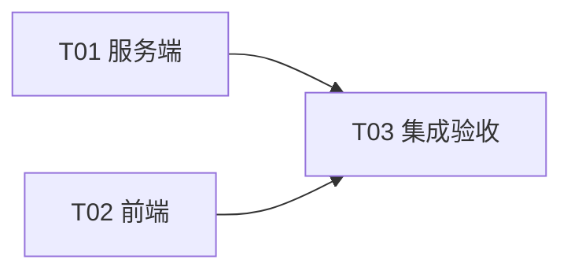

# 局域网加入总机 · 增量 1 设计（弹窗规范 + 去局域网绑定 + 上次总机）

> 输入：`docs/prd/2026-10-20-局域网加入总机-增量1.md`（唯一需求来源）。
> 前置：`docs/design/2026-10-20-局域网加入总机-设计.md`（下称「原设计」，873 行）+ 当前实现。本文只写变更。
> 硬约束兑现：零新增依赖；前端只动 `apps/web/app.js` / `style.css`；错误码只复用 E1091（语义中性化），不新增；不动传输层。

---

## 1. `joinable` 的判定与出口（P0-A）

### 1.1 精确表达式（唯一判定，两处出口共用）

```
joinable = !isLoopback(boundHost) && (allowLan === true || explicit === true)
// explicit = !!process.env.BANDI_HOST（与 server.mjs:1585 现有口径一致）
```

三情形逐一裁决（`boundHost` 取**进程实际监听**，即 server.mjs:3063 的模块级 `let`）：

| 情形 | allowLan | explicit | boundHost | joinable | 结论 |
| --- | --- | --- | --- | --- | --- |
| 桌面开关开 | true | false | 0.0.0.0 | **true** | 现状正确 |
| 云端 `BANDI_HOST=0.0.0.0` | false | true | 0.0.0.0 | **true** | 修 E1091 误报（本次核心） |
| 显式指定回环（`BANDI_HOST=127.0.0.1`） | false | true | 127.0.0.1 | **false** | 怪状态就该 false：它只在本机可达，宣布 joinable=true 是说谎 |

### 1.2 落点（同一函数导出，杜绝两份逻辑漂移）

- **`apps/server/src/netmode.mjs`**：新增 `export function isJoinable({ allowLan, explicit, boundHost })`（放在 `isLoopback` 59-62 之后，复用它）。放 netmode 的理由：`server.mjs` 与 `lan-announce.mjs` 都能 import 它而**无环**（netmode 只 import config）。
- **`apps/server/src/server.mjs` `helloPayload()`（78-95）**：91 行 `joinable: nm.allowLan` → `joinable: isJoinable({ allowLan: nm.allowLan, explicit: !!process.env.BANDI_HOST, boundHost })`。`boundHost` 是模块级 let，函数每次调用现读，`restartListening`（3397）换地址后自动跟上。90 行的 `allowLan` 字段**保留**（仍是开关值的广播，`/api/lan` 页口径不动）。
- **`apps/server/src/lan-announce.mjs`**：
  - 现状：`announcePayload()`（140-169）151 行 `joinable: true` 是**硬编码**（理由"能应答就说明…"）。
  - 改法：`sync()`（45-62）签名加 `explicit` 参数并连同 `boundHost` 存进模块状态；`announcePayload` 的 `joinable` 改调 `netmode.isJoinable(...)`。实际值仍恒为 true（被 sync 的门控保证），改它不是改行为，是**消灭第二份判定**。
  - `sync` 的门控 `on = allowLan && !isLoopback(boundHost)`（46 行）**保持不变**：云端显式监听的总机**不该**绑 UDP 8788 —— 发现是"同一网络"能力（PRD 增量不做清单第 1 条），数据中心里的云机不应答局域网扫描。四个调用方 server.mjs:1575 / 3350 / 3415 / 3428 补传 `explicit`。

### 1.3 节点侧 probe：三级判定的精确顺序（`apps/server/src/local-mode.mjs:294-340`）

```
① E1090「不是班底」   ：r.status !== 200 || body?.platform !== 'bandi'（308-315 不动）
② E2050「版本太旧」   ：typeof body.joinable !== 'boolean' || !caps.includes('scope')
③ E1091「不开放加入」 ：body.joinable === false（316-323 改判定与文案）
```

- **为什么 E2050 在 E1091 之前**：旧总机连 `joinable` 字段都没有（它是本次新加的），"太旧"比"不开放"更基本；`joinable` 缺失与 `caps` 无 `scope` 是同一个版本信号，归并到 E2050 一个出口（现 caps 检查 324-327 前移合并）。
- **旧行为链逐级**：完全不是班底 → E1090；是班底但太旧（hello 无 joinable / 无 caps）→ E2050，**显式抛、不静默降级**（这条在原实现就是显式的，本次只调顺序）；是班底但不开放 → E1091。
- E1091 新文案（B-3）：`这台班底没有对外开放加入（它可能只在本机使用）。去那台机器上确认，或问总机的主人`；detail 由 `allowLan=…` 改 `joinable=…`。
- probe 返回体（330-339）：`allowLan: true` → `joinable: true`（grep 全库确认返回体的 `allowLan` 无消费方 ✓）。
- 顺手（B-4）：`normalizeBase` 266 / 272 行示例补 `https://bandi.example.com`；275 行「（局域网里就是 http）」→「（云端部署用 https:// 开头的地址）」。

---

## 2. 「记住上次总机」（P0-C）的存储与生命周期

- **存哪**：数据目录 `config.json` 加一个键 `lastHost: { instanceId, label, url, joinedAt }`（`url` 是归一化后的 base）。与 `node.json` / `instance.json` 同目录同生命周期、**浏览器无关**（换浏览器、重装前端都在）；localStorage 是"这个浏览器"的记忆，而这是"这台机器"的记忆，语义不符，不采用。
- **与 `clearClientConfig`（local-mode.mjs:130-156）的相容**：`lastHost` 不在 `CLIENT_KEYS` 七键里 → leave 删七键后它成为"未知键"→ 走 148 行"保留文件、原样写回剩余"分支，机制天然成立，不用改保护逻辑。
- **裁决：`leave()`（431-435）不清 lastHost。** 理由：
  1. PRD 验收原文同句要求「加入→退出→再开向导，条目出现」**和**「退出总机后该条目消失」——自相矛盾，二者只能取一；
  2. 这条记录的全部价值在"退出 / 断线之后重连"（P0-C 的提级理由），退出即清 = 功能自废；
  3. 单条**覆盖写**语义：lastHost = 「最后一次成功加入的那台」，下次成功加入别的总机自然覆盖，无膨胀、无需清理。
  → 待产品确认：建议 C-3 ② 改为「记录保留至被下次成功加入覆盖」（见 §7 UNCLEAR）。
- **写点**：仅 `join()` 成功那一笔（402-410 的 `writeClientConfig` patch 里**同次**加 `lastHost`，与 `joinedAt` 同一时刻戳，单次原子写）。手动填地址探测成功**不预写**（我倾向并采纳：probe ≠ join；用户试探几个地址不该污染记录；C-1 原文就是「成功加入时记录」）。
- **读点**：`status()`（443-461）顶层加 `lastHost: cfg.lastHost ?? null`（向导打开时已在拉 status，app.js:2581，**不加新端点**）。扫描页 `drawScan`（app.js:2617-2628）置顶渲染「上次加入过：{label}（{url}）」，点击 → `wiz.url = 记录.url` → 复用 `pickCandidate` 路径（2840-2856：probe → explain，`cameFrom='manual'` 使"上一步"落手填页）。C-2 满足：仍走完整探测 + 新邀请码，记录只省填地址。探测失败 E1092 → 正常报错，**不静默清记录**（C-3 ③）。
- **为什么单条不做列表**：一个节点同时只属于一台总机（E1093，join 361-365），"上次"天然单数；列表要引入管理 UI（删 / 排序 / 重命名），成本远超"省一次手填"；PRD C-3 ① 也只约束一台。

---

## 3. 前端弹窗改造（变更 1）

### 3.1 dialog 结构（对照 `index.html:170-172` 的 memberDlg 抄）

```
<dialog class="joinwiz-dlg">
  <form method="dialog">
    <b>（标题，wireDialogHead 会把它搬进 .dlg-head）</b>
    <div class="joinwiz">…步骤内容，render() 重画区…</div>
  </form>
</dialog>
```

- `openJoinWizard()`（app.js:2559-2562）：建 dialog 后再建 form 包裹；`render()`（2778-2813）不再 `dlg.innerHTML = ''`，改为清 form 内 `.joinwiz` 容器重画。
- 首帧 render 后调 `wireDialogHead(form)`（453-459）：它把 form 顶层 `<b>` **原元素**搬进头部（标题 id/引用不换，防重复造搬移逻辑），`:scope > .dlg-head` 防重入（454）保证多步来回不出双标题（验收 5 ✓）。
- **每步标题**：各 drawX 的 `<b>…</b>` 首元素全部删掉（2619 / 2661 / 2677 / 2700 / 2728 / 2746 / 2761），render() 末尾按表更新头部 `<b>` 的 `textContent`：

| step | 标题 |
| --- | --- |
| scan / pick / manual | 加入总机 |
| explain | 加入「{host}」 |
| scope | 这台机器用来做什么 |
| joining | 加入「{host}」 |
| done | 加入成功 |

### 3.2 关闭与回车语义

- **× 关闭 = 取消**：wireDialogHead 生成的 `.dlg-close`（486-489，`type="button"`）onclick 即 `dlg.close()` → `'close'` 事件（2583）清 tick + remove ✓。**Esc** 触发 `'cancel'` 事件 → 浏览器默认行为就是 close() → 同样走 close 事件，tick 照清，无需另接处理器。向导状态全在局部 `wiz` 对象（2564-2578，本就不往 S 塞），中途关掉零残留 ✓。
- **回车**：`<form method="dialog">` 的默认 submit 会**直接关弹窗**（多步向导 = 丢现场）→ form 加 submit 处理器：`preventDefault()` 后触发当前内容里 `.primary` 按钮的 click（= 本步的「下一步 / 加入」）。语义与其它弹窗"回车 = 确认"一致，且不会误触 ×（× 是 type=button）。
- **`joinwiz-dlg` 类：保留**，但只承载 `dialog.joinwiz-dlg { width:520px }`（style.css:2651）。现 joinwiz-* 规则（2653-2678）本就是内容层（列表 / radio / 提示条 / 旋转圈），没有自制标题栏 / 关闭按钮可删；唯一外框级规则 `.joinwiz > b`（2654）随标题搬进 dlg-head 而删除（`.dlg-head b` 在 1990 已有系统样式）。UI-4 的"清理"= 删 2654 这一条。

---

## 4. 文案落点表（P0-B / P1-D，逐句到函数）

| PRD 条目 | 内容 | 位置（文件 + 行号，当前工作树） |
| --- | --- | --- |
| B-1 | 扫描页副句换「正在找同一网络里的班底总机…」+ 第三行云端提示 | `app.js` `drawScan` 2617-2628（2622 换句，2623 后加一行；2599 的计时句不动） |
| B-2 | 兜底页三条原因扩成四条 + label「局域网或云端都行」+ 两种地址示例 + 局域网/云端两行说明 | `app.js` `drawManual` 2675-2692（2679-2687） |
| B-3 E1091 | 中性文案（§1.3） | `local-mode.mjs` 316-323 |
| B-3 E1092 | 文案不变 | `local-mode.mjs` 298-306 |
| B-4 | 示例补 https、275 行改口 | `local-mode.mjs` 266 / 272 / 275 |
| P1-D | 「（未开局域网）」→「（未开放加入）」+ 新副文案（对云端显式监听不指向开关） | `app.js` `drawPick` 2636-2647（2642 标签、2647 副文案） |

P1-D 注记：`drawPick` 现用 caps 无 scope 分出「版本太旧」（2641，保留）；「未开放加入」分支在现 UDP 门控下几乎不触发（能应答即开放），改名是**口径统一**，不承诺行为变化。验收里"本机模式总机显示未开放加入"实际由 probe/E1091 路径覆盖，不在候选列表出现。

---

## 5. 任务列表（增量，3 条，按依赖排序）

### T01 · 服务端：joinable 共源 + probe 三级判定 + lastHost 读写（P0）
- 文件：`apps/server/src/netmode.mjs`、`apps/server/src/server.mjs`（helloPayload:91 + sync 调用方 1575/3350/3415/3428）、`apps/server/src/lan-announce.mjs`、`apps/server/src/local-mode.mjs`（probe 294-340、normalizeBase 266/272/275、join 402-410、status 443-461、leave 注释）。
- 验收：§1.1 三情形 joinable 全对；云端 `BANDI_HOST=0.0.0.0` 探测通过（不再 E1091）；回环总机 E1091 新文案；旧总机（无 joinable/caps）→ E2050；`join()` 成功写 lastHost、`status()` 带出；leave 后 config.json 保留 lastHost。

### T02 · 前端：弹窗规范 + 全部文案 + 上次总机条目（P0）
- 文件：`apps/web/app.js`（openJoinWizard 2559-2903）、`apps/web/style.css`（2651-2678）。
- 验收：× / Esc 关闭即取消、回车 = 本步主按钮、长内容头部吸顶、六步标题跟随、无双标题；扫描页置顶「上次加入过」点击直达 probe；P0-B / P1-D 文案逐条落位；`grep 局域网` 在向导文案只剩开关名与扫描副句。

### T03 · 集成验收（P0，依赖 T01+T02）
- 验收：PRD 增量三组验收全走一遍——云端加入成功；上次总机往返（加入→退出→再开向导→点条目→probe→输码）；记录指向的总机关机 → E1092 且记录不清；旧总机 E2050 不静默。

**并行结论：T01 与 T02 可并行。** 接口契约只有三点：① `/api/hello` 新增布尔 `joinable`；② probe 返回体 `allowLan:true` → `joinable:true`（前端不读该字段）；③ `status()` 新增 `lastHost`。T02 只依赖契约不依赖实现，可先行（mock 两个字段）。



---

## 6. 偏差回填（原设计文档被本增量修改的小节，只列编号）

`docs/design/2026-10-20-局域网加入总机-设计.md`：**§5.1**（status 加 lastHost）、**§5.3**（probe 判定顺序与返回体）、**§5.4**（hello 的 joinable 计算口径）、**§5.6**（leave 不清 lastHost 的说明）、**§9.4**（向导 dialog 结构改 form + wireDialogHead + 标题表）、**§13.3**（UDP 应答 joinable 语义对齐 hello）、**§11**（T02/T04 验收项由本增量 T01-T03 覆盖）。各节只需补一行指向本文，不重写。

## 7. UNCLEAR（待明确，1 条）

- PRD C-3 ②「退出即清」与其验收句「加入→退出→再开向导条目出现」矛盾。本文裁决：**不清，覆盖写**（§2 三条理由）。若产品坚持退出即清，T01 里 leave() 补删 lastHost 即可（一行），前端无需改动 —— 两案对 T02 零影响。

## 8. 共享知识（增量补充）

- `joinable` 的唯一定义在 `netmode.isJoinable`，`/api/hello` 与 UDP 应答都是它的出口；任何人改判定只改那一处。
- `lastHost` 只由 `join()` 成功路径写入；其它代码对它**只读**。
- `explicit` 恒等 `!!process.env.BANDI_HOST`，与 `/api/lan`（server.mjs:1585）同口径；env 运行期不变，无需缓存。
