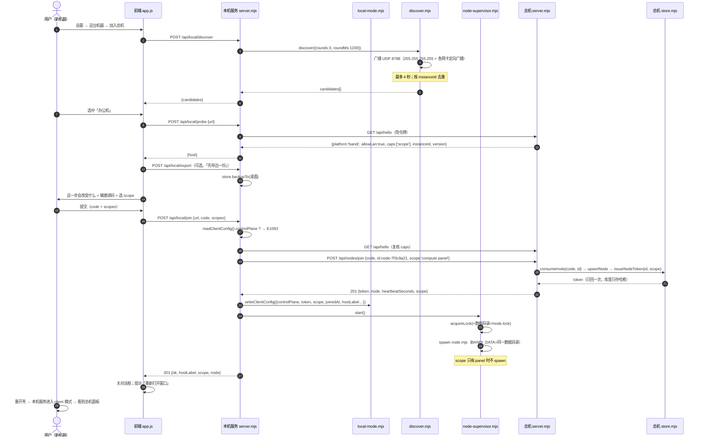
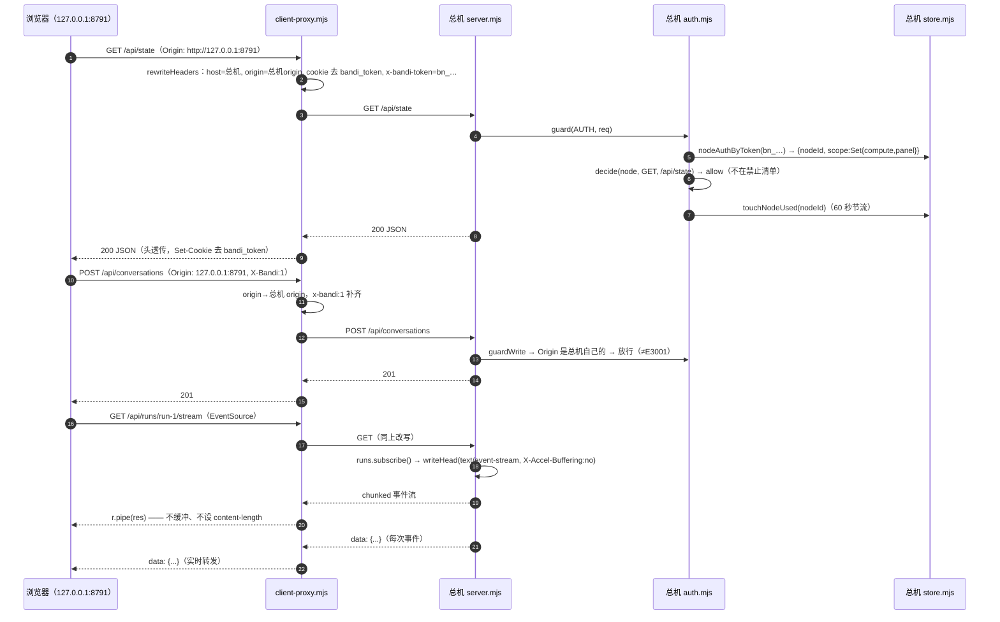
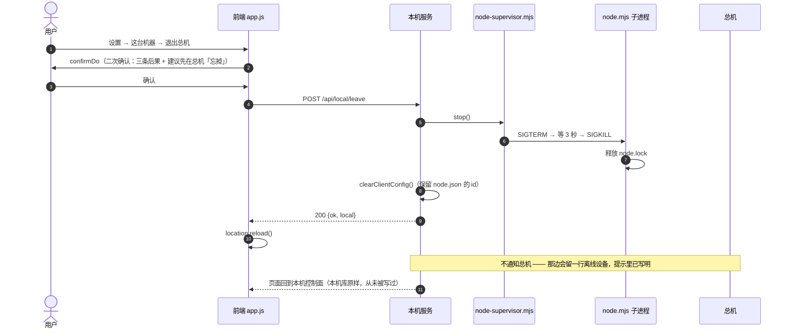
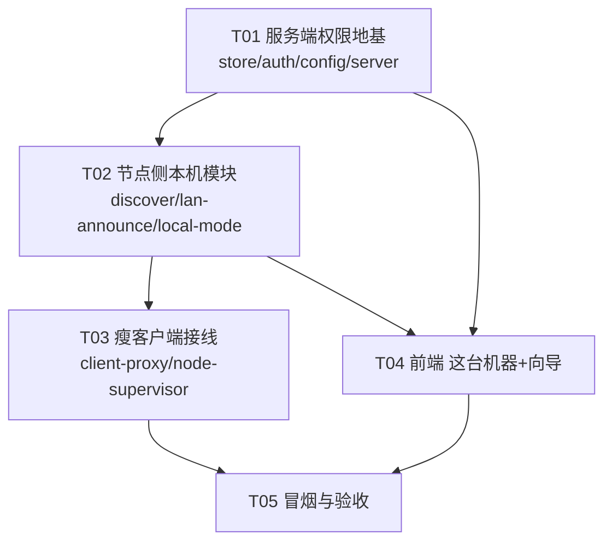

# 局域网加入总机 · 系统设计

> 版本：2026-10-20｜架构：Bob｜需求来源：`docs/prd/2026-10-20-局域网加入总机.md`
> 前置：`docs/形态决策.md`（托管控制面 + 客户端出站节点、认领不做同步、单机看不见节点）
> 本文每条结论都对着具体文件与行号。行号以当前工作树为准（`server.mjs` 2853 行、`app.js` 13956 行、`node.mjs` 719 行）。

---

## 0. 一句话方案

**本机服务恒定启动、恒定监听回环；「已加入」这个事实让它进入 `client` 模式——`/api/local/*` 自己处理，其余所有请求（含静态资源与 SSE）反代给总机并注入本机令牌。** Rust 零改动，既有节点协议零改动，前端只多一个「这台机器」分区 + 一个五步对话框。

---

# Part A · 系统设计

## 1. 实现方案总览

### 1.1 为什么不是「已加入就不起本机控制面」

PRD P0-4 的字面要求是「已加入且有 panel → 不起本机控制面，壳直接指向总机」。**不采纳**，改为「本机服务进入 client 模式」，四条理由（都有代码依据）：

| # | 理由 | 依据 |
| --- | --- | --- |
| 1 | 不起服务 = **「退出总机」这个入口不存在**。退出入口在 `设置 → 这台机器`，而那一页由本机服务提供；总机面板里没有（也不该有）退出按钮 → 用户死锁在总机上 | PRD §6.1、§十 |
| 2 | 桌面壳的窗口地址由 `shell.mjs` 的 `windowUrl()` 决定（`apps/desktop/shell.mjs:169`），它指向 `http://127.0.0.1:<port>`。要"直接指向总机"就得改壳 + 重编（`apps/desktop/target` 有已知旧缓存坑） | `shell.mjs:104-113`（`pickPort`）、`lib.rs:60`（`WebviewUrl::External`） |
| 3 | 浏览器直连 `http://192.168.1.9:8787` 的用户、「壳指向总机」覆盖不到；而 client 模式对"任何从本机打开的窗口"都成立 | — |
| 4 | 反代能做的事壳做不到：**改写 Origin、注入令牌、注`__BANDI_CLIENT__`** —— 这三件都在 Node 层最自然 | 见 §7 |

**收益**：`bandi.db` 仍然被本机服务打开（导出、计数、路径展示都用得上），「退出总机」随时可达，Rust 与既有启动链一行不动。

### 1.2 插在 `server.mjs:2611` 那条链的哪一格

现状（`server.mjs:2611-2697`）：

```
2619  auth.guard             ← 令牌闸
2621  serveStatic / 404      ← 静态资源
2628  key = METHOD path
2631  guardWrite             ← 写请求 CSRF（Origin + X-Bandi）
2634  routes[key] / handleXxx…  ← 业务
```

改成（**只在 2619 与 2621 之间加一段**，其余顺序不动）：

```js
// server.mjs:2619 之后
if (!auth.guard(AUTH, req, res, url)) return;

/* ---- 新增 A：本机专属接口，永远由本机处理（client 模式之外也要有，它是"加入"的入口）---- */
if (url.pathname.startsWith('/api/local/')) return handleLocal(req, res, url, LOCAL);

/* ---- 新增 B：client 模式 = 瘦客户端，其余一切（含静态与 SSE）反代给总机 ---- */
if (CLIENT.enabled) return clientProxy.forward(req, res, url, CLIENT);

if (!url.pathname.startsWith('/api/')) {   // 2621 原样
```

**为什么在 `auth.guard` 之后**：令牌语义只有一处（`auth.mjs:159`），不要在两处各判一遍。client 模式下本机强制回环（§4.4），`auth.required === false`（`auth.mjs:86`），闸本来就全放行；但若有人用 `BANDI_HOST=0.0.0.0` 强开，`/api/local/*` 仍会被令牌闸保护 + 额外回环校验，是双保险（P0-8）。

**为什么在 `serveStatic` 之前**：静态资源必须来自总机 —— 瘦客户端看到的 UI 要和总机版本一致（`/api/web-version` 也在总机那侧，`server.mjs:183`）。

**为什么在 `guardWrite` 之前**：本机这道 CSRF 判的是"网页借你的浏览器"，而反代出去的请求已经由**总机的** `guardWrite`（`server.mjs:132`）判；且本机 `allowedOrigins()`（`server.mjs:143`）只认 `config.port`，一旦壳选到 8787 之外的端口（`shell.mjs:104` 的 `pickPort`），本地这道就会对写请求误杀 403 `E3001`。这个耦合没必要留着。

### 1.3 client 模式的两个前提（缺一不可）

1. **本机强制回环**：`config.mjs` 里 `host` 的默认值多一个分支（见 §4.4）。否则一台昨天开过局域网的机器（`netmode.json` 里 `allowLan:true`）今天变瘦客户端，会以 `0.0.0.0` + 强制鉴权起来 —— 等于把总机的面板令牌暴露给整个网段。
2. **总机地址与令牌来自 `<数据目录>/config.json`**，就是 `node.mjs:49` 读的那份，字段完全兼容（只增不改）。

---

## 2. 八条裁决的落实（含 2 处必须修正）

| 裁决 | 落实位置 | 备注 |
| --- | --- | --- |
| 1 不起本机控制面 → **client 模式** | `server.mjs:2620` 一段、`client-proxy.mjs` 全部、`config.mjs` 监听收敛 | Rust 零改动，论证见 §1.1 |
| 2 scope 存 `node_tokens` | `store.mjs` 2588 之后加 `ensureColumn`；`issueNodeToken(nodeId, scope)` | 迁移 SQL 见 §4.1 |
| 3 反代处理 Origin / X-Bandi / Host | `client-proxy.mjs` 的 `rewriteHeaders()` | 见 §7.1 |
| 4 SSE 真流式 | 只对 `text/html` 缓冲，其余 `upstream.pipe(res)`；用 `node:http`/`node:https` 的 `request`，**不用 fetch** | 见 §7.2 |
| 5 防双跑 | `<数据目录>/node.lock`，`node-supervisor.mjs` 导出 `acquireLock()`；`node.mjs` 启动时拿锁 | 见 §4.5、§6.6 |
| 6 前端靠反代注入 | `client-proxy.injectClientConfig()` 往 `</head>`（`index.html:17`）前插 `<script>` | 字段见 §9.2 —— **有一处必须修正，见下** |
| 7 UDP 8788 跟开关原地启停 | `lan-announce.mjs` + `server.mjs` 三处同步点 | 见 §5.5 |
| 8 既有节点协议一行不改 | `heartbeat / claim / events / finish / report` 请求与响应体原样 | 见下「修正 2」——白名单要补，但协议不动 |

### 修正 1（裁决 6）：「无值 → 一律不渲染」会让 P0-2 无处落地

裁决 6 说 `window.__BANDI_CLIENT__` 无值就一律不渲染「这台机器」。但**想加入总机的那台机器，此刻正是一个"无值"的单机用户** —— 加入入口（PRD §6.1：设置 →「这台机器」→「加入总机」）就长在这个分区里。不渲染 = 功能入口消失。

**修正为两档**：
- `window.__BANDI_CLIENT__` **有值** → 渲染「已加入」态（总机名、scope、在线、导出、退出总机）；
- **无值** → 仍渲染该分区，但只有「独立使用 · 本机数据 · 导出 · 加入总机」，**全分区不出现"节点/总机/瘦客户端"字样**。单机用户看到的仍然是"这台机器上我的数据"，节点概念只在加入之后才出现。

### 修正 2（裁决 8）：`compute` 令牌今天在局域网总机上**根本跑不完一次活**

`nodeMayReach()`（`auth.mjs:130-149`）只放行 4 条：`/api/nodes/register`、`/api/nodes/<id>/heartbeat`、`/api/nodes/<id>/claim`、`/api/nodes/<id>/tasks/<tid>/report`。
而节点干活时还会打两条：`POST /api/runs/:runId/events`（`node.mjs:199`）与 `POST /api/runs/:runId/finish`（`node.mjs:332`）—— 这两条不在白名单里，节点令牌会被 `auth.mjs:172` 判 403 `E4030`。

今天没暴露，是因为 `auth.guard` 第 166 行 `if (!auth.required) return true;` **在 identify 之前就返回了**：回环形态（鉴权关）下整套节点越权检查根本不执行；而唯一的节点冒烟用例恰恰是回环形态（`smoke-node-jobs.mjs:72` 用 `BANDI_HOST:'127.0.0.1'`）。**一旦总机开了局域网（鉴权开），远端节点的"过程回传"和"回执"全部 403** —— 而本需求的主场景正是"局域网总机 + 远端节点"。

**因此 `compute` scope 的白名单必须是**（协议一个字节不改，只补判定）：

```js
// auth.mjs 里新增 runMayReach(who, method, pathname)：
POST /api/runs/:runId/events  ← 仅当 store.getNodeJobByRun(runId)?.nodeId === who.nodeId（store.mjs:2510）
POST /api/runs/:runId/finish  ← 同上
```
不加这条，"瘦客户端也能干活"（PRD 默认值）在真机上是一次都跑不通的。这条列为 T01 的验收项。

---

## 3. 文件清单与模块边界

### 3.1 新增（6 个）

| 文件 | 职责（只做这个） | 导出 |
| --- | --- | --- |
| `apps/server/src/discover.mjs` | 节点侧：UDP 广播探测，聚合去重 | `DISCOVERY_PORT`、`discover({port,rounds,roundMs,targets})`、`broadcastTargets()` |
| `apps/server/src/lan-announce.mjs` | 总机侧：UDP 应答器，跟随开关原地启停 | `sync({allowLan,boundHost,httpPort})`、`stop()`、`state()` |
| `apps/server/src/client-proxy.mjs` | 瘦客户端反代：改写头、注入令牌、SSE 直通、HTML 注入、连不上说明页 | `forward(req,res,url,cfg)`、`injectClientConfig(html,cfg)`、`offlinePage(cfg,err)` |
| `apps/server/src/local-mode.mjs` | 本机身份与配置：`config.json` / `node.json` / `instance.json` 读写、探测、加入、退出。**不碰 SQLite**（见下） | `SCOPE`、`readClientConfig`、`writeClientConfig`、`clearClientConfig`、`isJoined`、`instanceId`、`ensureNodeId`、`nodeIdentity`、`probe`、`join`、`leave`、`status` |
| `apps/server/src/node-supervisor.mjs` | 节点子进程：单实例锁 + 起停 + 状态 | `acquireLock()`、`readLock()`、`start()`、`stop()`、`status()` |
| `apps/server/src/smoke-lan-join.mjs` | 冒烟：真 UDP、真探测、真反代、真锁 | `main()` |

> **为什么 `local-mode.mjs` 不许 import `store.mjs`**：`node.mjs` 要 import 它（拿 `ensureNodeId` 和锁），而 `store.mjs` 一 import 就 `new DatabaseSync(dbPath)` 并跑迁移（`store.mjs:17-24`）—— 节点进程因此会去打开控制面库、写迁移，直接违反 PRD §七 第 7 条（节点只碰 `config.json`/`node.json`/`runtimes.json`）。所以本机库的"大小/计数/导出"放在 `server.mjs` 的 `handleLocal()` 里做（那里已经有 `store`）。

### 3.2 修改（7 个）

| 文件 | 改哪几处（行号锚点） | 改什么 |
| --- | --- | --- |
| `store.mjs` | 2588-2602 之后 | `node_tokens.scope` 列（`ensureColumn`）+ `issueNodeToken(nodeId, scope)` + `nodeAuthByToken(token)` + `setNodeScope` + `scopeOfNode` |
| `store.mjs` | 2282-2288 附近 | `nodes.lastUsedAt`（P1-3「最近使用」用它，别用 `lastSeenAt` 之外再造一个概念——见 §4.2） |
| `auth.mjs` | 164 | `GET /api/hello` 加入"免令牌放行"（与 `POST /api/nodes/join` 同一处） |
| `auth.mjs` | 116-121、130-149、171-183 | `identify` 带 `scope`；新增 `panelMayReach` / `runMayReach` / `isPanelForbidden`；`E4012`（已撤销）、`E4031`、`E4032` |
| `auth.mjs` | 249-285 | 登录页尾部加一句「这台机器如果已经加入过某台班底，请双击班底打开，不要用浏览器直接开这个地址」（P1-6） |
| `config.mjs` | 54-64 | `host` 多一个分支：已加入 client → 强制 `127.0.0.1`（§4.4） |
| `server.mjs` | 2619 之后 | 新增两段（§1.2），导出 `CLIENT` / `LOCAL` |
| `server.mjs` | 1203-1227 | `POST /api/nodes/join` 接受 `scope`（字符串或数组），`store.issueNodeToken(id, scope)` |
| `server.mjs` | 180-400（routes） | 新增 `GET /api/hello`（免令牌，见 §5.4） |
| `server.mjs` | 1425-1477 | `POST /api/restart` 与 `POST /api/lan` 写完开关后 `lanAnnounce.sync(...)`（§5.5） |
| `server.mjs` | 2785、2838-2853 | `server.listen` 回调与 `restartListening` 里各加一次 `lanAnnounce.sync(...)` |
| `server.mjs` | 1017-1036 附近 | 新增 `POST /api/nodes/:id/scope`（操作员改 scope，P0-3 规则 2） |
| `server.mjs` | 682-700 | 员工更新里：非操作员且 body 带 `model`/`runtime` → `403 E4032`（§6.4 第 15 条） |
| `node.mjs` | 91-100、650 | `ensureId()` 换成 `localMode.ensureNodeId()`；`main()` 开头拿单实例锁，退出释放 |
| `apps/web/app.js` | 顶部、1365、1374、2169 之后、4228 附近 | `CLIENT` 常量、设置分节、`renderMachine()`、`openJoinWizard()`、一次性横幅 |
| `apps/web/index.html` | 391 之后（`joinDlg` 旁） | 新增 `<dialog id="machineJoinDlg">` 骨架 |
| `apps/web/style.css` | 末尾 | `.machine-card` / `.wizard` / `.cand` / `.clientbar` |

> **Rust（`apps/desktop/src/*`、`shell.mjs`）零改动**：窗口永远指向 `http://127.0.0.1:<port>`（`shell.mjs:186` 的 `WINDOW_URL`），而那个端口上永远有一个能回答的 Node 服务 —— 未加入时它是本机控制面，已加入时它是瘦客户端反代。`windowUrl()` 探 `/api/state` 在 client 模式下会拿到 200（反代注入了令牌），所以壳**不会**再往地址里塞 `?token=`，令牌连 URL 都不进。

---

## 4. 数据结构变更

### 4.1 `node_tokens.scope`（幂等迁移）

放在 `store.mjs:2602` 那段 `db.exec` 之后，复用现成的 `ensureColumn`（`store.mjs:126-129`，内部就是 `PRAGMA table_info` 再 `ALTER TABLE`，这是本仓库既有的迁移写法）：

```js
/*
 * 令牌 scope（2026-10-20）：
 *   · 存**令牌**上而不是 nodes 上 —— 令牌才是身份载体，吊销/重发是令牌级操作；
 *     同一 nodeId 历史上可能有多枚令牌，放 nodes 会出现"新令牌继承旧权限"。
 *   · 老令牌一律 compute：老节点只干那五条活，行为与改前**完全一致**（验收项）。
 *   · 存成"排序后空格分隔"的规范串（'compute' / 'panel' / 'compute panel'），
 *     不用 JSON：SQL 里能直接 LIKE，人翻库也能一眼读懂。
 */
ensureColumn('node_tokens', 'scope', "scope TEXT NOT NULL DEFAULT 'compute'");
```

- 规范化函数 `normScope(input) → 'compute panel'`（去重、排序、只留白名单项、空则 `'compute'`）。
- 解析 `parseScope(str) → Set`。
- 常量：`SCOPE_COMPUTE='compute'`、`SCOPE_PANEL='panel'`（`local-mode.mjs` 与 `store.mjs` 各一份字面量，值相同；`store` 不 import `local-mode`，避免节点进程带进 SQLite）。

### 4.2 `nodes` 表：只加 `lastUsedAt`

P1-3 要「最近使用 10-20 14:32」。`nodes.lastSeenAt` 是心跳时间（15 秒一跳），"最近使用"指的是**用面板**。所以：

```js
ensureColumn('nodes', 'lastUsedAt', 'lastUsedAt TEXT');
```
写点：`auth.guard` 放行一个 `panel` scope 的请求时，节流更新（同一节点 60 秒最多写一次，`store.touchNodeUsed(nodeId)`）。**不加 scope 列**（裁决 2）。

### 4.3 `<数据目录>/instance.json`（总机身份，跨重启稳定）

```json
{ "instanceId": "inst-3f2a9c1e-8b7d-4a55-9e21-0c4d6f8a1b23", "createdAt": "2026-10-20T02:11:03.412Z" }
```
- 首次 `instanceId()` 调用时生成 `'inst-' + crypto.randomUUID()`，写盘。
- 用途：UDP 应答里的去重键（同一总机多网卡只回一行）、节点侧"记住上次总机"（P1-2）、反代注入给前端。
- 读失败/写不进 → 退回**进程内生成一次**（本次运行可用），日志告警；不要因为一个身份文件让服务起不来。

### 4.4 `<数据目录>/config.json`（**既有文件**，只加字段）

`node.mjs:58` 的 `writeConfig` 已经在写这份（mode 0600）。新增四个字段，旧字段一个不动：

```json
{
  "controlPlane": "http://192.168.1.9:8787",
  "token": "bn_…",
  "scope": "compute panel",
  "joinedAt": "2026-10-20T02:14:55.001Z",
  "hostLabel": "办公机",
  "hostHostname": "DESKTOP-7K2P",
  "hostInstanceId": "inst-3f2a…"
}
```
- `node.mjs` 只读 `controlPlane` / `token`（`node.mjs:84`、`72`），多出来的字段它视而不见 → **协议不改**。
- 优先级链不变：环境变量 > `config.json` > 默认（`node.mjs:47`）。

`config.mjs` 对应的监听收敛（改 54-64）：

```js
// 已加入 = 本机是瘦客户端。此时**必须只监听回环**：
// 否则昨天开过局域网的机器（netmode.json allowLan:true）会以 0.0.0.0 + 强制鉴权起来，
// 等于把总机的面板令牌敞给整个网段。BANDI_HOST 仍然优先（部署/调试要能压过去）。
const joined = (() => {
  try {
    const j = JSON.parse(fs.readFileSync(path.join(dataDir, 'config.json'), 'utf8'));
    return !!(j && j.controlPlane);
  } catch { return false; }
})();
export const clientJoined = joined;
export const host = process.env.BANDI_HOST
  ?? (joined ? '127.0.0.1' : lanAllowed ? '0.0.0.0' : '127.0.0.1');
```
（就地读、不 import `local-mode`：`store.mjs` import 了 `config.mjs`，`local-mode` 若要 import `store` 就成环。这也是 §3.1 那条"local-mode 不碰 SQLite"的另一半原因。）

### 4.5 `<数据目录>/node.lock`（单实例锁）

```json
{ "pid": 24188, "startedAt": "2026-10-20T02:15:01.220Z", "controlPlane": "http://192.168.1.9:8787" }
```
- 拿锁：`fs.writeFileSync(file, json, { flag: 'wx' })`（原子创建）。`EEXIST` 时读出来，用 `process.kill(pid, 0)` 判活（`EPERM` 也算活）；活着 → 返回 `{locked:false, pid}`（不抛错 —— 撞锁是**正常情形**）；死了 → `unlink` 后重试一次（`exclusive` 抢不到就再抛，最多两轮）。
- 放锁：`process.on('exit')` + `SIGINT`/`SIGTERM` + 正常返回；**只删自己 pid 的那份**（别删别人的）。
- 谁拿锁：**`node.mjs` 自己**（`main()` 开头）。这样"autostart 装过的常驻"和"client 模式 spawn 的"走同一把锁，后起者直接 `process.exit(0)`（**2026-10-20 QA 实测回填：不是早期写的 exit 2** —— autostart 的重启探测会把非零当成"起失败"而反复拉起，撞锁退出是正常情形不是故障），打一行 `[节点] 已经有一个节点在跑（pid N），这个退出`（PRD P1-4：**不静默等待**。⚠️ 该行实现走 stdout 且未带 `E1095` 码，与本节早先"E1095 进 stderr"的设想不符 —— 见 QA 报告 2026-10-20，待裁决）。
- `node-supervisor.start()` 先 `readLock()`：被活进程占着 → 不 spawn，返回 `{running:true, external:true}`（这是"autostart 已经在跑"的正常情形，不是错误）。

### 4.6 其它既有文件（不动，只说明）

`netmode.json`、`node.json`、`runtimes.json`、`bandi.db` 的表结构（除 §4.1/§4.2 两处）**全部不动**。退出总机时 `node.json` 的 `id` **保留**（PRD §五决策 C），这样重新加入同一总机不会攒出第二台设备。

---

## 5. 接口定义

统一错误体沿用 `fail()`（`server.mjs:114`）：`{ error, code }`；前端 `api()`（`app.js:1169`）把它变成 `EXXXX：服务异常` + `err.detail`。

### 5.1 `GET /api/local/status`

本机身份的**唯一读数**（设置页、连不上页、向导都用它）。本机处理，**回环限定**。

```jsonc
// 200
{
  "client": {
    "joined": true,
    "controlPlane": "http://192.168.1.9:8787",
    "hostLabel": "办公机",
    "hostHostname": "DESKTOP-7K2P",
    "hostInstanceId": "inst-3f2a…",
    "scope": ["compute", "panel"],
    "since": "2026-10-20T02:14:55.001Z",
    "node": { "running": true, "pid": 24188, "external": false }
  },
  "local": {
    "dataDir": "C:\\Users\\me\\AppData\\Roaming\\bandi",
    "dbPath": "…\\bandi.db",
    "dbSize": 44123648,
    "dbMtime": "2026-10-19T10:20:11.000Z",
    "counts": { "personas": 12, "conversations": 37, "projects": 3 }
  },
  "instanceId": "inst-9a1c…",       // 本机（不是总机）的 instanceId
  "nodeId": "node-7f3c9a21",
  "warnings": []                     // 例如「另一个数据目录里也有节点常驻」
}
```
未加入时 `client: { joined:false, node:{running:false} }`，`local` 照给。

### 5.2 `POST /api/local/discover`

```jsonc
// 入参（可选）：{ "rounds": 3, "port": 8788 }
// 200 —— 最多 4 秒返回
{ "candidates": [
  { "instanceId": "inst-3f2a…", "label": "办公机", "hostname": "DESKTOP-7K2P",
    "address": "192.168.1.9", "port": 8787, "url": "http://192.168.1.9:8787",
    "joinable": true, "version": "1.1.0", "caps": ["scope"], "seenAt": "…" }
] }
```
- 按 `instanceId` 去重；`url` 用**回包来源地址**（`rinfo.address`）+ 应答里的 `httpPort`，不用应答里的 `url`（多网卡时它可能是别的网卡）。
- 空数组不是错误（PRD 步骤 3 的兜底页就是它）。

### 5.3 `POST /api/local/probe`

```jsonc
// 入参：{ "url": "http://192.168.1.9:8787" }
// 200
{ "host": { "label":"办公机","hostname":"DESKTOP-7K2P","instanceId":"inst-3f2a…",
            "version":"1.1.0","caps":["scope"],"httpPort":8787,"allowLan":true } }
```
失败（**三条分开说**，PRD 步骤 4）：

| 情形 | HTTP | code |
| --- | --- | --- |
| 连上了但不是班底（`/api/hello` 非 200 或没有 `platform:'bandi'`） | 400 | `E1090` |
| 是班底，但 `allowLan:false` | 400 | `E1091` |
| 连不上（ECONNREFUSED / ETIMEDOUT / 解析失败） | 400 | `E1092` |
| 能连上但 `caps` 里没有 `scope`（旧总机） | 409 | `E2050` |

### 5.4 `GET /api/hello`（总机侧，**免令牌**，新增）

`auth.mjs:164` 与 `POST /api/nodes/join` 并列放行。**故意不带任何秘密** —— 它披露的字段与 UDP 应答完全同源（PRD P0-1 已经决定这些是局域网可见的）。

```jsonc
// 200
{ "platform": "bandi", "proto": 1, "version": "1.1.0",
  "instanceId": "inst-3f2a…", "label": "办公机", "hostname": "DESKTOP-7K2P",
  "httpPort": 8787, "allowLan": true, "joinable": true,
  "caps": ["scope"] }
```
`version` 读 `apps/desktop/version.json`（`repoRoot` 下，运行期读一次缓存；读不到给 `null`）。
`allowLan` 取 `netmode.readNetMode().allowLan`（**开关值**，不是监听值——这正是"开关关掉就不再可加入"的判据）。

### 5.5 `POST /api/local/join`

```jsonc
// 入参（`scopes` 数组与 `scope` 字符串两个拼写**都收**：`body?.scopes ?? body?.scope`，实测均 201 —— 前端发的是 `scopes` 数组）
{ "url": "http://192.168.1.9:8787", "code": "bj_xxx", "scopes": ["panel","compute"] }
// 201
{ "ok": true, "hostLabel": "办公机", "hostHostname": "DESKTOP-7K2P",
  "controlPlane": "http://192.168.1.9:8787", "scope": ["compute","panel"],
  "node": { "running": true, "pid": 24188 } }
```

服务端动作序列（**顺序即实现顺序**）：

1. `readClientConfig().controlPlane` 已存在 → `409 E1093`（文案带总机名与地址 + 只给「退出总机」，PRD §五决策 C）。
2. `probe(url)` → 复用 §5.3 的失败码。
3. `caps` 无 `scope` → `409 E2050`（**不静默降级**）。
4. `POST {url}/api/nodes/join`，body：`{code, id: ensureNodeId(), label: hostname, hostname, platform, runtimes: declared(), externals, scope: normScope(scopes)}`。
   - 401 → 透传 `E4011`（邀请码不对/用过/过期，输入框保留）；
   - 其它非 201 → `400 E1097`（带 `detail` 进 console）。
5. `writeClientConfig({...})` 失败 → `500 E1097`（**此时还没动任何既有状态**，可重试）。
6. `supervisor.start()`：`scope` 含 `compute` 才 spawn；**panel-only 不 spawn**（PRD「只当入口不接活」）。spawn 失败 → **不回滚**，返回 201 带 `node:{running:false, why}`（加入本身成功了，节点下次会自己起）。
7. 返回。

### 5.6 `POST /api/local/leave`

```jsonc
// 入参：{}
// 200
{ "ok": true, "killed": true, "local": { "dbPath": "…", "counts": {…} } }
```
动作：`supervisor.stop()`（先停，避免它把刚清掉的令牌又用一次）→ `clearClientConfig()`（删 `controlPlane/token/scope/joinedAt/hostLabel/hostHostname/hostInstanceId`，**保留 `node.json`**）→ 返回。
`clearClientConfig` 的保护规则（**2026-10-20 QA 实测回填**）：删完之后**没有剩余键** → 整个 `config.json` 文件删掉（零痕迹）；**有未知键**（有人手工加过字段，如 `"别删我":1`）→ **保留文件**，原样写回去掉七个键之后的剩余对象。
未加入时 → `400 E1098`（这台机器还没加入任何总机）。**不通知总机**（PRD：建议先在总机「忘掉」）。

### 5.7 `POST /api/local/export`

```jsonc
// 入参：{}  （可选 { "dir": "…" } —— 只允许桌面/下载）
// 200
{ "file": "C:\\Users\\me\\Desktop\\bandi-备份-20261020-101503.db", "size": 44123648 }
```
- 复用 `store.backupTo()`（`store.mjs:3230`，`VACUUM INTO`）。
- 落点优先级：`os.homedir()/Desktop` → `os.homedir()/Downloads` → `<数据目录>/exports/`（逐级 `existsSync` 判定；都不行就最后一级）。
- 文件名带秒级时间戳（照着 `db-backup.mjs:19-22` 的 `stamp()` 写法，避免 `VACUUM INTO` 撞名）。
- 写不进去 → `500 E1096`。
- **不提供导入**（PRD 明确不做，也不留钩子）。

### 5.8 `POST /api/nodes/join`（总机侧，**既有接口加一个字段**）

```jsonc
// 入参（新增 scope，其余原样）
{ "code":"bj_xxx", "id":"node-7f3c9a21", "label":"…", "hostname":"…", "platform":"…",
  "runtimes":[…], "externals":[…], "scope": "compute panel" }   // ← 新增；缺省 = compute
// 201（原样 + scope 回显，便于节点自检）
{ "token":"bn_…", "node":{…}, "heartbeatSeconds":15, "scope":"compute panel" }
```
- `scope` 校验：只接受 `compute` / `panel` 的组合；出现别的值 → `400 E1047`（与"加入要带 id"同码，别新增）。
- **缺省 `compute`**：老的 `node.mjs --join`（`node.mjs:602`）一个字节不改也能继续用。

### 5.9 `POST /api/nodes/:id/scope`（总机侧，操作员改权限）

```jsonc
// 入参：{ "scope": "compute panel" }
// 200：{ "nodeId": "node-…", "scope": "compute panel" }
// 403 E4031 / E4032：非操作员（含面板令牌）一律不行 —— 这就是决策 A 规则 2「scope 只能总机侧改」
```

### 5.10 错误码表（本次新增/复用）

| 码 | HTTP | 中文（前端只印这一句 + 码） | 出处 |
| --- | --- | --- | --- |
| `E1090` | 400 | 这个地址上不是班底（可能是别的程序）。检查端口，或去那台机器上确认班底开着 | PRD |
| `E1091` | 400 | 这台班底没打开「允许局域网内的机器加入」。去那台机器上打开它，然后点重启 | PRD |
| `E1092` | 400 | 连不上那个地址。核对地址与端口；如果总机开着，多半是防火墙挡住了 8787 | PRD |
| `E1093` | 409 | 这台机器已经加入了「X」，先退出才能加入别的 | PRD |
| `E1094` | 403 | 本机专属接口只能在回环上调用 | PRD |
| `E2050` | 409 | 那台班底版本太旧，先升级它再加入 | PRD |
| `E4011` | 401 | 邀请码不对、已经用过、或者过期了 | PRD（透传） |
| `E4012` | 401 | 这台机器的授权已被总机撤销（面板上「忘掉」了），退出总机后重新加入 | PRD |
| `E4031` | 403 | 这台机器只有算力权限，看不了面板 | PRD |
| `E4032` | 403 | 面板权限不能做管理动作（发邀请码/删改设备/改连接器/改模型路由/重启与局域网开关）**新增** | 本次 |
| `E1095` | 409 | 这台机器上已经有一个节点进程在跑了（pid N），不用再起一个 **新增** | 本次 |
| `E1096` | 500 | 导出失败：写不进那个目录 **新增** | 本次 |
| `E1097` | 500 | 加入没走完：令牌拿到了但本机配置没写成 **新增** | 本次 |
| `E1098` | 400 | 这台机器还没加入任何总机 **新增** | 本次 |

`E4012` 的判定：`identify()` 拿到 `null` 而令牌以 `bn_` 开头 → 说明"这枚节点令牌曾经是真的、现在库里的哈希没了"（`store.mjs:2621` `revokeNodeTokens` 就是唯一会删它的地方）→ 401 `E4012`。**不要**在没有这个前缀时乱猜（操作员令牌删了就是 `E4010`）。

---

## 6. 鉴权与 scope（最容易被实现走样的一处）

### 6.1 判定只有一处

`auth.guard`（`auth.mjs:159`）里 `identify()` 之后统一走一个函数：

```js
const decision = decide(who, req.method, url.pathname);  // 'allow' | 'E4031' | 'E4032'
```
`who = { kind:'operator' }` → `allow`；`who = { kind:'node', nodeId, scope:Set }` → 三条规则按序：

1. `compute` 且命中"节点自己的活"（`nodeMayReach` + `runMayReach`，§2 修正 2）→ `allow`；
2. `panel` 且**不在**禁止清单里 → `allow`（并在节流下 `touchNodeUsed`）；
3. 有 `panel` 但命中禁止清单 → `E4032`；没有 `panel` 且不是自己的活 → `E4031`。

**三路携带（Cookie / `X-Bandi-Token` / `?token=`）走的都是这一个 `decide`** —— `tokenOf()`（`auth.mjs:101`）取到哪个都一样（PRD 决策 A 规则 3）。

### 6.2 不为 `panel` 令牌开 Cookie 交换（**刻意**）

`auth.mjs:189` 的 `?token=` → Cookie + 302 只给 `operator`。**不给 `panel` 加这条路**：
- 瘦客户端走反代，浏览器**根本拿不到令牌**（令牌在反代的头里），EventSource 也不需要（同源 + 反代注入头）；
- 若给 `panel` 开 Cookie，总机令牌就落进了那台机器的浏览器 Cookie 里 —— 比 URL 更长寿、更容易被同机进程读走，正好和决策 A 想收的口子相反；
- 直接拿浏览器开总机地址 + `?token=bn_…` 的用户，会看到登录页（`E4010` 的 hint 已写明"双击班底打开"）。

### 6.3 `panel` 禁止清单（**对着 `server.mjs` 逐条查出来的**）

> 口径：`panel` = 「看 + 用」；下列五类管理动作只有握着总机 `token` 文件的那台（`operator`）能做。

| # | 类别 | 方法与路径（精确） | 代码位置 |
| --- | --- | --- | --- |
| 1 | 发邀请码 | `POST /api/nodes/invites` | `server.mjs:1188` |
| 2 | 删/改设备 | `DELETE /api/nodes/:id`（忘掉＝吊销） | `server.mjs:1017` |
| 2 | | `POST /api/devices/:id/rename` | `server.mjs:1496` |
| 2 | | `POST /api/devices/:id/runtimes` | `server.mjs:1525` |
| 2 | | `PUT|PATCH /api/devices/:id/runtimes/:rid` | `server.mjs:1534` |
| 2 | | `DELETE /api/devices/:id/runtimes/:rid` | `server.mjs:1546` |
| 2 | | `POST /api/nodes/:id/tasks`（让**别的机器**装东西） | `server.mjs:1117` |
| 3 | 改连接器与凭据 | `POST /api/connectors` | `server.mjs:939` |
| 3 | | `PUT|PATCH /api/connectors/:id` | `server.mjs:973` |
| 3 | | `DELETE /api/connectors/:id` | `server.mjs:980` |
| 3 | | `POST /api/ssh/servers`（含私钥路径） | `server.mjs:258` |
| 3 | | `POST /api/git/token` / `DELETE /api/git/token` | `server.mjs:2208` / `2223` |
| 4 | 改模型路由 | `POST /api/quota`（每模型限额＝路由约束） | `server.mjs:392` |
| 4 | | `PUT|PATCH /api/personas/:id` **且 body 带 `model` 或 `runtime`**（字段级，在 handler 里判） | `server.mjs:682-700` |
| 5 | 重启与局域网开关 | `POST /api/restart` | `server.mjs:1425` |
| 5 | | `POST /api/lan`（`GET` 允许——只读） | `server.mjs:1452` |
| — | 权限本身 | `POST /api/nodes/:id/scope` | 本次新增 |
| — | **架构补充**：插件装卸＝在总机落代码，风险与"改连接器"同级 | `POST /api/plugins/:id/install|enable|disable`、`DELETE /api/plugins/:id` | `server.mjs:1565` / `1578` |

**允许**（明确写下来，免得实现时过度收紧把"用"也挡了）：员工增删改（除上表 model/runtime 字段）、会话/消息、群、任务/项目、工作流、定时任务、技能、额度**读**、连接器**读**、设备**读**、`GET /api/lan`、`GET /api/state`、`/api/runs/*/stream`。

### 6.4 实现要点

- 路径匹配用**精确正则表**（上面那张表逐条翻译，不写"前缀包含"），放在 `auth.mjs` 顶部常量里，注释里标 `server.mjs:<行号>`。
- 人员编辑那条必须落在 handler（`readBody` 只有那里有），所以 `auth.mjs` 额外导出 `mayManage(req)`（`req.bandiAuth?.kind === 'operator'`），handler 一行判断即可。
- 判定**不缓存**（PRD 决策 A 规则 2：改完对下一次请求立即生效）。

---

## 7. 反代细节（`client-proxy.mjs`）

### 7.1 头改写（`rewriteHeaders`）

| 头 | 处理 | 为什么 |
| --- | --- | --- |
| `host` | 改成 `UP.host`（`192.168.1.9:8787`） | 总机用 `new URL(req.url, 'http://'+host)` 拼地址（`server.mjs:2612`） |
| `origin` | 改成 `UP.origin` | 不改 → 总机 `guardWrite` 见 `http://127.0.0.1:8791` 不在 `allowedOrigins()`（`server.mjs:143`）→ **403 `E3001`，能看不能动** |
| `referer` | 把本机 origin 前缀换成 `UP.origin` | 同上（部分链路按 Referer 判） |
| `cookie` | 删掉 `bandi_token` 那一段，其余保留 | `tokenOf` 是 `cookie \|\| header \|\| query`（`auth.mjs:105`）——**cookie 会赢**，本机残留的旧 cookie 会把注入的头顶掉 |
| `x-bandi-token` | **覆盖**成 `cfg.token` | 瘦客户端的全部身份 |
| `x-bandi` | 非 GET/HEAD/OPTIONS 时补齐 `'1'` | 总机 `guardWrite` 要求它 |
| `connection` / `proxy-connection` / `transfer-encoding` | 删 | hop-by-hop |
| `content-length` | 删（交给 Node 按流处理） | 浏览器可能给 `Content-Length`，转发时长度不变则无害；但删掉更稳，避免与 chunked 打架 |
| `accept-encoding` | 删（强制上游不压缩） | HTML 要注入，压缩后得解压；直接不要压缩最省事，反代是同机/局域网，带宽不是瓶颈 |

回程（上游 → 浏览器）：
- 状态码与头原样透传，删 `connection` / `transfer-encoding` / `content-encoding` / `content-length`（我们自己决定）；
- `set-cookie`：删掉 `bandi_token` 与 `Domain=` 属性（总机的 Cookie 不该落进瘦客户端的浏览器）；
- `location`：若以 `UP.origin` 开头 → 换成 `cfg.localOrigin`（本机 origin），否则原样。

### 7.2 SSE 与流式（裁决 4）

**只有一种情形缓冲**：`content-type` 含 `text/html`（要注入 `__BANDI_CLIENT__`）。其余**一律 `upstream.pipe(res)`**。

```js
import http from 'node:http';
import https from 'node:https';

export function forward(req, res, url, cfg) {
  const UP = cfg.upstream;                       // new URL(cfg.baseUrl)
  const lib = UP.protocol === 'https:' ? https : http;
  const headers = rewriteHeaders(req, cfg);
  const up = lib.request({
    protocol: UP.protocol, hostname: UP.hostname, port: UP.port || 80,
    method: req.method, path: url.pathname + url.search, headers,
  }, (r) => {
    clearTimeout(connectTimer);
    const ct = String(r.headers['content-type'] ?? '');
    const isHtml = ct.includes('text/html');
    const out = rewriteResponseHeaders(r.headers, cfg);
    if (isHtml) {
      const chunks = [];
      r.on('data', (c) => chunks.push(c));
      r.on('end', () => {
        const html = injectClientConfig(Buffer.concat(chunks).toString('utf8'), cfg);
        out['content-length'] = Buffer.byteLength(html);
        res.writeHead(r.statusCode, out);
        res.end(html);
      });
      return;
    }
    // ← SSE / JSON / 静态全部走这里：不设 content-length、不缓冲、不 await text()
    res.writeHead(r.statusCode, out);
    r.pipe(res);
    r.on('error', () => res.destroy());
  });

  /*
   * 只对"连上"设超时（10 秒），**不对整个响应设超时** ——
   * `/api/runs/:id/stream` 是长活连接，整包超时会把"看它干"掐死。
   */
  const connectTimer = setTimeout(() => up.destroy(new Error('ETIMEDOUT')), 10000);
  up.on('error', (e) => { clearTimeout(connectTimer); onUpstreamDown(req, res, cfg, e); });
  req.on('aborted', () => up.destroy());         // 浏览器关了 → 别让上游连接挂着
  req.pipe(up);
}
```

- `subscribe()`（`runs.mjs:73-102`）写的是 `Content-Type: text/event-stream` + `X-Accel-Buffering: no`，头原样透传，`pipe` 天然分块 → 前端 `new EventSource('/api/runs/'+runId+'/stream')`（`app.js:10836`）照常工作。
- **不用 `fetch`**：Node 的 fetch 对流式响应要手动 `res.body`（web stream）转 Node stream，`text/event-stream` 还容易被 undici 的缓冲行为坑；`http.request` 是一行 `pipe`。

### 7.3 连不上总机（PRD §6.3 的三出口页）

`onUpstreamDown`：
- `/api/*` → `502 { code:'E1092', error:'连不上总机' }`（前端 toast 就能用；**2026-10-20 QA 实测回填：502，不是 503/E1096** —— E1096 已被「导出失败」占用）；
- 页面请求 → 返回 `offlinePage()`：**自包含 HTML**（内联样式与脚本，不依赖任何外部资源），内容是 PRD §6.3 那张卡片 + 三个按钮：
  - 「重试」→ `location.reload()`；
  - 「换一台总机」→ `POST /api/local/leave`（先断开）→ `location.href='/'`，然后用户从设置里重新加入；
  - 「退出总机，回到本机」→ 二次点击确认 → `POST /api/local/leave` → `location.href='/'`。
- **不给「临时用本机模式」**（PRD 明确）。
- 这一页由**本机服务**返回，所以它一定可读（总机挂了，本机服务还活着）。

### 7.4 HTML 注入

插在 `</head>` 之前（`apps/web/index.html:17`；若上游 HTML 没有 `</head>` 就插在 `</body>` 前，再没有就前置）：

```html
<script>window.__BANDI_CLIENT__={"hostLabel":"办公机","hostHostname":"DESKTOP-7K2P","hostUrl":"http://192.168.1.9:8787","instanceId":"inst-3f2a…","scope":["compute","panel"],"since":"2026-10-20T02:14:55.001Z","localBase":"/api/local"};</script>
```
`app.js` 在 `<body>` 末尾加载（`index.html:410`），所以读得到。

---

## 8. 时序图

### 8.1 加入流程



### 8.2 瘦客户端一次带 SSE 的请求（含 Origin 改写与令牌注入）



### 8.3 退出流程



---

## 9. 前端改造（只动 `app.js` + `index.html` + `style.css`）

### 9.1 位置与命名

| 事项 | 位置 |
| --- | --- |
| `const CLIENT = window.__BANDI_CLIENT__ \|\| null;` | `app.js` 顶部（`const S = {` 之前） |
| 设置分节 | `SETTINGS_SECTIONS`（`app.js:1365`）加 `['machine','这台机器','本机数据 · 加入总机']`，放在 `prefs` 之后 |
| 渲染分派 | `openSettings`（`app.js:1374`，1383-1388 那串 `if`）加一行 `if (S.settingsSection === 'machine') return renderMachine();` |
| 左栏 | 无需改：`renderList`（`app.js:4215-4232`）就是从 `SETTINGS_SECTIONS` 生成的 |
| 分区渲染 | 新增 `renderMachine()`（放在 `renderRuntimes` 之前，`app.js:2162` 附近） |
| 向导 | 新增 `openJoinWizard()`（放在 `openJoinDialog`（`app.js:2342`）之后，两者语义不同：一个发码给**别人**，一个让**自己**加入） |
| 一次性横幅 | 新增 `maybeClientBanner()`，在 `load().then(...)` 之后调用（文件末尾那段启动链） |
| 设备详情加一行 scope | `renderDeviceDetail()`（`app.js:3202`），在 `devHeadHtml`（`app.js:2405`）下方的信息行里加「这台能看到面板 · 最近使用 …」 |

### 9.2 `window.__BANDI_CLIENT__` 契约（共享知识，前后端一致）

```ts
window.__BANDI_CLIENT__ = {
  hostLabel: string,        // 总机机器名（人起的，可能重名）
  hostHostname: string,     // 总机主机名（不重）
  hostUrl: string,          // http://192.168.1.9:8787
  instanceId: string,       // 总机实例 id（去重/记住上次总机用）
  scope: ('compute'|'panel')[],
  since: string,            // ISO，加入时间
  localBase: '/api/local',  // 本机接口前缀（别硬编码路径）
}
```
**约定**：`app.js` 里只允许出现一处 `window.__BANDI_CLIENT__`（顶部那个 `CLIENT` 常量），别处一律用 `CLIENT`。

### 9.3 「这台机器」两档文案（§2 修正 1）

未加入（无 `CLIENT`）：`状态 独立使用（本机数据）` + 本机库路径/大小/员工数/会话数/项目数/最后修改 + `[导出] [加入总机]`。
已加入（有 `CLIENT`）：`状态 已加入「办公机」· http://… ● 在线` + `这台能 看面板 · 也能干活`（只读，来自 `scope`）+ `本机数据 …` + `[导出] [退出总机]`。
数字与路径一律来自 `GET /api/local/status`（**前端不自己算**，避免"看着 42MB、导出 38MB"）。

### 9.4 向导状态机（一个 `<dialog>`，可回退）

`scan → pick|manual → explain → scope → joining → done`，状态存本地对象，`render()` 按状态画。要点：
- 扫到**只有一台也不自动选中**（PRD 步骤 1）；
- 候选行三样都给：机器名 / 主机名 / IP:端口；不可加入的置灰 + 副文案（`未开局域网` / `版本太旧`）；
- 失败一律 `toast('E1091：服务异常')`，`err.detail` 进 console（`api()` 已经做了，`app.js:1189-1209`）；
- 邀请码输入框失败时**保留现场**；
- 步骤 6 的 scope 三选一，默认「当入口，也能干活」，风险提示那段原文取自 PRD；
- 结束页按 scope 分叉（compute-only 时换文案）；
- 全程不出现 `alert` / 原生 `confirm`（破坏性走 `confirmDo`，`app.js:2442` 的 `rich()` 负责 `**强调**`）。

### 9.5 横幅

`CLIENT` 存在且 `localStorage['bandi.clientBanner.'+CLIENT.instanceId] !== '1'` → 在消息区顶部插一条 `clientbar`：「这是「办公机」的面板。这台机器原来的数据还在本机，没有上传、也没有删。设置 →「这台机器」里能看到它，也能导出。」+「知道了」。点掉写 `localStorage`，**按机器记一次**。

---

# Part B · 任务分解

## 10. 依赖包

**零新增 npm 依赖**（PRD 硬约束）。只用到 Node 内置：

```
- node:http / node:https  反代（SSE 直通）
- node:dgram              UDP 8788 应答与探测
- node:crypto             instanceId、令牌比较
- node:fs / node:path / node:os   配置、锁、网卡枚举
- node:child_process      node-supervisor 起停子进程
- node:sqlite             （已在 store.mjs 用）scope 迁移
```
前端：无框架、无构建、无组件库。

## 11. 任务列表（5 个，按依赖排序）

### T01 · 服务端权限地基：scope 上令牌 + `/api/hello` + 监听收敛
- **源文件**：`apps/server/src/store.mjs`、`apps/server/src/auth.mjs`、`apps/server/src/config.mjs`、`apps/server/src/server.mjs`
- **依赖**：无
- **优先级**：P0
- **做什么**
  1. `node_tokens.scope` 迁移 + `issueNodeToken(nodeId, scope)` + `nodeAuthByToken` + `setNodeScope` + `scopeOfNode` + `touchNodeUsed`（`lastUsedAt`）。
  2. `auth.mjs`：`identify` 带 scope；`decide()`（`panel` 禁止清单 §6.3 逐条）；**`runMayReach`（§2 修正 2，events/finish 按 `getNodeJobByRun` 校主）**；`E4012`/`E4031`/`E4032`；`GET /api/hello` 免令牌；登录页补 P1-6 那句。
  3. `config.mjs`：`clientJoined` 分支（§4.4）。
  4. `server.mjs`：`GET /api/hello`；`POST /api/nodes/join` 收 `scope`；`POST /api/nodes/:id/scope`；员工更新里的 model/runtime 字段闸（`server.mjs:682`）。
- **验收**：带 `scope:'compute'` 的令牌打 `/api/runs/<自己的runId>/events` → 200；打别人的 runId → 403；打 `/api/state` → 403 `E4031`。带 `scope:'compute panel'` → `/api/state` 200、`DELETE /api/nodes/x` → 403 `E4032`。老令牌（无 scope 列时的行）→ 行为与今天一致。`node apps/server/src/smoke-node.mjs` 仍绿。

### T02 · 节点侧本机模块：发现 / 应答 / 身份与配置 / `/api/local/*`
- **源文件**：`apps/server/src/discover.mjs`、`apps/server/src/lan-announce.mjs`、`apps/server/src/local-mode.mjs`、`apps/server/src/server.mjs`
- **依赖**：T01
- **优先级**：P0
- **做什么**
  1. `discover.mjs`：3 轮 × 1.2s、按 `instanceId` 去重、`targets` 可注入（给用例走 127.0.0.1）。
  2. `lan-announce.mjs`：`sync()` 幂等；`on = allowLan && !isLoopback(boundHost)`；bind 失败只告警不抛。
  3. `local-mode.mjs`：`ensureNodeId`（**与 `node.mjs:91` 完全同一算法**）、`instanceId`、`read/write/clearClientConfig`、`probe`、`join`、`leave`、`status`。**不 import store**。
  4. `server.mjs`：`handleLocal()` 接 6 条 `/api/local/*`（`status`/`discover`/`probe`/`join`/`leave`/`export`），每条先 `isLoopback(remoteAddress)` 否则 `E1094`；`export` 用 `store.backupTo`；`listen` 回调 + `restartListening`（2838）+ `POST /api/lan`（1452）三处 `lanAnnounce.sync()`。
- **验收**：两台目录起两个服务，A 开 `allowLan` 并重启后，B 的 `discover` 4 秒内列出 A；A 关开关后立刻列不出（不重启）。从非回环地址 `POST /api/local/join` → `E1094` 且 `config.json` 零变化。

### T03 · 瘦客户端接线：反代 + 单实例锁 + 插链
- **源文件**：`apps/server/src/client-proxy.mjs`、`apps/server/src/node-supervisor.mjs`、`apps/server/src/server.mjs`、`apps/server/src/node.mjs`
- **依赖**：T01、T02
- **优先级**：P0
- **做什么**
  1. `client-proxy.mjs`：§7.1 头改写、§7.2 流式（HTML 才缓冲）、`injectClientConfig`、`offlinePage`。
  2. `node-supervisor.mjs`：`acquireLock/release`（`wx` + pid 判活 + 只删自己的）、`start/stop/status`（`external` 识别"autostart 已在跑"）。
  3. `server.mjs:2619` 之后插入 §1.2 那两段；`CLIENT`/`LOCAL` 在启动时算一次。
  4. `node.mjs`：`ensureId()` 改调 `localMode.ensureNodeId()`；`main()` 开头 `acquireLock()`，拿不到 → 打印原因 + **`exit(0)`**（2026-10-20 裁决回填：不是早期写的 2 —— 撞锁退出是正常情形，非零会被 autostart 的重启探测当成"起失败"反复拉起；详见 §4.5 的回填注）；`SIGINT/SIGTERM/exit` 释放。
- **验收**：加入后**本机 `bandi.db` 的 mtime 在"点加入"前后不变**（迁移发生在启动那一刻，与今天一致）；`curl http://127.0.0.1:8791/api/state` 返回**总机**的员工；`curl -N .../api/runs/<id>/stream` 能持续收到 `data:`（不是一次性吐完）；两个 `node.mjs` 同数据目录，第二个**退出码 0** 且打一行含在跑 pid 的说明（详见 §4.5 的回填注）。

### T04 · 前端：「这台机器」分区 + 五步向导 + 一次性横幅
- **源文件**：`apps/web/app.js`、`apps/web/index.html`、`apps/web/style.css`
- **依赖**：T01、T02（契约），端到端要等 T03
- **优先级**：P0
- **做什么**：§9 全部。两档文案、向导状态机、横幅、设备详情 scope 行（P1-3 的一半，另一半在 T01 的 `GET /api/devices` 里回 scope）。
- **验收**：单机用户能走完 加入→看总机面板→退出→回到本机，全程无命令行、无 `alert`；扫不到时可只靠手填地址走通；`E1091/E1092/E4011/E4031` 四种失败都能看到「码 + 短句」toast，console 有 `detail`。

### T05 · 冒烟与验收清单
- **源文件**：`apps/server/src/smoke-lan-join.mjs`、`deploy/README.md`、`docs/design/2026-10-20-…-设计.md`（回填实现偏差）
- **依赖**：T02、T03、T04
- **优先级**：P0
- **做什么**
  1. 真 UDP：`lan-announce` 起在 8788 的临时端口 → `discover({targets:['127.0.0.1']})` 拿到候选；关开关后收不到。
  2. 真探测 + 真加入（两个数据目录）：断言 `config.json` 的字段、令牌 scope、`node.lock`。
  3. 真反代：起两个服务，B 反代到 A，断言 `GET /api/state` 200（panel）、`DELETE /api/nodes/x` 403 `E4032`、SSE 至少收到 2 条 `data:` 且首条在 300ms 内到（证明不是整包缓冲）。
  4. 真锁：spawn 第二个 `node.mjs` → **退出码 0**（2026-10-20 QA 实测回填：不是早期写的 2）并打一行含在跑 pid 的说明；详见 §4.5 的回填注。
  5. `deploy/README.md` 加一条 `netsh advfirewall` 放行 8788/8787 的命令（R1，**不自动改防火墙**）。

## 12. 任务依赖图



---

## 13. 共享知识（跨文件约定）

### 13.1 scope 常量与语义

```
compute  —— 接活/心跳/回传自己那次运行；白名单见 §6.1 第 1 条（含 §2 修正 2 的两条）
panel    —— 看面板 + 用（员工/会话/任务/工作流/定时），减五类管理动作
'compute panel' —— 规范串：去重、按字典序、空格分隔。空/未知 → 回退 'compute'
```
- 只能**总机侧**改（`POST /api/nodes/:id/scope`，操作员）；节点侧只读（`config.json` 里那份仅供展示）。
- 判定**不缓存**，每次请求按令牌判。

### 13.2 `panel` 禁止清单 → 就是 §6.3 那张表
实现时**逐条翻译成正则**，一条不许漏、一条不许扩（扩了会把"用"挡掉，漏了等于给管理权）。架构补充的那条（插件装卸）也在表里，别漏。

### 13.3 UDP 包格式（JSON，非定长）

```jsonc
// 探测（节点 → 广播地址:8788）
{ "bandi":"discover", "v":1, "nonce":"<hex 8 字节>" }
// 应答（总机 → 单播回 rinfo）
{ "bandi":"announce", "v":1, "nonce":"<原样回>",
  "instanceId":"inst-…", "label":"办公机", "hostname":"DESKTOP-7K2P",
  "httpPort":8787, "allowLan":true, "joinable":true,
  "version":"1.1.0", "caps":["scope"], "proto":1 }
```
- 一条 ≤ 600 字节（< MTU，不触发分片）。
- `nonce` 回显：用来丢掉上一次扫描的迟到回包（否则"关掉开关还能看到一行"）。
- 节点侧**地址取 `rinfo.address`**，不信任应答里的 IP。
- 端口：默认 8788，可用 `BANDI_DISCOVERY_PORT` 覆盖（P2-2），应答器与探测共用同一个读取点。

### 13.4 反代头规则（一句话版）
`host→总机`、`origin→总机origin`、`referer` 换前缀、`cookie` 去 `bandi_token`、`x-bandi-token→本机令牌`、写请求补 `x-bandi:1`。回程去 `set-cookie` 里的 `bandi_token`、`location` 换回本机 origin。

### 13.5 `window.__BANDI_CLIENT__` 字段
见 §9.2。`app.js` 只有一个读取点。

### 13.6 文件与锁

| 文件 | 谁写 | 语义 |
| --- | --- | --- |
| `config.json` | `local-mode.writeClientConfig`（0600） | 本机是"谁的节点" |
| `node.json` | `local-mode.ensureNodeId`（首次） | 本机 deviceId，**退出总机不删** |
| `instance.json` | `local-mode.instanceId`（首次） | 本机实例 id（UDP 去重） |
| `node.lock` | `node.mjs`（`acquireLock`） | 单实例互斥，`{pid,startedAt,controlPlane}` |
| `netmode.json` | 既有 `netmode` | 不变 |

### 13.7 错误一律「码 + 中文」
服务端 `fail(res,status,code,中文)`；前端只印 `EXXXX：服务异常` + toast 短句，详情进 `console.error`（`app.js:1189`）。**禁止 `alert`/原生 `confirm`**。

---

## 14. 待明确事项（3 条，都影响实现）

1. **`autostart` 装的节点用的是另一个数据目录**（`autostart.mjs:57-64`：Windows `%APPDATA%\bandi-node`），而瘦客户端的 `config.json` 在 `%APPDATA%\bandi`。两者的 `node.json` 不同 → 在总机上**会出现两台设备**（一台来自 autostart、一台来自 client 模式），单实例锁也管不到（不同目录）。
   **本次处置**：不迁移数据、不改 `autostart`。`/api/local/status` 的 `warnings` 里加一条检测（兄弟目录存在 `config.json` 且 `controlPlane` 相同 → 提示"另一个数据目录里也有节点常驻，建议卸掉它"），设置页照实显示。**需要产品确认**这句提示的文案与是否要提供一键卸载。
2. **`nodes.lastUsedAt` 的写点**（§4.2）我设计成"`panel` 请求 60 秒节流写一次"。若 P1-3 只想显示 `lastSeenAt`（心跳时间），这条可以整条删掉 —— 需要产品定"最近使用"到底指什么。
3. **导出落点**：PRD 说"落在桌面/下载目录"。桌面目录不是所有平台都可解析（Linux 可能没有 `~/Desktop`），我的兜底是 `~/Downloads` → `<数据目录>/exports/`。**需要产品确认**：找不到桌面时要不要弹目录选择（那需要引入文件选择框，`<input type=file webkitdirectory>` 只能选目录且不可写，实际得让用户自己拷 —— 所以我倾向不弹，直接落到兜底目录并把完整路径用 toast 说出来）。
