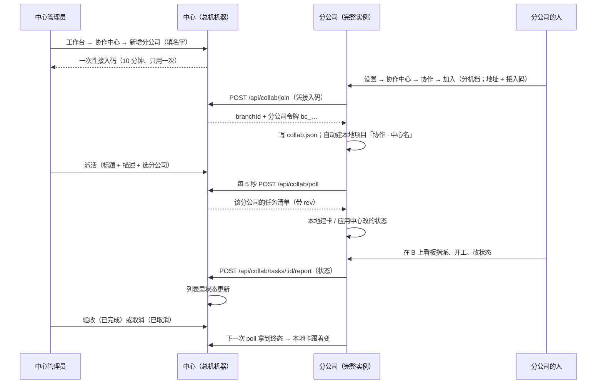

# 协作中心（总公司 / 分公司）· MVP 任务书

> **变更注（2026-11-01）**：中心页入口从「工作台 › 协作中心」搬进「**设置 → 协作 → 协作中心**」
> （用户要求撤工作台磁贴）。页面本体 `renderCollabCenter` 现在直接画进 `#settingsView`（设置主从版式），
> 面包屑/整页子页那套不再适用；分公司侧 CLI 口径不变。本文 §8.1、§11.2 的「工作台 → 协作中心」字样
> 一律按新口径读。
>
> **变更注（2026-11-02）**：分公司侧的「协作」分节从「设置 → 这台机器」页**搬进「设置 → 协作中心」页**
> （模式卡下面、设备表上面），显隐跟着模式卡的**分机/总机**走 —— 分机给加入入口，总机只留一行指路，
> 已加入任何档都显示状态卡。见 §8.2（已按新口径重写）。旧口径「这台机器 → 协作」的字样一律按新位置读。
>
> 版本：2026-10-31（评审定稿）｜ 状态：**可执行** ｜ 执行方：**WorkBuddy**
> 性质：新增一条独立关系，不改现有 node 通道
> 前置阅读：[形态决策 §十四](../形态决策.md)（多机协同已降级为实验）、[局域网加入总机设计](2026-10-20-局域网加入总机-设计.md)（现有「算力节点」通道，本任务**不复用**）
> 执行口径：照 §十二 交付、§十四 顺序、§十五 的坑。**别扩范围**；拿不准的地方在回报里写出来，不要自己改产品口径。

> **给 WorkBuddy 的开场（可直接用）：** 读这份任务书，按 §十四 的顺序做：先 T01 → T02 → T03，把 §11.1 的 1–15 跑绿，再做 T04/T05 的 UI，最后 T06 全量回归。开工前先看 §十五（坑）和 §十六（边界）。分支 `bandi/collab-mvp-20261031`，一个提交，不 push；卡住就停下来回报，别硬绕。

---

## 一、一句话

给「一台机器（中心）把任务派给另一台完整实例（分公司），分公司在本地看板接单、干活，状态自动回到中心」做一条最小链路。

**只同步任务与状态。不同步数据，不远程执行，不搬文件与凭据。**

---

## 二、已拍板的模型（讨论结论，别再来回改）

| | 中心（总公司） | 分公司 |
|---|---|---|
| 角色 | 派活、看进度、对「待验收」点验收、对未终态任务点取消 | 接单、在本机执行、回传状态（也允许自己判定「已完成」） |
| 存什么 | 分公司名录、任务、状态 | 自己的通讯录/项目/仓库/远程连接/会话，**全在本地** |
| 不碰什么 | 分公司的业务数据、本机文件、CLI | —— |
| 连接方向 | 只应答，不主动连分公司 | **主动连中心**（出站轮询） |
| 加入前的状态 | 一台普通的完整班底 | 一台普通的完整班底 |

**边界三句话（越过就不做）：**

1. 不搬文件、不搬凭据、不代跑 CLI（那是「算力节点」通道，不是这个）；
2. 不派人名单（MVP 只派到「分公司」这一级，不做联络员/花名册，见 §十三）；
3. 状态沿用统一任务八态（想法/待办/进行中/待验收/已阻塞/失败/已完成/已取消），**不造第二套词**。

### 2.1 评审已定的三个取舍（2026-10-31，按推荐执行，执行时别再问）

| 取舍 | 结论 | 理由 |
|---|---|---|
| 分公司的卡放哪 | **复用本地项目 + 现有任务看板**（`project_tasks`，`source='collab'`） | 指派数字员工、走流程、评论、PR 全是现成的，不造第二套卡 |
| 标题/描述能不能改 | **只读**（内容归中心）；本地只能改状态、执行人、评论、走流程 | 本地改了不回传，两边迟早不一致；要补充信息写评论或让中心改 |
| 谁能收尾 | 中心可对「待验收」点**验收**；分公司也可以自己判定**已完成**；**已完成/已取消之后两边都不能再改** | 看板上拖到「已完成」是自然动作，硬拦会让人以为坏了；终态仍锁死 |

---

## 三、和现有「加入总机（算力节点）」的关系

**这是第二条独立关系，不是改造现有 node 通道。**

- 不共用邀请码 / 令牌 / `config.json` 的 `controlPlane`；
- 不启动 `node.mjs` / `node-supervisor`；
- 不把监听收回环、不触发重启、不进入「节点配置面」；
- 分公司加入后**仍然是一台完整的本机**：工作台、通讯录、项目、看板、代码托管、远程连接照常。

**两条关系互斥（都要在接口层拦）：**

- `/api/local/collab/join` 发现 `localMode.isJoined()` → `409 E4047`「这台机器已经加入了总机（算力节点），先退出才能加入协作中心」；
- `/api/local/join`（算力）发现 `collab.json` 存在 → `409 E4047`「这台机器已经加入了协作中心，先退出才能加入总机」。

理由：node 通道 2026-10-28 已降级冻结（[形态决策 §十四](../形态决策.md)）；协作 MVP 不该重新激活它，也不该让「加入协作」把本机变成没有面板的节点。

---

## 四、主流程



---

## 五、数据模型

### 5.1 中心侧（新文件 `apps/server/src/store/collab.mjs`，SQL 只在这里）

```sql
CREATE TABLE IF NOT EXISTS collab_invites (
  code       TEXT PRIMARY KEY,   -- bi_<8 位 base64url>
  label      TEXT NOT NULL,      -- 分公司名字（中心管理员填）
  createdAt  TEXT NOT NULL,
  expiresAt  TEXT NOT NULL,      -- createdAt + 10 分钟
  usedAt     TEXT,               -- 用过就写；用了再拿同一码 → E4040
  branchId   TEXT
);
CREATE TABLE IF NOT EXISTS collab_branches (
  id         TEXT PRIMARY KEY,   -- br_<newId 风格>
  label      TEXT NOT NULL,
  hostname   TEXT,               -- 分公司自报
  tokenHash  TEXT NOT NULL,      -- sha256(分公司令牌)，明文只回给分公司一次
  createdAt  TEXT NOT NULL,
  lastSeenAt TEXT,               -- 每次 poll 刷新；>30 秒没动静 = 离线
  revokedAt  TEXT                -- 中心「移除」/ 分公司「退出」都写这里（留痕）
);
CREATE TABLE IF NOT EXISTS collab_tasks (
  id              TEXT PRIMARY KEY,   -- ct_<newId 风格>
  branchId        TEXT NOT NULL,
  title           TEXT NOT NULL,
  description     TEXT NOT NULL DEFAULT '',
  status          TEXT NOT NULL DEFAULT '待办',  -- 统一八态，MVP 用其中 7 态（「想法」不出现）
  result          TEXT,               -- P1 用；MVP 留空
  rev             INTEGER NOT NULL DEFAULT 1,    -- 中心每改一次 +1（防回环的水位）
  createdByUserId TEXT,               -- 中心侧建卡的人（users.id，可空）
  createdAt       TEXT NOT NULL,
  updatedAt       TEXT NOT NULL
);
CREATE INDEX IF NOT EXISTS idx_collab_tasks_branch ON collab_tasks (branchId, updatedAt);
```

`store.mjs` 里加 `export * from './store/collab.mjs';`。

### 5.2 分公司侧

**配置文件** `<数据目录>/collab.json`（0600，照 `local-mode.writeClientConfig` 的写法）：

```json
{
  "centerUrl": "http://192.168.1.9:8787",
  "branchId": "br_xxx",
  "token": "bc_xxx",
  "centerLabel": "办公室那台",
  "centerHostname": "DESKTOP-XXX",
  "joinedAt": "2026-10-31T…",
  "projectId": "pj_xxx"
}
```

`project_tasks` 加三列（`store/projects.mjs` 的 `ensureColumn`，放在现有列之后）：

```sql
collabTaskId  TEXT              -- 中心任务 id；NULL = 不是协作卡
collabRev     INTEGER NOT NULL DEFAULT 0   -- 已应用的中心 rev
collabStatus  TEXT              -- 最后一次与中心对齐的状态（用于发现"本地改了"）
```

- 加索引 `CREATE INDEX IF NOT EXISTS idx_project_tasks_collab ON project_tasks (collabTaskId);`
- `store/projectTasks.mjs`：
  - `createProjectTask` 的 INSERT 加这三列（默认 null/0）；
  - `updateProjectTask` 的 UPDATE 列表加这三列（`?? null` / `?? 0`，照现有老库兼容写法）；
  - 新增 `getProjectTaskByCollabTaskId(collabTaskId)`、`listCollabCardsNeedingReport()`（`WHERE collabTaskId IS NOT NULL AND status <> COALESCE(collabStatus,'')`）。

**本地项目**（加入成功时自动建，幂等）：名字 `协作 · <centerLabel>`，root `<数据目录>/collab/<branchId>/`（`fs.mkdirSync(..., {recursive:true})`）。`projectId` 记进 `collab.json`；项目被删了就按 root 重新找/重建（不要静默丢任务）。

---

## 六、接口契约

### 6.1 中心侧（都必须 `mayManage` —— operator 或 admin 登录用户）

| 方法 | 路径 | 请求 | 成功 | 失败 |
|---|---|---|---|---|
| POST | `/api/collab/invites` | `{label}` | `201 {code, label, expiresAt}` | E4046 名字空/太长 |
| GET | `/api/collab/branches` | — | `200 {branches:[{id,label,hostname,joinedAt,lastSeenAt,online,revokedAt,openTasks}]}` | — |
| POST | `/api/collab/branches/:id/revoke` | — | `200 {ok:true}` | E4045 |
| POST | `/api/collab/tasks` | `{branchId,title,description}` | `201 {task}` | E4045 分公司不在/已移除；E4046 标题空 |
| GET | `/api/collab/tasks?branchId=` | — | `200 {tasks:[…]}`（updatedAt 倒序） | — |
| PATCH | `/api/collab/tasks/:id` | `{status}`，只许 `已完成` / `已取消` | `200 {task}` | E4045；E4046 别的状态 |

**字段上限**：label/title ≤ 200 字，description ≤ 10000 字。
**公开字段**：`branch.openTasks` = 该分公司未终态任务数（给列表用，别让前端自己数）。
**移除语义**：只写 `revokedAt`，不删行（留痕）；中心列表里保留「已移除」。

### 6.2 分公司 → 中心（**免令牌**，凭据在 body/头里，由 handler 校验）

> 这四条必须在 `auth.mjs guard()` 顶部的免令牌清单里放行（跟 `/api/nodes/join` 同一种模式），
> 否则中心开了局域网（鉴权开）之后，分公司永远进不来。**CSRF 闸照过**（分公司请求不带 Origin，天然放行）。

| 方法 | 路径 | 凭据 | 请求 | 成功 |
|---|---|---|---|---|
| POST | `/api/collab/join` | 接入码 | `{code, hostname}` | `201 {branchId, token, center:{label,hostname,version}}` |
| POST | `/api/collab/poll` | `X-Bandi-Token: bc_…` | `{}` | `200 {center:{label,hostname,version}, now, tasks:[{id,title,description,status,result,rev,updatedAt}]}` |
| POST | `/api/collab/tasks/:id/report` | `X-Bandi-Token: bc_…` | `{status}` | `200 {task}` |
| POST | `/api/collab/leave` | `X-Bandi-Token: bc_…` | `{}` | `200 {ok:true}` |

- `join`：一次性消耗接入码（`UPDATE … WHERE code=? AND usedAt IS NULL AND expiresAt > now`，原子）；建 `collab_branches`；令牌 `bc_` + 32 字节随机 base64url，库里只存 sha256。**同一 IP 每分钟最多 10 次**，超了 `429 E4048`。
- `poll`：只回 **这个分支自己的**任务；同时刷新 `lastSeenAt`；任务上限 200 条（updatedAt 倒序）。
- `report`：只许 `待办 / 进行中 / 待验收 / 已阻塞 / 失败 / 已完成`；`已取消` 只能中心写。中心任务已是终态（已完成/已取消）→ `409 E4046`。成功时 `rev += 1`。
- `leave`：写 `revokedAt`（分公司主动退出）；幂等。
- 分公司令牌失效/被移除 → 一律 `401 E4044`，**不要**回「需要令牌」的 E4010（那是操作员令牌的文案，分公司看不懂）。

### 6.3 本机侧（走 `/api/local/*`，沿用 `routes/local.mjs` 的**回环闸** E1094）

| 方法 | 路径 | 请求 | 成功 | 失败 |
|---|---|---|---|---|
| GET | `/api/local/collab/status` | — | `200 {joined, centerUrl, centerLabel, branchId, online, lastSyncAt, lastError, projectId, revoked}` | — |
| POST | `/api/local/collab/join` | `{url, code}` | `200 {centerLabel, branchId, projectId}` | E4041 连不上；E4040 码不对；E4042 已加入；E4043 对面太旧；E4047 已是算力节点 |
| POST | `/api/local/collab/leave` | — | `200 {ok:true}` | E4042 未加入 |

**加入顺序（照现有 `localMode.join` 的写法，失败码要能区分）：**

1. 已有 `collab.json` → `409 E4042`；
2. 已是算力节点 → `409 E4047`；
3. 探 `GET {url}/api/hello`（4 秒超时）：
   - 不是 200 / `platform !== 'bandi'` → `400 E4041`；
   - `caps` 里没有 `'collab'` → `409 E4043`「那台班底版本太旧，先升级它」；
4. `POST {url}/api/collab/join`；
   - 401 → `401 E4040`（码不对/过期/用了）；
   - 404/405 → `409 E4043`；
   - 其余非 201 → `400 E4041`；
5. 写 `collab.json`（原子 + 0600）→ 建/找项目 → 启动同步循环 → 返回。
   **不重启、不动 netmode、不动 `config.json`。**

**退出**：best-effort 调中心 `leave`（2 秒超时，失败不拦）→ 删 `collab.json` → 停循环。
**本地项目与卡片不删**（那是这台机器的数据；重新加入同一中心会按 collabTaskId 复用/新建，见 §十三）。

---

## 七、同步状态机与防回环（实现的核心）

**分公司侧每 5 秒一拍；失败退避 15 秒；一个 tick 没跑完不叠下一个（`inFlight` 标志）。**

```
tick:
  1) POST {center}/api/collab/poll  （带 bc_ 令牌）
  2) 对返回的每条 task：
       local = getProjectTaskByCollabTaskId(task.id)
       if (!local) 建卡：projectId、title、description、status、source='collab'
                    + collabTaskId=task.id + collabRev=task.rev + collabStatus=task.status
       else if (task.rev > local.collabRev):
                    status := task.status；collabRev := task.rev；collabStatus := task.status
                    （只动这三列，不触发 startProjectTask —— 中心的取消/验收不该把活跑起来）
  3) listCollabCardsNeedingReport()：
       对每张 status !== collabStatus 的卡 → POST report {status}
       成功后 collabStatus := status（失败留着，下一拍重试）
```

**防回环规则（必须这么做，否则两边互相盖）：**

- 应用中心改的状态时，**同时**把本地 `collabStatus` 写成同一值 —— 下一拍就不会把中心刚改的值又报回去；
- 中心接受一次 report 后 `rev += 1`；分公司下一拍看到 `rev` 变大，应用回来的是**同一个状态**，等于空操作；
- 分公司报告时**只报状态**，不报标题/描述（内容以中心为准）；
- 中心终态（已完成/已取消）之后，再收到 report 一律 409 —— 终态不可逆；
- 分支本地 `status` 改成 `已取消` 要拦（`E4046`「取消由中心决定」），中心取消后分公司本地卡才会跟着变。

**撤销/掉线：**

- 中心「移除」→ 分公司下一拍 401 E4044 → 状态页显示「已被中心移除」→ **停循环**，不自动清 `collab.json`（跟现有 E4012 的口径一致：不静默清，给「退出协作」按钮）；
- 中心不可达 → 本地照常可用，状态页显示「离线」+ 最后成功时间；恢复后自动续上；
- 分公司退出 → 删配置、停循环；中心那边留 `revokedAt`（列表标「已移除」）。

---

## 八、前端

### 8.1 中心：工作台 → 协作中心（新文件 `apps/web/js/collab.mjs`）

- 工作台宫格新增一组「协作」，一颗磁贴「协作中心」，说明「把活派给分公司，看进度」。
  只有 operator / admin 看得到（照 `renderWorkbenchGrid` 里 `limitedByRole` 的判据；devMode 不显示）。
- 整页版式（照 `openRemotePage` / `openSchedules` 的工作台子页）：面包屑「工作台 › 协作中心」。
- 两块：
  1. **分公司**：名称 / 主机名 / 在线（`lastSeenAt` < 30 秒）/ 最近联系 / 加入时间 / 操作「派活」「移除」；右上「＋ 新增分公司」。
  2. **我派出去的活**：标题 / 分公司 / 状态 / 更新时间 / 操作「验收」（仅 `待验收`）「取消」（非终态）。
- 弹窗（走现有 dialog + `wireDialogHead`，破坏性操作走 `confirmDo`，**禁用 `alert`/原生 `confirm`**）：
  - **新增分公司**：只填名字 → 生成接入码后，同一个弹窗换成「接入码 + 有效期 + 三步说明」：
    `① 在那台机器上：设置 → 协作中心（模式卡切分机）→ 加入协作中心；② 填这台机器的地址（下面这个）；③ 粘贴接入码。`
    地址取 `lan.boundLan && lan.urls[0]`，否则 `location.origin`（同 `openJoinDialog` 的写法）；**只听回环时给一行警告**「这台机器现在只听本机，分公司连不到它 —— 先切到总机模式（设置 → 协作中心 → 模式卡切总机）或走隧道」。
  - **派活**：选分公司 + 标题 + 描述。
- 空态文案：还没有分公司 →「点右上角『新增分公司』，把一台机器接进来」。

### 8.2 分公司：设置 →「协作中心」页的「协作」分节

- 位置（**2026-11-02 二十三改搬家**）：从「这台机器」页（`#collabMount`）搬进「协作中心」页 —— `collab.mjs` 的 `renderCollabCenter` 里，模式卡 `#clModeMount` 之后、设备表之前，挂 `<div id="clBranchMount"></div>`，调 `renderCollabSection($('clBranchMount'))` + `watchCollabSection(...)`。`connectors.mjs` 不再 import 这两个函数（与 collab.mjs 的互相 import 只剩单向）。
  用户原话：「把这个协作移到协作中心，通过分机和总机开关控制显示和隐藏」。
- **显隐跟着模式卡的分机/总机走**（`/api/lan.acceptNodes`）：
  · **分机**（`acceptNodes=false`）+ 未加入 → 说明 +「加入协作中心」入口；
  · **总机**（`acceptNodes=true`）+ 未加入 → **只剩一行指路**（「这台是总机，不加入别的协作中心；想挂到别的中心把模式切回分机」），不给加入入口；
  · **已加入 / 已被移除** → 无论哪一档都显示状态卡（退出总得有地方点，别把状态变成黑洞）。
  · 切换即时生效：`paintModeCard` 新增 `onRoleChange` 回调（切角色成功就调，**只重画 `#clBranchMount` 这一节**，不整页闪；原来的 `onChange` 仍只管「对外服务翻面 → 整页重画」）。
- 未加入（分机）：一句说明 +「加入协作中心」按钮 → 弹窗（地址 + 接入码）。
  **2026-11-02 三十一改（用户截图："这里应该是连接"）**：不再有"终端执行"变体 —— 上面那版"服务器形态点了产出 CLI 命令"已删。`/api/local/collab/join` 跟 leave / export 一样放宽成 `secret: 'never'`（本机接口授权设计 v10；原"SSRF / 数据外流面"的论证作废：落点要目标中心签发的接入码背书，本机数据不经过这个接口外带），任何形态下点「连接总机」都是**真加入**。CLI（`bandi collab join`）只服务无头机器。
- 已加入：中心名 / 地址 / 在线状态 / 加入时间 / 本地项目（「打开项目」）/ 底部「退出协作」（`confirmDo`，正文写清「本机的任务和卡片不会删」）。
- 节点形态的机器走的是另一套整页（`renderNodeMode`），设置里的这一页不渲染 —— 与 §三 的互斥一致。

### 8.3 分公司看板上的「协作卡」

- 卡片来源 `source='collab'`，显示「总公司」标签（不再显示「手动建卡」）：
  - **来源文案只改服务端一处**：`project-tasks.mjs` 的 `SOURCE_TEXT` 加 `collab: '总公司'`（看板 pill、筛选选项、卡片详情都读它，别在前端另写一份）；
  - 前端「是不是本地卡」的判据要加 collab（这三处）：
    - `projects.mjs` 约 1078 行 `const open = (r.source === 'manual' || r.source === 'repo') && …`
    - `projects.mjs` 约 3492 行 `const local = r.source === 'manual' || r.source === 'repo'`
    - `chat.mjs` 约 1497 行（员工详情里那张只读卡）同一句
- 卡片详情右栏「来源」现在写死 `isFlowCard ? '流程' : isRepo ? '仓库值班' : '手动建卡'`（`projects.mjs` 约 2489 行）：加 `isCollab ? '总公司'` 一档。
- **标题/描述只读**（见 §九 的 E4046），本地可以：改状态、改执行人、评论、走流程、关联 PR。
- `updateProjectTask`（`project-tasks.mjs`）开头加拦：
  - `cur.source === 'collab'` 且带 `title/description` → 抛 `E4046`「总公司派的任务，标题/描述由中心改」；
  - `cur.source === 'collab'` 且 `status === '已取消'` → 抛 `E4046`「取消由中心决定」。
- `DELETE /api/projects/tasks/:id` 对 `source='collab'` 拒绝（`E4046`「总公司派的任务不能删，只能等中心取消」）—— 否则下一拍会把它重建出来。

### 8.4 接线点

- `shell.mjs` 的 `ROUTES` 加 `collab: () => { setNav('plugins', { skipOpen: true }); return openCollabPage(); }`（照 `schedules`）。
- 新模块 `apps/web/js/collab.mjs` 必须进 `sw.js` 的 `JS_MODULES`，并把 `VERSION` 从 `v5` 加到 `v6`。
- 工作台磁贴接线在 `experts.mjs` 的 `renderWorkbenchGrid()` 里（照 `data-schedules` 那一颗）。
- 宫格分组建议新建 `workbenchCollabSection()`（放 `projects.mjs` 或 `collab.mjs`），别硬塞进「项目」组。

---

## 九、错误码（先 grep 全仓确认 E404x 未被占用）

| 码 | HTTP | 文案（中文，UI 只显示码 + 这句） |
|---|---|---|
| E4040 | 400/401 | 接入码不对、已经用过、或者过期了 —— 让中心重新生成一个 |
| E4041 | 400 | 连不上中心。核对地址与端口；如果中心开着，多半是防火墙挡住了这个端口 |
| E4042 | 409 | 这台机器已经加入了某个协作中心，先退出再换 |
| E4043 | 409 | 那台班底版本太旧（不认识协作中心），先升级它再加入 |
| E4044 | 401 | 分公司的授权已被中心移除，退出协作后重新加入 |
| E4045 | 404 | 分公司或任务不存在（可能已被移除） |
| E4046 | 400/409 | 这个动作在协作任务上不允许（标题描述由中心改、取消由中心定、不能删） |
| E4047 | 409 | 这台机器已经加入了总机（算力节点）/ 协作中心，先退出才能加入另一种 |
| E4048 | 429 | 试得太频繁，过一分钟再试 |

**新错误码在文件头登记**（一码只表达一件事），别复用 E1046/E1098 之类的旧码。

---

## 十、接线点清单（执行时按这个查，别漏）

| 文件 | 改什么 |
|---|---|
| `apps/server/src/store/collab.mjs` | **新增**：三张表 + invites/branches/tasks 的读写；令牌 sha256；`newId('br_')` 风格自定 |
| `apps/server/src/store.mjs` | 加一行 `export * from './store/collab.mjs';` |
| `apps/server/src/store/projects.mjs` | `project_tasks` 加三列 + 索引 |
| `apps/server/src/store/projectTasks.mjs` | INSERT/UPDATE 加三列；`getProjectTaskByCollabTaskId`；`listCollabCardsNeedingReport` |
| `apps/server/src/routes/collab.mjs` | **新增**：6.1 + 6.2 的 8 条接口；`join` 里消耗邀请码、发 token；`poll/report/leave` 自己校验 bc_ 令牌 |
| `apps/server/src/collab-branch.mjs` | **新增**：读/写/清 `collab.json`、`join/leave/status/startIfJoined`、5 秒 tick（poll→apply→report）、退避、`inFlight` |
| `apps/server/src/routes/local.mjs` | 加 3 条 `/api/local/collab/*`（在回环闸之后） |
| `apps/server/src/server.mjs` | ① `helloPayload().caps` 加 `'collab'`；② 路由链加 `handleCollab`；③ `server.listen` 后调 `collabBranch.startIfJoined()`；④ `local-mode.join` 的互斥检查（或放 local 路由里） |
| `apps/server/src/auth.mjs` | guard 顶部免令牌清单加 4 条 collab 路径（注释写清"凭据是 bc_ 令牌，校验在 handler"） |
| `apps/server/src/lan-announce.mjs` | `caps` 与 hello 同步加 `'collab'`（同一个口径，不加也能跑，但别让两处漂移） |
| `apps/server/src/project-tasks.mjs` | `SOURCE_TEXT` 加 `collab: '总公司'`；`updateProjectTask` 的 collab 只读/取消拦截 |
| `apps/server/src/routes/project.mjs` | 协作卡 DELETE 拒绝 |
| `apps/web/js/collab.mjs` | **新增**：中心页 + 分公司设置分节 + 加入/退出的弹窗 |
| `apps/web/js/connectors.mjs` | 「这台机器」页加 `#collabMount` + 调 `renderCollabSection` |
| `apps/web/js/experts.mjs` | 宫格加「协作」组与磁贴、点击接线 |
| `apps/web/js/shell.mjs` | `ROUTES.collab` |
| `apps/web/js/projects.mjs` | collab 算本地卡（约 1078 / 3492 两处）、卡片详情来源（约 2489） |
| `apps/web/js/chat.mjs` | 员工详情只读卡的「本地卡」判据（约 1497） |
| `apps/web/sw.js` | `JS_MODULES` 加 `/js/collab.mjs`；`VERSION` v5 → v6 |
| `apps/server/src/smoke-collab.mjs` | **新增**（见 §十一） |
| `tools/run-smokes.mjs` | 登记 `apps/server/src/smoke-collab.mjs`（不登记 = 直接报错退出） |

---

## 十一、验收

### 11.1 新用例 `apps/server/src/smoke-collab.mjs`（照 `smoke-node-jobs.mjs` 的起法）

两台真实进程：
- **中心**：`BANDI_DATA=<tmp>/center`、`BANDI_PORT=<p1>`、`BANDI_HOST=0.0.0.0`、`BANDI_TOKEN=<op>`（鉴权开，才能测令牌）；
- **分公司**：`BANDI_DATA=<tmp>/branch`、`BANDI_PORT=<p2>`、`BANDI_HOST=127.0.0.1`（回环，UI/API 免登录）。

断言（逐条 `check()`）：

1. 中心 `POST /api/collab/invites`（op 令牌）→ 201，`code` 以 `bi_` 开头；
2. 分公司 `POST /api/local/collab/join {url, code}` → 200，返回 `branchId` / `projectId` / `centerLabel`；
3. 中心 `GET /api/collab/branches` → 1 条，6 秒内 `online=true`（poll 已刷新 `lastSeenAt`）；
4. 中心 `POST /api/collab/tasks` → 201，状态 `待办`，`rev=1`；
5. 10 秒内分公司 `GET /api/tasks` 出现该卡：`source='collab'`、标题一致、`project_name` 是「协作 · …」；
6. 分公司 `PATCH` 卡状态 → `进行中`；10 秒内中心 `GET /api/collab/tasks` 也是 `进行中`；
7. 分公司改成 `待验收`；中心看到 `待验收`；
8. 中心 `PATCH` 任务 `已完成`；10 秒内分公司卡变 `已完成`；
8b. **分公司自判完成**：中心再建一张 → 分公司拉到 → 分公司直接改成 `已完成` → 中心 10 秒内看到 `已完成`；
9. 中心新建第二张卡 → 分公司拉到 → 中心 `PATCH 已取消` → 分公司卡变 `已取消`；
10. **只读**：分公司 `PATCH` 该卡 `{title:'改个名'}` → 400 `E4046`；
11. **令牌**：中心 `POST /api/collab/poll` 不带令牌 → 401；乱码令牌 → 401 `E4044`；
12. **移除**：中心 `POST /api/collab/branches/:id/revoke` → 分公司 10 秒内状态变「已被移除」；
13. **退出**：分公司 `POST /api/local/collab/leave` → 200；`GET /api/local/collab/status` → `joined:false`；本地项目与卡片仍在；中心列表该分公司 `revokedAt` 非空；
14. **离线可用**：杀掉中心 → 分公司 `GET /api/tasks` 仍 200、卡还在；`status` 显示离线；
15. **互斥**：分公司已有 collab.json 时再 `POST /api/local/collab/join` → 409 `E4042`（不重复建）；
16. **回归**：`smoke-node-jobs` / `smoke-lan-join` / `smoke-auth` / `smoke-project-tasks` / `smoke-users` / `smoke-roles` / `smoke-device-roles` 全绿。

> 码过期那条不靠等 10 分钟：复用同一个 `code` 再 join 一次 → E4040，已覆盖"用过即废"。

### 11.2 手动（两台真机/两台虚拟机，同一网段）

1. 中心：设置 → 协作中心 → 模式卡切「总机」；同一页「设备」节点「＋ 添加设备」→ 复制地址与接入码；
2. 分公司：设置 → 协作中心 → 协作 → 加入（地址 + 码，模式卡要在分机档）→ 成功；
3. 中心：派活一张卡；
4. 分公司：工作台 → 项目 → 「协作 · …」→ 看板上看到卡 → 指派一个数字员工 → 拖进行中 → 干完 → 待验收；
5. 中心：协作中心列表里状态跟着变 → 点「验收」→ 分公司卡变已完成；
6. 断网测试：停掉中心，分公司照常开会话/改本机数据；恢复后状态续上。

---

## 十二、交付与红线

- **分支**：`bandi/collab-mvp-20261031`；**一个提交**，中文提交信息写清「改了什么 / 为什么 / 怎么验证」；`git commit -s`；**不 push、不打 tag、不改 `version.json`**。
- **零依赖**：不许新增 `package.json` / 锁文件 / `node_modules`。
- **SQL 只在 `store/`**；路由/同步模块不写 SQL。
- 错误一律「码 + 中文」；UI 禁用 `alert` / 原生 `confirm`（破坏性走 `confirmDo`）。
- 新 JS 模块必须进 `sw.js` 的 `JS_MODULES` 且 `VERSION` +1。
- 新 smoke 必须登记进 `tools/run-smokes.mjs`。
- 提交前 `git status` 不许带 `tmp_state.json` / `tmp_tasks.json` / `.zcode/` / `codex-*.html`。
- 过程可以多次本地提交，**交付前收成一个提交**（`git reset --soft` + 重新 commit，或交互式 squash）。

**回报格式（照这个写，别贴一屏日志）：**

```
分支：bandi/collab-mvp-20261031（一个提交，未 push）
改了什么：<按 §十 的文件清单逐项一行>
服务端链路：§11.1 第 1–15 条 → 逐条 ✅/❌ + 失败原因
回归：smoke-… 全绿 / 红的哪几条、为什么
手动：§11.2 六步走完没有、截图/现象
遗留：没做的、已知问题、需要拍板的
```

---

## 十三、明确不做（P1 / P2，写在这里防止顺手加）

| 项 | 为什么现在不做 |
|---|---|
| 联络员 / 花名册 / 点名到人 | 先把"到分公司"跑通；加人名单要跨实例同步人员 ID，成本和隐私都上一个台阶 |
| 验收驳回、重新打开 | MVP 只做「已完成 / 已取消」两个终态；打回要引入新的状态往返规则 |
| 任务结果摘要 / 附件 / 产物链接 | 状态先跑通；结果回传要定格式与权限，P1 再做 |
| 实时推送（SSE/长连接） | 5 秒轮询对"人看进度"完全够用；长连接等 P1 |
| UDP 自动发现中心 | 手填地址局域网/云端都能用；发现只是省一次输入 |
| TLS / 证书 | MVP 只在可信内网用；公网必须走隧道（见 deploy/README 三之二） |
| 中心高可用 / 多中心 | 一个分公司只属于一个中心（与现有 E1093 单总机口径一致） |
| 细粒度权限（谁能派活） | MVP = `mayManage`（operator/admin） |
| 分公司数据上报 / 统一通讯录 | 与「分公司是独立个体」冲突；这是另一个产品 |

---

## 十四、执行顺序与完成定义（WorkBuddy 照这个做）

**先服务端链路，再 UI，最后全量回归。** 不要先画页面：接口没通，页面只能靠猜，必返工。

| 步 | 内容 | 完成定义（DoD） | 自己怎么验 |
|---|---|---|---|
| 0 | 开分支、读代码 | `git switch -c bandi/collab-mvp-20261031`；§十 列的文件都读过 | `git status` 干净 |
| 1 | **T01** 中心 store | 三张表 + invites/branches/tasks 的读写；重启服务不报错（幂等） | 用临时 `BANDI_DATA` 起一次服务；再起一次，不重复建表/报错 |
| 2 | **T02** 中心接口 | §6.1 + §6.2 全通；guard 豁免；hello `caps` 含 `collab` | 临时脚本按「发码 → 加入 → 建任务 → poll → report → revoke」跑一遍（这就是 §11.1 的 1–4、11、12） |
| 3 | **T03** 分公司同步 | `/api/local/collab/*` + 5 秒 tick + 防回环 + 双向互斥 | 两台进程：中心建卡 → 分公司 10 秒内出现卡；分公司改状态 → 中心变；中心取消 → 分公司变 |
| 4 | **T06 前半** 接口级冒烟 | `smoke-collab.mjs` 覆盖 §11.1 的 1–15 | `node apps/server/src/smoke-collab.mjs` 全绿 |
| 5 | **T04** 中心页 | 工作台磁贴 + 协作中心页 + 发码/派活/验收/取消 | 浏览器手动走一遍（§11.2 的 1、3、5） |
| 6 | **T05** 分公司 UI | 设置分节 + 看板协作卡（来源/只读/删除拦截） | 浏览器手动走一遍（§11.2 的 2、4、6） |
| 7 | **T06 全量** | 登记 `tools/run-smokes.mjs`，跑既有回归 | `node tools/run-smokes.mjs` 全绿（真 CLI 的排除项除外） |

**几条硬规矩：**

- 每步先自己验，再进下一步；没验完不要开下一步。
- **T04 与 T05 都改 `apps/web/js/collab.mjs`**（不同函数）—— 由同一个人顺序做（先 T04 后 T05），不要两个人同时改这个文件。
- 过程可以多次本地提交，**交付前收成一个提交**（仓库口径见 §十二）。
- 哪一步卡住超过半小时，停下来回报「卡在哪、试过什么、需要什么决定」，不要自己改产品口径硬绕。
- 文件清单以 §十 为准；写作用域按步骤走，不要顺手改无关模块。

---

## 十五、实现时最容易踩的坑（WorkBuddy 必读）

1. **SQL 只在 `store/`**；新域要在 `store.mjs` 加 `export * from './store/collab.mjs'`；`ensureColumn` 必须放在建表之后（放前面新库会 `no such table`）。
2. **`project_tasks` 的 store 层 `updateProjectTask` 是固定列清单**：新加的三列不写进那条 `UPDATE`，等于"赋值了但没落库"。这是本任务最容易白干的一处。
3. `auth.guard` 的 4 条免令牌要放在函数**最顶部**（`if (!auth.required)` 之前）；`identify()` 不认识 `bc_` 令牌，**别去改它**，校验放 handler。
4. 分公司请求不带 `Origin`，`guardWrite` 天然放行；不要给脚本补 `X-Bandi`（那是浏览器 CSRF 的闸）。
5. `server.mjs` 的 `helloPayload().caps` 与 `lan-announce.mjs` 的 `caps` **两处都要加 `'collab'`**，否则两台新机器之间会出现"一台能加、一台加不了"。
6. 同步循环用 `setInterval(...).unref()`；用 `inFlight` 防叠；失败只打一行日志（别每 5 秒刷屏）。
7. `source='collab'` 的前端「本地卡」判据有**三处**（`projects.mjs` ×2、`chat.mjs` ×1），漏一处卡就点不开、筛选也错。
8. `sw.js` 加新模块并 `VERSION+1`；`tools/run-smokes.mjs` 登记新用例 —— 漏了不是报错就是老客户端白屏。
9. 时间统一 `nowIso()`；令牌只存 sha256；比较用 `crypto.timingSafeEqual`；明文只在 join 响应里回一次。
10. **消耗邀请码要脏写安全**：`UPDATE … WHERE code=? AND usedAt IS NULL AND expiresAt > now`，`changes === 1` 才算成功；同一个码并发只许一个成功。
11. 中心 LAN 模式下**不要整段免令牌**：只放 `join / poll / report / leave` 四条；管理接口照常 `mayManage`。
12. 不要把 `collab_tasks` 塞进中心项目看板：中心页面独立（`/api/collab/tasks`），别复用 `/api/tasks`。
13. 协作卡**不要走 `startProjectTask` 的自动开工**：同步循环用 store 层直接改三列；走业务层会因为"状态变了+有执行人"把活跑起来。
14. **删除保护**：`DELETE /api/projects/tasks/:id` 对 `source='collab'` 要拦；否则下一拍就重建，看起来像"删不掉/闹鬼"。
15. 中心必须是一台**正常面板**的机器（不是算力节点）；节点形态没有工作台入口，UI 不显示、文档里说明。

---

## 十六、边界情况与预期行为（实现前先看一遍）

| 情况 | 预期 |
|---|---|
| 中心离线 / 断网 | 分公司本地照常（看板/会话/项目都能用）；状态页显示离线 + 最后成功时间；恢复后自动续上 |
| 中心点「移除」 | 分公司下一拍 401 `E4044` → 停循环；状态页显示「已被中心移除」；**不自动清 `collab.json`**，给「退出协作」按钮 |
| 分公司点「退出」 | 删 `collab.json`、停循环；中心留 `revokedAt`；**本地项目与卡片不删** |
| 重复加入 | 409 `E4042`，不重复建 |
| 地址错 / 中心没开 | 400 `E4041`，文案里点明"地址、端口、防火墙" |
| 中心版本旧（不认识 collab） | 409 `E4043`，提示升级，不静默降级 |
| 已是算力节点，又点加入协作 | 409 `E4047`；反过来（已是协作，又点加入总机）也 409 `E4047` |
| 任务标题空 / 描述超长 | 400 `E4046` |
| 中心已取消/已完成，分公司再报状态 | 409 `E4046`；分公司下一拍拿到终态后本地跟着变 |
| 本地删协作卡 | 400 `E4046`（"不能删，只能等中心取消"） |
| 本地删「协作 · …」项目 | 下一拍按 root 重建项目、把未完成的任务重新拉回来（**不要删用户数据**；文档里说明） |
| 分公司重新加入同一中心 | 新建 branchId；旧卡按 `collabTaskId` 复用；旧的已删卡会被重新建出来（MVP 接受） |
| 两台机器时钟不一致 | 同步判据只用 `rev`，不用时间 |
| 非管理员 / 手机端 | 管理接口 403；手机端看不到中心页，分公司卡片按现有手机规则（可看不可拖） |
| 中心本身是某台总机的算力节点 | **不支持**：它没有工作台入口；文档里说明"中心要用正常面板的机器" |
| 中心重启 | 表在库里，分支与任务都在；分公司下一拍自动续上，不需要重新加入 |
| 任务超过 200 条 | poll 只回最近 200 条（MVP 接受；分页留 P1） |

---

## 十七、为什么不是另外几种做法（省得下次重开）

- **不复用「加入总机」通道**：那条通道会把机器变成"只剩节点配置页"的算力节点，正好和"分公司保留完整本机功能"相反；而且它已被降级冻结。
- **不用长连接**：MVP 要验证的是"任务能不能来回"，5 秒轮询够；长连接留给 P1。
- **不把中心任务建在中心的项目看板里**：中心已经有任务看板，但跨机器的卡没有本地 project 可挂；单开 `collab_tasks` 表，中心页面独立，避免把两种卡混在同一张看板（也不改 `project-tasks.mjs` 的核心行计算）。
- **分公司侧必须复用 `project_tasks`**：这样指派数字员工、走流程、评论、PR 这些都是现成的，不需要第二套卡。
- **标题/描述只读**：中心是任务来源；分公司改了不回传，迟早两边不一致。要补充信息就写评论或让中心改。

---

## 附：版本记录

- **2026-10-31 初稿**：模型、数据、接口、验收、任务拆分。
- **2026-10-31 评审定稿**：锁定 §2.1 三个取舍（复用本地项目与看板 / 标题描述只读 / 中心可验收且分公司可自判完成）；执行顺序改为「先服务端 T01–T03，再 UI T04–T05，最后 T06 全量」；补 §十五 常见坑、§十六 边界情况、§十二 回报格式；执行方 = WorkBuddy。
