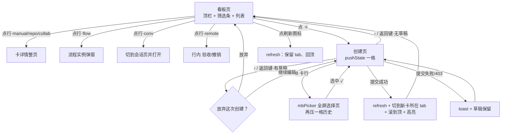

# 手机端任务看板 · 交互规格 v2.1（与《移动端任务看板-视觉规格》v2.1 对齐）

> 范围：`body.mb-narrow`（≤900px）下的「任务看板」整页 + 「新建任务」创建页。
> 桌面（>900px）**一个像素不动**：`openBoardPage` 的桌面分支、`taskDialog()` 桌面弹窗、`wireBoard()` 全部保持原样。
> **分工**：视觉数值（色值/字阶/间距/圆角/高度）以 `2026-11-05-移动端任务看板-视觉规格.md` v2.1 为准；本文只定**结构、状态、行为、边界**。两文冲突时以本文的行为口径为准，视觉数值以视觉规格为准。
> 命名：看板页 `kb-l-*`、创建页 `kb-new-*`、创建页 body 状态类 `kb-new-open`；创建页两个标题盒**不同名**（输入框 `.kb-new-inputtitle` / 栏内标题 `.kb-new-bartitle`）；容器 id 只约定 `#kbTabs` / `#kbList`（视觉规格不依赖 id，只用 `#kbList` 写两条布局规则，这是给前端的契约）。
> 每条只给**一种**方案；标「复用」的 = 不改既有实现。

## 0. 三条裁决原则

1. **状态永远可见**：任何写操作（建卡/改状态）后，结果必须落在用户眼前那一屏 —— 建完自动定位到新卡所在 tab。
2. **返回键只有一层含义**：屏幕上有可退的层就退一层，没有就回上一级页面；筛选、滚动、展开都不占历史。
3. **不发明新机制**：`.detail-head`、`mbPicker`、`confirmDo`、pushState 一格历史 —— 全部复用既有骨架。

---

## 1. 页面层级（定死）

```
body.no-list（整页视图）
└ #pluginView.kb-page（flex 列 / overflow:hidden / 本页唯一布局容器，现成）
   ├ .detail-head   顶栏  52 + safe-area  flex:none（**复用 body.no-list 那套玻璃栏**）
   ├ .kb-l-filter   筛选条 44             flex:none：`#kbTabs`(flex:1 横滑) + 刷新钮(flex:0 0 auto)
   └ #kbList        列表  flex:1          本页唯一滚动容器
```

- 不要 `position:sticky`：列表是独立滚动容器，顶栏与筛选条在 flex 列里天然不滚（iOS 上 sticky + 内滚容器会抖）。若样式里已写成 sticky，无副作用，但**不得**把列表改成整页滚动。
- 宿主 CSS 契约（照视觉规格落，别各写一套）：
  - `#pluginView.kb-page .detail-body { display:flex; flex-direction:column; min-height:0; overflow:hidden; padding:0 }`
  - `#kbList { flex:1; min-height:0; overflow-y:auto; overscroll-behavior:contain; scrollbar-width:none }`
  - 列表内边距挂在 `#kbList` 上（`.kb-l-list { padding:4px 16px calc(24px + env(safe-area-inset-bottom)) }`）—— 页面本身不滚，别再把 padding 加在容器外。
- 创建页替换 2、3 两行（顶栏换文案），同样 flex 列：顶栏 / 表单滚动区 / 底部动作条。

### 1.1 顶栏（三槽，绝对定位）

| 位置 | 内容 | 行为 |
|---|---|---|
| 左 | ‹（图标 tint，热区 44×44） | 全局看板 → 工作台；项目看板 → 项目清单 |
| 中 | 标题 17/600，单行，绝对居中，`left/right:52px` + 省略 | 全局 =「任务看板」；项目看板 = `project.name` |
| 右 | ＋（tint，热区 44×44） | 进创建页 |

- 外壳**复用** `.detail-head`（`body.no-list` 下已是 52px 玻璃 + 居中标题 + 0.5px hairline，与工作台/通讯录同规格）；内部三槽自排（返回绝对左、标题绝对居中、＋ 绝对右）。不再用 `headRow(breadcrumb(…))`，**面包屑删除**。
- 返回实现：全局 `setNav('plugins')`（= 现有 route `{label:'工作台', to:'workbench'}`）；项目看板 `openProjectsPage()`（**不带 id** —— 带 id 手机会把该项目详情又画一遍）。
- 顶栏**只有两个钮**（‹ 与 ＋）。**不使用**全局 `.mb-backbar` 单例：它绑死 `body.mb-detail-open`，点击语义是「回列表」，与本页「回工作台」冲突（复用会退到空主区）。

### 1.2 刷新：筛选条右端的图标（不占顶栏）

- 位置：筛选条最右，`.kb-l-filter{display:flex}` + `#kbTabs{flex:1;overflow-x:auto}` + 刷新钮 `flex:0 0 auto` —— **固定不随 tab 横滑**。
- 为什么不是顶栏：顶栏右槽必须留给 ＋（本页唯一主动作）；两个 44 图标会破坏标题的绝对居中（左右不对称，标题实际偏左）。
- 为什么不做下拉刷新：下拉是"无提示的手势"，而刷新在本页是**低频但必须可达**的动作（看板无轮询，只看不操作时会停在旧数据）；一颗图标可点可读屏、实现零改动。**结论：刷新＝图标，不做下拉。**（`mobile.mjs` 的下拉刷新留在 `#listBody`，不改）
- 行为：
  - 点击 → 图标转一圈 + `disabled` 直到 `wire.refresh()` 完成；**保留当前 `S.kbMobileTab`**，列表**回到顶部**（主动刷新＝要看最新的，rank 排序下新活就在最前）。
  - 转圈期间**构图不能跳**：图标容器仍 18×18，只做 `transform:rotate()`；`prefers-reduced-motion` 下换成静态 60% 透明、不转。
  - 回顶用 `scrollTo({ top: 0 })`，**不加 smooth**（"我刚点了刷新"语境里 60ms 滚动动画像卡顿）。
  - 失败 → `toast(服务端文案)`，图标复位，列表不动。
  - `aria-label="刷新任务"`；读屏不播"刷新中"以外的噪音。

---

## 2. 列表：单列平铺，不分组（定死）

**选单列平铺**：不做「组标题 + 组内行」，也不做只留 tab 又分组。
理由：

1. 分组与 tab 是同一维度（状态）的两种表达，同时上就是两套导航并排；用户要么点 tab、要么滑到组头，指向同一件事。
2. 任务量小（<10）：8 个组头里大半是 0 张或 1 张，一屏被切成 8 块，信息密度掉一半，空组还扎眼。
3. 任务量大（50+）：tab + 数量角标定位比「滑到某个组头」快；单 tab 内 50 行是同一状态，组头恒定，纯占高度。
4. 平铺可直接用服务端既有排序（见下），零新增排序、零组头空态处理。

- 排序：**不重排**。`全部` 用 `kbRows(data)` 的服务端顺序（`rank` 该管的活在前，同档时间新→旧）；单 tab 用 `column.cards` 顺序（时间倒序）。手机端不提供第二套排序。
- 行数上限沿用服务端 `MAX_ROWS = 200`，不做分页。
- 容器形态（视觉定，交互含义要写清）：**一整张 inset grouped 卡装下全部行**（左右 16 / 12 圆角 / 0.5px 淡描边），行间 hairline 内缩 16。不是"每行一张卡"（那是卡片墙），也不是裸通栏 —— 一张卡 = 一个列表本体，行与行之间靠 hairline 分隔，`:active` 压 `--mb-press`。
- 状态感的双编码：**元信息行首 6px `--st-*` 圆点 + 状态词**（颜色与文字同时给）。不做 3px 左色条：68px 高的色条面积是圆点的 5 倍，8 状态混排会把列表左缘变成彩条墙、抢在标题前面，且竖色条是桌面卡的语法。

---

## 3. 状态筛选条（tab）

- 数据与内存态：**复用 `S.kbMobileTab`，语义不改**（`'all'` 或列 key）；不进路由、不压历史、换 tab 不触发 fetch。
  - 理由：筛选是视图状态不是位置。压历史会把「返回键」变成「撤筛选」，直接违反 §0.2，也让「返回=回工作台」变成要按两次。
- 形态：**横向滚动胶囊，不换 segmented control**（段数 2–9 浮动、中文四字标签 + 数量，segmented 固定等宽放不下）。视觉数值见视觉规格：容器 44、pill 32、14/500、未选 `--mb-fill` 实底、选中 `--mb-tint` 14% 软底无描边；**数量是 pill 内 12px 纯文字**，不套第二层角标。
- tab 集合：
  1. `全部`（count = `kbRows(data).length`）；
  2. `data.columns` 中 **count > 0** 的列，顺序 = 列序（与桌面从左到右一致）；
  3. **例外**：当前 `S.kbMobileTab` 若不在上面集合里（刚把那一类最后一张卡移走 / 换了板），**仍保留该项**，count 显示 `0`，按 `COL_STATUS` 键序插在正确位置。
     - 理由：正在看的那一类不能凭空消失（否则像「筛选被重置」）；保留 0 计数 + 空文案能解释"这一类现在空了"。
     - 仅当 `S.kbMobileTab` 既不在数据里、也不是合法列 key 时才回落 `'all'`。
- 默认 `'all'`（现状保持）。
- 当前 tab 可见性：paint 后若当前项不在可视区，`scrollIntoView({inline:'center', block:'nearest'})`；**只在换 tab / 首次进入时做**，不在每次重画时抢滚动。
- a11y：`<nav class="kb-l-filter" aria-label="任务状态">` + 每项 `button[aria-pressed]`（筛选 chip 语义，不引入 tablist + roving tabindex）；数量写进 `aria-label`（"待办 3 个"）。

---

## 4. 列表行

### 4.1 解剖（结构定死）

```
标题（16/1.4，≤2 行，超出省略）
● 状态词 · 项目 pill · 执行人 ………………………… 时间
```

- 行高 min 68；双行标题约 90；上下 padding 11、左右 16；行间 hairline 内缩 16。
- 标题 `-webkit-line-clamp: 2`。**两行**：任务标题多是句子（"把 X 页改成 Y 并补测试"），1 行看不出要做啥；3 行会把一屏压到 5 张以下。
- 元信息行优先级（358px 宽放不下四段，必须定死收缩顺序）：
  - 时间、`● 状态词`：`flex:0 0 auto`，**永不缩**；
  - 执行人：`flex:1; min-width:0`，**第一个省略**；
  - 项目 pill：`flex:0 1 auto; max-width:40%`，第二个省略；**仅全局面板渲染**（项目看板服务端已摘 `project_name`）。
  - 执行人为空显示「未指派」。
- **不画行尾 chevron**：三种卡里两种（流程/会话）点开是弹窗，chevron 会让人以为是"推进一层页面"。
- 行上的 `title`（现在放 `note`）在触屏上无效，删除，改 `aria-label`。

### 4.2 点击：三路跳转原样保留（**复用 `wireBoard`，不改**）

| 卡来源 | 行属性 | 点开是什么 |
|---|---|---|
| 手工 / 仓库 / 协作（有 `manual_id`） | `data-kb-open` | 整页卡详情 `openTaskCardPage` |
| 流程（`source === 'flow'`） | `data-kb-flow` + `data-kb-tpl` | 流程实例弹窗 |
| 会话（`conversation_id`） | `data-kb-conv` | 切到会话页并打开该会话 |

- 三个属性继续由 `kbMobileRow()` 生成，`wireBoard(listEl, S.kbLast.wire)` 继续接线。
- **分公司卡（`remote`，无 `manual_id`）现在是死行**，补成：不可点（不给 `tabindex`），行尾按桌面同一口径给动作 —— 状态「待验收」→「验收」；非终态 →「撤销」；终态不给。复用桌面 `data-kb-cl-done` / `data-kb-cl-cancel`（`wireBoard` 已有接线，含撤销二次确认）。
- 键盘/外接键盘：可跳转行 `tabindex="0"`；`wireBoard` 不动（它只给 `data-kb-open` 挂了 Enter/Space），手机列表 `paint()` 后补**一条**委托 `keydown`（Enter/Space → `row.click()`），覆盖 flow / conv 两类。
- 已知行为（不改，写在这里免得当 bug 报）：点会话卡会离开看板切到「会话」一级页（`setNav('messages')`）；回看板走底部「工作台」→ 任务看板，位置记忆（`S.boardAll` / `S.projectId`）会回到原板。

### 4.3 长按：**不做**（定死）

- 详情页里已能改状态、改执行人、删卡；看板上长按再复制一份快捷菜单 = 同一能力两个位置。
- 长按与列表纵向滚动打架；iOS 长按还会触发文本选择/预览；发现性为零（没有任何提示告诉用户"可以长按"）。
- 移动端"改状态"只有一条路：进详情。**不做**批量、不做滑动操作（swipe action）。

---

## 5. 新建任务（重点）

### 5.1 入口与宿主

- 入口唯一：顶栏「＋」。空态中央另给一颗软底按钮，调同一个函数。
- 宿主：**在同一 `#pluginView` 里换页**（`view.innerHTML` 换掉，保留 `kb-page` 类），`body` 加 `kb-new-open`。
  - 不用 `<dialog>`：`#taskDlg` 的手机满屏纸是把弹窗形态打补丁打出来的（`mobile.css` 三段注释就是补丁史）。
  - 不用覆盖层：省掉 focus trap / 滚动锁 / z-index 三件事。
- `body.kb-new-open .mb-tabbar { display:none }`（写在 mobile.css §16.7 之后，同权重靠后覆盖）：避免误点一级页丢草稿，也腾出高度。
- 历史：进页 `history.pushState({kbNew:true})`（当前格已有该标记则复用，reload 不重压）；返回键 / ‹ 退掉这一格回看板。
- 结构：

```
.detail-head（‹ / 标题「新建任务」/ 右侧空）
滚动区（flex:1 / overflow-y:auto）
  A. 输入区（无框）
  B.「执行配置」inset grouped 卡（分节头在卡外，行 52，值右 + ›）
  C.「创建后立即开始」独立一张卡
底部动作条（flex:none + safe-area，与滚动区之间**不画 hairline**）
```

- 键盘：沿用 `--mb-vh`（`mobile.mjs ④`），动作条永远在键盘上方。**不改**。
- 推入动画 160ms，`prefers-reduced-motion` 下关掉。

### 5.2 字段分组与控件形态（定死）

**A 输入区（无标签，placeholder 即标签）**

| 字段 | 控件 | 规则 |
|---|---|---|
| 标题 | `input` 单行，自动聚焦 | 必填；placeholder「任务标题」；空值时底部主按钮为禁用视觉（见 §5.5） |
| 描述 | `textarea` | 选填；placeholder「添加描述…」；自动长高（`scrollHeight`），>8 行后内部滚动 |

**B 执行配置（行式，字号/高度按视觉规格）**

| 序 | 行 | 控件形态 | 出现条件 / 默认值 |
|---|---|---|---|
| 1 | 执行设备 | 行 → **mbPicker** | 仅当 `/api/collab/branches` 有 `status==='active'` **且** `!S.isDevice`；默认「本设备」；**只有本设备时整行不画** |
| 2 | 状态 | 行 → **mbPicker**（8 项固定，取自 `COL_STATUS` 的值序，选项前置 `--st-*` 圆点） | 常显；默认见 §5.3 |
| 3 | 执行方式 | **两行 radio**（带副标题） | 常显；默认「派给人」 |
| 4 | 执行人 | 行 → **mbPicker**（`search`） | 仅「派给人」；默认「不派活」 |
| 5 | 流程 | 行 → **mbPicker** | 仅「由流程执行」；默认第一条已发布流程 |
| 6 | 项目 | 行 → **mbPicker**（`search`） | **仅全局面板**；默认**不选**，行显示「选项目 ›」 |

- **执行方式做成两行 radio（不是分段控件）**：两条路后面发生的事完全不同（派活到会话 vs 发起整条流程），必须各带一行说明；分段控件放不下副标题，且"分段"暗示同等强度的可逆切换，这里切模式会隐藏下文（执行人 ↔ 流程）。
  - 「派给人」副标题：发到他的会话里去做，进展在那条会话里看
  - 「由流程执行」副标题：卡跟着流程走，按步骤办
  - 切换只换**显示**，两边已选的值都留着（与桌面 `syncMode` 同口径）。
- 四个选择器**一律走 `mbOpenPicker`**（`chat.mjs` §20.5：开页压一格历史、选中 ✓ 回填、返回收页；状态选项前置 6px `--st-*` 圆点，与列表行 meta 同一个 `.kb-l-dot` 语法）。**唯一扩展**：给 `mbOpenPicker` 加可选 `search`（视觉规格 §6.6），并把 `mbOpenPicker` `export`（现为模块私有；`projects.mjs` 已 import `chat.mjs`，无新环）。
  - 需要搜索：执行人（数字员工 + 真人可能 30+）、流程（可能 20+）、项目（可能 20+）。状态只有 8 项，不传。
  - 搜索框在**滚动区之外**（`flex:0 0 auto`）：输入即过滤，框自己不能滚走。
  - 占位三套：「搜名字或岗位…」/「搜项目名…」/「搜流程名…」；无结果时整页一行 13px「没有匹配的」（不换空插画、不给按钮）。
  - 交互：输入即过滤（不做防抖——本地数组几十项，同步过滤比等待更跟手）；清空输入回到全量；焦点在推入动画之后再进（避免布局跳动把键盘顶歪）。
  - **选中态只染文字与 ✓，圆点保持 `--st-*` 原色**：圆点是"这条是什么状态"的数据，染成主题色这条信息当场消失（`aria-selected` 也照此只标选中）。
- 项目**不预选第一项**（与桌面弹窗不同，故意的）：桌面上项目清单在左栏看得见，手机默认选中第一项会静默把卡建到错的项目里。空提交时 `toast('先选一个项目，任务才有地方挂')` + 该行高亮 1.5s（与桌面同一句文案）。
- 无已发布流程：「由流程执行」radio **置灰不可选**，副标题换成「还没有已发布的流程」，行尾给文字链「去发布 ›」→ `openRoute({view:'workflows'})`。理由：让人选进去再看空清单 = 白跑一趟。
- 执行设备选中分公司后：B 卡只留「执行设备」一行，其余行隐藏；A 区下方出现说明条「派到「X」：卡建在那台机器上，状态由它报回来；这边只看到一张只读卡」；C 卡整块隐藏；提交只发 `{branchId, title, description}`（与桌面一致）。
  - `S.isDevice` 时不显示设备行：`POST /api/collab/tasks` 要 `collab:manage`（`route-policy.mjs` 无 `device:true`），设备令牌必 403，显示了只会白填。

**C 创建后立即开始**

- 一行：22×22 复选框 + 标签「创建后立即开始」，下一行 13px `--mb-text-3` 动态说明（见下表）。独立一张卡，与 B 卡间距 16。
- **默认未勾**（与桌面实际行为一致：`syncStart()` 首次运行就会把空执行人的勾清掉）。**只有用户点击才改勾选值**；条件不再满足时自动取消勾。理由：勾上会真的派活/发起流程，自动勾 = 自动产生副作用。
- 禁用态：**只降复选框（40%）**，说明文字保持正常对比度 —— 那句话是用户唯一能看懂「为什么不能勾」的入口（视觉规格已写成 `[aria-disabled="true"] .kb-new-box{opacity:.4}`）。

联动规则表（**行为与桌面完全一致，只把长解释压成一行**）：

| 条件 | 勾选框 | 说明文案 |
|---|---|---|
| 派给人 + 已选数字员工 + 状态≠想法 | 可勾 | 建好就派到他的会话，工作目录是这个项目 |
| 派给人 + 未选执行人 | 禁用·取消勾 | 先选执行人，否则没人接这件活 |
| 派给人 + 状态=想法 | 禁用·取消勾 | 「想法」先不派活，想做的时候拖到「进行中」 |
| 派给人 + 选了真人（`u:`） | 禁用·取消勾 | 真人执行：卡挂在他名下，不开会话、不派活 |
| 由流程执行 + 已选流程 + 状态≠想法 | **勾上·禁用** | 选了流程就立即发起；想先挂着就把状态改成「想法」 |
| 由流程执行 + 已选流程 + 状态=想法 | 禁用·取消勾 | 「想法」先不发起，拖到「进行中」才发 |
| 由流程执行 + 未选流程 | 禁用·取消勾 | 先选一条流程（实际不可达：radio 已置灰） |
| 派到分公司 | 整块隐藏 | —— |

提交时 `startNow` **照抄桌面算法**，不要在手机端另算一套：
`flow ? 状态 !== '想法' : (!isUser && !!执行人 && 勾选)`。

### 5.3 状态默认值

| 进页前所在 tab | 默认状态 |
|---|---|
| `idea` | 想法 |
| `todo` | 待办 |
| 其它（`all` / `doing` / `review` / `blocked` / `failed` / `done` / `cancelled`） | 待办 |

- 与桌面「只有想法、待办两列给 ＋」同一口径：进行中及之后的状态是**流转的产物**，直接建进去没有语义（还容易建出"已完成"的新卡）。所以预填只在这两个 tab 生效，其余一律「待办」。
- 「建完看不见卡」的隐患由 §5.5 的「建完自动切 tab」兜住，不靠预填。

### 5.4 返回 / 放弃确认

- 无草稿（标题与描述都空）→ 直接退，不问。
- 有草稿（标题或描述非空）→ **复用 `confirmDo('…', { title: '放弃这次创建？', ok: '放弃' })`**（手机上是贴底抽屉，一行按钮）；「放弃」→ 退，「继续编辑」/ 点蒙层 → 留在原页，已填内容一个不丢。
- 返回动作用 `S.kbLast.data` **重画看板（不重新取数）**，并恢复进创建页前记下的 `#kbList` 的 `scrollTop` —— 返回必须瞬时、列表不能跳回顶部（只有提交成功才滚到顶，见 §5.5）。
- 其余字段改动（选了人、改了状态）**不单独确认** —— 写下的字是无价的，选的值重选成本低。
- 硬件返回键同一条路：`popstate` 里先判有无草稿，**有草稿就先重新压回这一格再弹确认**（浏览器已经把画面退走了，不压回去确认框会盖在看板上）。
- 草稿只在内存（关闭创建页即弃），**不做持久化**：建一张卡是 30 秒内的事，为草稿加 storage 与恢复提示不划算（写明在此，避免后面当 bug 修）。

### 5.5 提交

1. 主按钮状态：标题为空 → **禁用视觉**（`--mb-fill` 底 + `--mb-text-3` 字，视觉规格已定），但**语义用 `aria-disabled="true"` 而不是原生 `disabled`**：仍可点，点下去 `toast('任务得有标题')` + 聚焦标题。理由：原生 disabled 的按钮是"点了完全没反应"，用户（和读屏）拿不到任何解释；视觉一致、行为可学。
2. 点下去（标题非空）→ 按钮进入「创建中…」+ `disabled` + `submitting` 闸，**整页禁止返回**（顶栏 ‹ 同时不可用）：弱网连点会建两张。
3. 成功 → **先**把 `S.kbMobileTab` 置为新建卡所在列的 key，**再**调 `S.kbLast.wire.refresh()`（顺序不能反：`renderBoardMobile` 只保留已存在的 tab），回看板 + `toast('已创建','ok')` + 列表滚到顶 + 新卡行 1.6s 高亮（reduced-motion 下只静态高亮，无过渡）。
   - 流程模式且已发起 → 追加 `toast('流程已经起来了 —— 到流程实例里看每一步')`（桌面同一句）。
   - 分公司模式 → `toast('派出去了 —— 它下一次同步（几秒内）就会出现在那台机器的看板上')`，回看板；列表里暂时没有这张卡**不算失败**。
4. 失败（含 403 无 `task:write`）→ **留在创建页**，草稿不动，`toast(服务端文案)`，按钮恢复；不弹二次确认、不自动重试。
5. 不提供「继续创建」（桌面那颗）：手机一次建一件、回看板确认结果，比连着建三张更不容易建错。

### 5.6 创建页边界

| 场景 | 表现 |
|---|---|
| 全局面板且 0 个项目 | 不画项目行；中央空态「还没有项目 —— 任务得有地方挂」+ 软底按钮「去项目」→ `openRoute({view:'projects'})`；主按钮禁用视觉（**唯一**允许真正不可提交的场景） |
| 无已发布流程 | 见 §5.2：radio 置灰 + 去发布文字链 |
| 分公司清单取不到 | 静默当"没有分公司"（与桌面 `.catch(() => {})` 同口径），不报错、不挡建卡 |
| 执行人清单为空 | 执行人行显示「暂无可派的人」，picker 只有「不派活」；不挡建卡（先建卡后派人） |
| 提交 403 / 断网 | toast 服务端文案 + 草稿保留 |
| 选中分公司后它掉线 | 照常可提交（服务端排队等它回来），说明条追加「（离线）」 |

---

## 6. 空 / 错 / 载 状态

一句话 + 一颗**软底按钮**（44 高；空态里的蓝不和顶栏「＋」抢）：

| 状态 | 文案 / 按钮 |
|---|---|
| 全板 0 张（`all`） | 「还没有任务」/「新建任务」→ 创建页 |
| 某 tab 0 张 | 「这个状态没有任务」/「看全部」→ 切 `'all'`（不压历史） |
| 取数失败 | 「任务没取到」/「重试」→ `wire.refresh()`。**窄屏也走窄屏形态**：⚠️ 现状 `openBoardPage` 里 `if (narrow && !err)` 会让失败掉进桌面分支，手机上是错版看板 —— 本次一起修：`renderBoardMobile` 收 `err` 参数，顶栏/筛选条照常画 |
| 加载中 | 骨架 3~5 条高 68 的灰条（`--mb-fill`），>300ms 才显（快网不闪） |

---

## 7. 无障碍清单

- 顶栏：三个控件（‹ / ＋ / 刷新）均 ≥44×44 命中；`aria-label`「返回工作台」「新建任务」「刷新任务」；标题是本页唯一 `h1`。
- 筛选条：`nav[aria-label=任务状态]` + `button[aria-pressed]`；数量进 `aria-label`。
- 行：可跳转行 `tabindex="0"` + `aria-label="<标题>，<状态>，<执行人>"`；不可跳转行（分公司卡）不给 `tabindex`。焦点环只用 `:focus-visible`（触屏不画）。
- 状态**双编码**：6px 圆点（颜色）+ 状态词（文字），色弱与单色屏都读得到。
- 对比度：正文与弱色文字 ≥4.5:1（深浅两套都验）；禁用态**说明文字不降对比**，只降复选框。
- 表单：`title` / `description` 有 `aria-label`；radio、checkbox 用真 `<input>` + `<label>`（整行可点，不用 div 模拟），勾选框说明走 `aria-describedby`；主按钮禁用态用 `aria-disabled="true"`（保持可聚焦），并在点击时给出原因。
- 选择页（`mbPicker`）：行已有 `role=button` + Enter/Space；新增搜索框补 `aria-label="搜索"`；选中项 `aria-selected`。
- 焦点顺序 = DOM 顺序（顶栏 → 筛选条 → 列表；创建页：标题 → 描述 → B 卡各行 → C 勾选 → 主按钮），不出现 `tabindex > 0`。
- 动效：`prefers-reduced-motion` 下推入、图标旋转、新卡高亮、按压全部关掉。

---

## 8. 深浅主题 / reduced-motion

一句话：新样式只吃 `--mb-*` / `--st-*` token（深浅两套自动跟随），动效一律尊重 `prefers-reduced-motion` —— 不新建主题分支、不写死色值。

---

## 9. 高风险交互与降级

| 风险 | 触发场景 | 降级方案 |
|---|---|---|
| 建完看不见卡 | 在「进行中」tab 建了一张「待办」 | §5.3 预填（想法/待办两 tab）+ §5.5 建完自动切 tab 到新卡所在列（双保险） |
| 历史栈幽灵格 | 创建页的 ‹ / 硬件返回 / 手势返回三种退法 | 统一「先 `history.back()`，画面在 `popstate` 里收」（mbPicker 同款铁律）；`mobile.mjs` 的 `popstate` 顶部加一条 `if (document.body.classList.contains('kb-new-open')) return;` 守卫（与 `mb-picker-open` 同款），免得它把这一格当根页再压回去 |
| 提交中返回 | 弱网连点 / 手快按返回 | 提交期间 ‹ 与主按钮双双不可用 + `submitting` 闸，`finally` 一定恢复 |
| 刷新连点 | 手指在刷新钮上连点 | 图标 `disabled` 到请求结束（转圈同时就是状态），失败复位 |
| 会话卡跳走 | 点会话卡 → 切到会话一级页 | 既有行为不改；回看板靠底部「工作台」+ 位置记忆 |
| 分公司卡点不动 | 无跳转属性（现状死行） | 行上给「验收 / 撤销」（`wireBoard` 已有接线），不给 `tabindex` |
| 设备令牌无 `task:write` | 绑定用户角色被收紧 | 403 → toast 原始文案 + 草稿保留；**不隐藏＋**（`card.create` 已开 `device:true`，正常设备能建） |
| 元信息放不下 | 358px 宽 + 长项目名 + 长人名 | 按 §4.1 收缩顺序：时间/状态永不缩，执行人先省，项目 pill 40% 上限再省 |

---

## 10. 复用清单（明确「不改」）

- `.detail-head`（`body.no-list` 的 52 玻璃栏）+ hairline：**复用**，只换内部三槽。
- `wireBoard()`：三路跳转、验收/撤销、建卡回调 —— **不改**。
- `kbMobileRow()`：三路属性生成 —— 不改，只补行内元素（圆点 / 项目 pill / 时间 / `aria-label`）与 `data-col`。
- `S.kbMobileTab` 内存态语义、`kbRows()`、`COL_STATUS`、`CRUMB_GO.workbench`：**不改**。
- `.mb-backbar` 单例、`body.mb-detail-open` 主从折叠：**不给本页用**（语义冲突，见 §1.1）。
- `mbOpenPicker`（§20.5）：复用；唯一改动 = `export` + 可选 `search`。
- `confirmDo`（手机上已是贴底抽屉）：复用，不改。
- `--mb-vh` 键盘适配：复用，不改。
- `mobile.mjs` 的下拉刷新：留在 `#listBody`，**不扩到看板**（本页用刷新图标）。
- 桌面 `taskDialog()`：**保留不动**（桌面仍走弹窗）；手机端不再调用它。

---

## 11. 断点策略

| 档 | 行为 |
|---|---|
| ≤900px（`body.mb-narrow`） | 本规格全量生效：列表形态 + 顶栏 + 筛选条 + 创建页 |
| ≤600px（`body.mb-tiny`） | 只做紧凑化（行 padding、间距），**不改结构**；不出现第二套布局 |
| >900px | 桌面看板一行不动（多列 + 拖拽 + 列头＋ + 筛选层 + `taskDialog` 弹窗） |

窄 → 宽跨越（转屏 / 分屏 / 调试窗口）：`applyBreakpoints` 只切类不重画。
- 看板页：靠 `openBoardPage` 既有分发，下次进页自然走桌面形态。
- 创建页：**不因变宽而丢**。规避方式是样式口径 —— 看板的 `kb-l-*` 写在 `@media (max-width:900px)` 里，而**创建页的 `kb-new-*` 不套媒体查询**（它只可能由手机端渲染出来，桌面永不进），转屏后照样完整可用、草稿不动。

---

## 12. 流程图



历史栈（自上而下）：

```
[看板格]  ←push→  [创建页 {kbNew}]  ←push→  [mbPicker {mbPicker}]
```

- `mbPicker` 退一格 = 回收选择页（`chat.mjs` 自己处理）；
- 创建页退一格 = 回看板（`projects.mjs` 处理，`mobile.mjs` 的 `popstate` 顶部守卫放行）；
- 看板格退一滴 = 回工作台（一级页，底栏高亮同步）。

---

## 13. 关键界面线框要点

**看板页**

```
┌──────────────────────────────────────┐
│ ‹          任务看板 / 项目名         ＋ │ 52 + safe-area（.detail-head 玻璃栏）
├──────────────────────────────────────┤
│(全部 12)(想法 2)(待办 5)(进行中 3)… ↻ │ 44；tab 横滑，刷新钉右不随滑
├──────────────────────────────────────┤
│ ┌──────────────────────────────────┐ │ ← 一整张 inset grouped 卡
│ │ 把登录页的错误文案补齐并……        │ │   标题 2 行
│ │ ● 待办 · 官网改版 · 张三  2小时前  │ │   meta 13：状态·项目(仅全局)·人 + 时间
│ │──────────────────────────────────│ │ ← hairline 内缩 16
│ │ 给流程「发布」加一步人工确认       │ │
│ │ ● 进行中 · 张三          昨天     │ │
│ │──────────────────────────────────│ │
│ │ 派到分公司的活…        待验收 验收 │ │ ← 分公司卡：不可点，行尾动作
│ └──────────────────────────────────┘ │
└──────────────────────────────────────┘
  ↑ #kbList 是唯一滚动容器；顶栏与筛选条不参与滚动
```

**创建页**

```
┌──────────────────────────────────────┐
│ ‹            新建任务                │
├──────────────────────────────────────┤
│ 任务标题（无框，自动聚焦）            │
│ 添加描述…（无框，自动长高）           │
├──────────────────────────────────────┤
│ 执行配置                              │ ← 分节头在卡外
│ ┌──────────────────────────────────┐ │
│ │ 状态                    待办   › │ │ 52 行，值右 + ›
│ │ 执行方式                          │ │
│ │  ◉ 派给人                          │ │ 两行 radio + 副标题
│ │    发到他的会话里去做…             │ │
│ │  ○ 由流程执行                      │ │
│ │    卡跟着流程走，按步骤办          │ │
│ │ 执行人                 不派活  › │ │
│ │ 项目                   选项目  › │ │ ← 仅全局面板
│ └──────────────────────────────────┘ │
│ ┌──────────────────────────────────┐ │
│ │ ☐ 创建后立即开始                  │ │
│ │   先选执行人，否则没人接这件活     │ │ 说明 13px，禁用时也不降对比
│ └──────────────────────────────────┘ │
├──────────────────────────────────────┤ ← 不画 hairline
│      ［     创建任务     ］           │ 50 高软/实底 + safe-area
└──────────────────────────────────────┘
```

**选择页（复用 §20.5，形态不改）**

```
┌──────────────────────────────────────┐
│ ‹            执行人                  │
├──────────────────────────────────────┤
│ ［搜名字或岗位…］                     │ ← 本次新增的 search：滚动区之外，不随列表滚
│ 不派活                             ✓ │ 散行自成第一张卡
│ 真人                                  │ header 在卡外
│ ┌──────────────────────────────────┐ │
│ │ 李四                              │ │ 点行即选中并回填
│ └──────────────────────────────────┘ │
│ 数字员工                              │
│ ┌──────────────────────────────────┐ │
│ │ 张三 · 前端                        │ │
│ └──────────────────────────────────┘ │
└──────────────────────────────────────┘
```

---

## 14. 验收清单（QA 照着点）

1. 全局看板 ‹ → 落工作台；项目看板 ‹ → 落项目清单；标题在两种板下都真正居中（左右各 52px 留白）。
2. 8 个状态都有卡时 tab 顺序与桌面列序一致；0 张的列不出 tab；把某 tab 最后一张卡移走后，该 tab 仍在、显示 0 +「这个状态没有任务」。
3. 列表 50 张：滚动只发生在列表区，顶栏与筛选条不动；tab 横滑到最右时刷新钮仍在原位。
4. 点手工/协作/仓库卡 → 卡详情页；点流程卡 → 实例弹窗；点会话卡 → 切到会话并打开。
5. 分公司卡：待验收有「验收」、进行中有「撤销」、终态无按钮；行本身点不动。
6. ＋ → 创建页（底部 tabbar 消失）；标题为空时主按钮是灰态，点它 → toast + 聚焦标题；填了标题按钮变实底可提交。
7. 只填标题就返回 → 弹「放弃这次创建？」；什么都没填就返回 → 直接回看板；两种情况返回后列表停在原来的滚动位置。
8. 全局面板：未选项目 → 提示选项目；0 个项目 → 空态「去项目」。
9. 选「由流程执行」且无已发布流程 → radio 置灰 + 去发布。
10. 派给人 + 数字员工 + 待办 → 勾可勾；改选真人 → 锁死且文案变真人那句；改状态为想法 → 锁死且文案变想法那句。
11. 创建成功：自动跳到新卡所在 tab、滚到顶、新行短暂高亮、toast 出现。
12. 弱网：连点创建只建一张；提交中返回键无效。
13. 刷新图标：连点只发一次请求，转圈期间不可点（图标容器不变大、筛选条不抖），完成后停在当前 tab 且列表瞬间回顶。
14. 选择页（执行人 / 项目 / 流程）：搜索框不随列表滚；输入即过滤、无结果「没有匹配的」、清空回全量；选中后状态圆点仍是 `--st-*` 原色（只有文字和 ✓ 变主题色）。
15. 创建页按硬件返回：有草稿弹确认、无草稿回看板；两种情况都不会把创建页重新压回栈里（连按两次能退回看板，不是空页）。
16. 358px 窄机：长项目名 + 长人名时，时间与状态不缩、执行人先省略、项目 pill 不超 40%。
17. 深浅两套主题 + 系统「减少动效」各过一遍（转圈变静态 60%、推入无动画、新卡高亮无过渡）。

## 15. 2026-11-06 再设计：新建任务页（方案 A「卡片预览式重排」）

§5.2 的「执行配置」一张长表在实机上读起来像填设置 —— 行多、主次不分，「立即开始」
这个最重的后果埋在中间。重排为按建卡的思考顺序分三段（**能力与提交口径一概不变**，
仍是 §5.2 的字段与联动规则）：

```
A 输入区（无框，不变）
B 怎么干        —— 执行方式两张**独立大卡**（选中描边染 tint + 微 tint 底），不再是同卡两行 radio
C 派给谁        —— 「派给他」时：chips 横滑直选（数字员工实心底在前、真人描边底殿后、
                   「真人」小字标分界、「不派活」是第一枚 chip 且默认选中）；
                   >6 人时行尾「全部 ›」进原 §20.5 搜索选择页
  选流程        —— 「由流程执行」时：原 value cell 行（副标题置灰与「去发布 ›」照旧）
D 更多设置      —— 状态 / 项目 / 立即开始收进一行摘要（● 状态色点 · 项目名 · 立即开始·自动/开/关），
                   点整行内联展开：状态行、项目行（仅全局面板）、勾选框 + 动态说明
底部主按钮（不变）
```

- 摘要行的「立即开始」三态替勾选框说话：流程锁勾 = `自动`；勾上 = `开`；其余 = `关`。
  "为什么不能勾"的说明仍只在展开后的勾选框下面（收起时框不在，解释也不在）。
- 勾选意愿记进 `kbNewState.startNow`（收起时勾选框不在 DOM，提交从状态读，不再摸 DOM）；
  条件不再满足时由 paintKbNew 在画之前清掉 —— 与「自动取消勾」同一条规则，只是搬了位置。
- 缺项目提交失败：toast 原文案不变，**顺手把「更多设置」撑开** —— toast 指到的地方就在眼前。
- chips 整段重画会丢横向滚动位置：paintKbNew 重画前后搬运 `scrollLeft`。
- 旧 §5.2 的「执行方式两行 radio」表述由本节替代；radio 的语义（切模式隐藏下文、
  两边已选值都留着）原样保留，只是换了皮的尺寸。

> **同日追加（v108）**：B 段两张大卡右侧各加一枚 › 箭头 —— 点击先把模式切到该卡、
> 再跳对应选择页（派给他 → 执行人带搜索；由流程执行 → 流程）。没已发布流程时
> 流程卡置灰且不画箭头（点了只会进空清单，副标题 +「去发布 ›」已把话说完）。
> C 段的 chips 行与选流程行保留 —— 它们是"就地快选"，箭头是"进页细选"，两条路并存。

> **同日再追加（v109）**：C 段撤掉 —— 「派给谁」chips 行与「选流程」行不再渲染，
> 卡上 › 箭头成为进选择页的**唯一**入口；选中的人/流程回显在大卡第三行
> （有选择染主题色，不派活/未选择保持灰）。两卡回显各自独立（切模式不清值，见 §5.2）。

> **同日三改（v110）**：D 段不再折叠 —— 摘要行撤掉，状态 / 项目 / 立即开始（勾选框 +
> 动态说明）直接铺开成一段卡；展开交互与 `st.more` 退役。缺项目提交仍 toast 原文案
> （该行本来就在眼前）。
