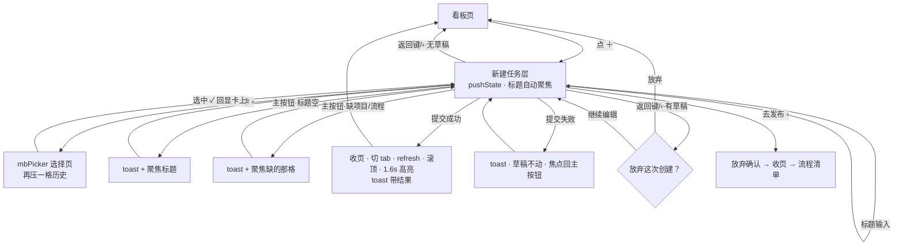

# 手机端「新建任务」交互规格 v1

2026-11-06 · 作者：ux（体验设计）· 配套《2026-11-05-手机端任务看板-交互规格》v2.1 §5/§15 与《移动端任务看板-视觉规格》
本文只管**信息架构 / 流程 / 状态反馈 / 无障碍**；色彩、圆角、字阶等视觉细节见视觉规格（并行产出）。

涉及代码：`apps/web/js/projects.mjs`（kbEnsureNew 约 1268–1360、openKbNewPage 约 1371–1418、kbStartState 约 1429–1444、kbNewGroupHtml 约 1445–1516、kbNewSubmit / kbTryClose / kbCloseNew）、`apps/web/mobile.css` §21.1。
硬约束：**不改接线 id**（kbNewTitle/kbNewDesc/kbNewGroup/kbNewOk/kbNewStart/kbNewHint）与 data-* 钩子；历史栈（pushState/back）机制不动；选择页复用 mbPicker。本文所有提案均已按此校验，可编码实现。

---

## 0. 定位：解决什么问题

主理人判定：现状页面**表单感**——读起来像填设置，不像「快速把一件事派出去」。
本规格不动能力与提交口径（§5.2 字段、`kbStartState` 锁定规则、mbPicker、历史栈全部继承），
只在四个杠杆上动手：

| 杠杆 | 现状 | 本规格 |
|---|---|---|
| 段落命名 | 「更多设置」把读者拉进"配置心智" | 改名「**建好之后**」（决策 D1） |
| 主按钮 | 恒为「创建任务」，后果埋在勾选框小字里 | 文案随模式**说出后果**（决策 D2） |
| 被挡提交 | toast 说了缺什么，但没说"缺的那格在哪" | toast + **焦点跳到缺的那格**（决策 D3） |
| 成功反馈 | toast「已创建」不带结果 | 文案带结果对象（决策 D4） |

明确**不做**的（既有裁决，写死防回潮）：
- 不预选项目 / 不预派活（防静默建错，2026-11-05 定稿）；
- 卡上 › 箭头是进选择页的唯一入口（v109 撤 chips 的裁决）；
- 「建好之后」段不折叠（v110 撤摘要行的裁决——页面本来就短，收起反而多一跳）；
- 草稿不持久化（建一张卡是 30 秒内的事，不做 storage + 恢复提示）。

---

## 1. 信息架构

### 1.1 段落与顺序（自上而下）

```
A  输入区（无框）          标题（必填，自动聚焦）+ 描述（可选，自动长高）
B  怎么干                  两张大卡二选一：派给他 / 由流程执行；选中结果回显在卡标题正下方
B' （条件）去发布 ›        仅当无已发布流程，贴在流程卡下方
C  建好之后                状态行 / 项目行（仅全局面板）/ 创建后立即开始勾选框 + 动态说明
D  底部主按钮              创建任务（文案随模式变化，见 D2）
```

**顺序理由**：这是建一张卡的思考顺序——先想清楚"这件事要做什么"（A），
再想"谁来干"（B，页面里最重的选择，两张大卡占视觉重心），
最后才是"建出来挂在哪、叫不叫醒人"（C）。
三段从"事 → 人 → 后果"递进，不是配置表单的字段罗列；
主按钮收尾，视线走完一遍正好落在提交上。

### 1.2 段命名与文案表（D1）

| 位置 | 现状 | 定稿 | 理由 |
|---|---|---|---|
| C 段节头 | 更多设置 | **建好之后** | 「设置」一词触发配置心智；「建好之后」用时间叙事，且这三行内容（挂在哪 / 归哪个项目 / 叫不叫醒谁）恰好就是"建好之后会发生什么"的答案。只改 `sec('更多设置')` 一处文案，不动结构 |
| B 段节头 | 怎么干 | 怎么干（不变） | 口语、动词开头，本来就是"派活"的语言 |
| 标题占位 | 任务要做什么 | 不变 | 问句式占位比「标题」更像在帮你想事 |
| 描述占位 | 补充说明（可选） | 不变 | "（可选）"免除义务感 |
| 主按钮 | 创建任务 | 见 D2 | —— |

> 命名约束：节头是纯展示文本，无 id / data-* 依赖，改名零接线成本。

### 1.3 主按钮文案随模式变化（D2）

按钮 id/语义不变（kbNewOk，aria-disabled 口径照旧），只让 `textContent` 跟着
`kbStartState` 的结论走——**把"点下去会发生什么"放到按下点上**，后果不再只活在 C 段小字里：

| 条件（提交时 startNow 将生效？） | 按钮文案 |
|---|---|
| 流程模式 且 已选流程 且 状态≠想法（锁勾，必然发起） | **创建并发起流程** |
| 派给他 + 数字员工 + 勾了立即开始（可派） | **创建并派活** |
| 其余（不派活 / 真人 / 想法状态 / 未勾） | 创建任务 |

- 文案由 `paintKbNew` / `kbNewSyncStart` 在重画时一并刷新；提交中沿用「创建中…」；
  失败恢复时按上表重算（而不是死写回「创建任务」）。
- 开页时（未勾、未选人）恒为「创建任务」，与现状一致——空表不预支承诺。
- 不做第三种以上变体：文案只表达"会不会立刻叫醒人"这一件事，其余后果仍在 C 段说明里。

---

## 2. 主路径触达次数审计

最短主路径（项目看板进、派给一位数字员工、建完就走）：

| # | 触达 | 说明 |
|---|---|---|
| 1 | 点「＋」 | 进页，标题自动聚焦、键盘弹起 |
| 2 | 输标题 + 键盘 done | 必填，不可省 |
| 3 | 点「派给他」卡右 › | 进执行人选择页（唯一入口，保留） |
| 4 | 点选某人 | mbPicker 选中即回填收页（已是零确认往返） |
| 5 | 点主按钮 | 提交 |

**结论：5 触是结构下限。** 第 3–4 步等价于"指名派活"这一动作本身，不能靠预选省掉
（既有裁决）；标题必填也不能省。因此本规格**不再减触点，减的是每一步的认知成本**：

- 键盘 done 只收键盘、不跳焦点：描述可选，强制跳过去等于替用户多走一步。
- 从选择页返回后回显立即可见（选中卡描边 + 回显紧跟标题），无需滚动——两卡与回显都在首屏内（390×844 实测，见截图）。
- 若还要勾「立即开始」：第 5 触前多 1 触勾选框，共 6 触；勾选框就在主按钮上方一个自然滚动位内，不新增定位成本。
- 全局面板另需选项目（+2 触）：这是"不预选项目"裁决的直接代价，保留。

> 反向审计过更快方案并否决：默认勾「立即开始」= 自动产生派活副作用（§5.2 裁决）；
> 首屏只露标题+主按钮的"极简首屏"= 把 C 段压进二次展开（v110 已否）；均不做。

---

## 3. 完整交互流

### 3.1 进入

1. 入口：看板顶栏「＋」（唯一入口；空态软底按钮调同一函数）。
2. 全屏层 `#kbNew` 推入 160ms（`prefers-reduced-motion` 下无动画）；`body.kb-new-open` 隐底部 tabbar。
3. `history.pushState({kbNew:true})`；Android 返回键 / 手势 / ‹ 同一格历史，口径不动。
4. 自动聚焦标题：滑入完成后延时聚焦（现状 80ms 方案保留）——**键盘铁律**：键盘弹起文档滚不动、visualViewport 不派发，因此
   - 标题输入必须处于上半屏（现状即满足：标题在 52px 顶栏正下方，任何机型首屏可见）；
   - **禁止**任何"聚焦后页面位移 / 收头部 / 滚动到输入框"的补偿方案；
   - 主按钮吃 `--mb-vh`，永远悬在键盘上方，键盘不遮提交路。
5. 默认值：`S.kbMobileTab === 'idea'` → 状态预填「想法」，否则「待办」；模式「派给他」、执行人「不派活」、项目**不预选**、流程取第一条已发布（仅作回显候选）、立即开始未勾。
6. 选中反馈不需要 aria-live 宣告（radio 变化读屏自会播报），但 C 段动态说明 `#kbNewHint` 保持 `aria-live="polite"`——模式切换导致锁定状态变化时说明文本随之播报。

### 3.2 输入与选择 / 回显

- 标题：单行，`enterkeyhint="done"`；描述：自动长高（>8 行内部滚动）。
- 两张大卡 = 真 radio（`name=kbNewMode`）：点卡身切换模式，只换显示，两侧已选值都保留（与桌面 syncMode 同口径）。
- 卡右 ›（唯一入口）：先切到该卡模式，再跳 mbPicker——›「派给他」→ 执行人（带搜索）；›「由流程执行」→ 流程。
- 选中回显在卡标题正下方：有值用 `--mb-text`（500，不染 tint——避免与染色标题糊在一起，§12 追加裁决），无值灰（「不派活」/「未选择」）。回显是**状态陈述**，不是第二入口，不可点。
- 无已发布流程：流程卡置灰（radio disabled + 副标题「还没有已发布的流程」）、不画 ›；卡下「去发布 ›」→ 放弃确认（见 3.5）→ 收页 → `setNav('workflows')`。
- C 段行（状态 / 项目）走 mbPicker；状态 8 项无搜索、选项带 `--st-*` 圆点；执行人 / 项目 / 流程带搜索。
- 「立即开始」可用性全部由 `kbStartState` 计算，规则一字不改（见 §5）。

### 3.3 提交（成功）

1. 主按钮可点（标题非空）→ 按钮进入「创建中…」+ 原生 disabled + `submitting` 闸；顶栏 ‹ 同步不可用（整页禁返回，弱网防半路请求）。
2. 成功 → 清草稿 → 收页 → **先**切 `S.kbMobileTab` 到新卡所在列**再** refresh（顺序铁律）→ 列表滚顶 → 新卡 1.6s flash（reduced-motion 只静态高亮）。
3. 反馈文案带结果（D4）：
   - 流程模式已发起：`流程已经起来了 —— 到流程实例里看每一步`（不变）；
   - 派给他 + startNow 生效：**`已创建，{name}这就开始`**；
   - 其余：**`已创建`**（维持）。
   - toast 语义不变（ok/error 样式），只改文案拼接。
4. 「去哪」的答案维持现状：回到看板、眼前就是新卡（切 tab + 滚顶 + 高亮）。
   不做"停留在创建页继续建下一张"（§5.5 裁决保留：一次建一件、回板确认，更不易建错）。

### 3.4 提交（被挡 / 失败）—— D3

| 被挡原因 | 反馈 | 焦点 |
|---|---|---|
| 标题为空（按钮灰但可点） | toast「任务得有标题」 | 聚焦标题框（现状保留） |
| 未选项目（全局面板） | toast「先选一个项目，任务才有地方挂」 | **新增：聚焦项目行**（`data-kb-pick="proj"`），读屏与视线同时到位 |
| 流程模式未选流程 | toast 原文案 | **新增：聚焦流程卡**（radio disabled 时聚焦卡内说明区，保证可达） |
| 服务端失败 / 403 / 断网 | toast 服务端文案 | **新增：焦点送回主按钮**——刚才按的就是它，失败后从这继续 |
| 提交中连点 | `submitting` 闸吞掉 | —— |

- 失败一律**留在创建页、草稿一个不动**；不弹二次确认、不自动重试。
- 失败后按钮恢复为按 §1.3 规则重算的文案 + `aria-disabled` 跟随标题实际状态。

### 3.5 放弃确认 / 返回键

- 无草稿（标题与描述皆空）→ ‹ / 返回键 / 手势直接收页，不问。
- 有草稿 → `confirmDo('写下的标题和描述不会保留。', { title: '放弃这次创建？', ok: '放弃' })`：放弃 → 收页；继续编辑 / 点蒙层 → 留页，内容不丢。
- 选过的值（人 / 流程 / 状态 / 项目）**不**单独确认——重选成本低，写字才是无价的。
- popstate 铁律不动：先 `history.back()`、画面等 popstate 收；`kbNewClosing` / `kbNewAbandon` 防连点防重复确认，机制照旧。
- Android 返回键且键盘弹起：依赖系统默认"先收键盘"（Tauri WebView 现状行为），本页**不**拦截键盘态返回；确认抽屉出现时键盘应已收起，异常情况由 `--mb-vh` 保证抽屉仍在可视区（见 §9 风险表）。

### 3.6 流程图



历史栈：`[看板格] ←push→ [创建页 {kbNew}] ←push→ [mbPicker {mbPicker}]`，机制与守卫一律不动。

### 3.7 线框要点（结构，视觉细节归视觉规格）

```
┌──────────────────────────────────────┐
│ ‹            新建任务                 │ 52 + safe-area
├──────────────────────────────────────┤
│ 任务要做什么            （19px 无框） │ ← 上半屏铁律：键盘弹起也必须可见
│ 补充说明（可选）                      │
│                                      │
│ 怎么干                                │
│ ┌──────────────────────────────────┐ │
│ │ 派给他                        ›  │ │ 选中卡 tint 描边+微底（无圆点，§12-①）
│ │   张三（回显）                   │ │ 回显紧跟标题、解释之上
│ │   发到他的会话里去做…             │ │
│ └──────────────────────────────────┘ │
│ ┌──────────────────────────────────┐ │
│ │ 由流程执行                    ›  │ │ 无流程→置灰，卡下「去发布 ›」
│ └──────────────────────────────────┘ │
│ 建好之后                              │ ← 仅改节头文案
│ ┌──────────────────────────────────┐ │
│ │ 状态                     待办  ›  │ │
│ │ 项目（仅全局）           未选择 ›  │ │
│ │ 创建后立即开始          （开 · 右）│ │ 真 checkbox 换皮成开关（§12-③）
│ │   未派活：卡先挂着，谁也不会被叫醒 │ │ hint 作注脚：无 hairline、间距 3px，aria-live
│ └──────────────────────────────────┘ │
├──────────────────────────────────────┤ ← 无 hairline
│        ［  创建并派活  ］             │ 文案随模式，--mb-vh 悬于键盘上
└──────────────────────────────────────┘
```

---

## 4. 状态与反馈清单（逐元素）

触屏无 hover；active = 按压态；命中区一律 ≥44×44。

| 元素 | 默认 | active | 禁用/锁定 | aria |
|---|---|---|---|---|
| 顶栏 ‹ | 常态 | `--mb-press` | 提交中 `disabled` | `aria-label="返回看板"` |
| 标题输入 | 无框、placeholder 19px | focus 无描边（无框输入区不加 ring，caret 即焦点指示） | — | `aria-label="任务标题"`（新增） |
| 描述 | 自动长高，min 44 | 同上 | — | `aria-label="补充说明"`（新增） |
| 两张大卡 radio | 未选：普通底；选中：tint 描边 + 标题染色（无微 tint 底，§12 追加裁决 a） | `--mb-press` | 流程卡无流程：radio disabled、标题 `--mb-text-3`、副标题 `--mb-text-2`（≥4.5:1，不降对比）；「去发布」走文本级 tint | 真 `<input type=radio>`；卡组 `role=radiogroup aria-label="执行方式"`（新增）；`aria-label` 拼回显值（新增，如「派给他，已选 张三」） |
| 卡右 › | 44×44 命中区 | `--mb-press` | 随卡置灰（不渲染） | `aria-label="选执行人"/"选流程"`（现状已有） |
| 回显行 | `--mb-text` 500（有值）/ 灰（无值），不染 tint | — | 非控件，不可点 | 作为卡 aria-label 的一部分播报 |
| 去发布 › | 文字链 tint | `--mb-press` | — | `aria-label="去发布流程"`（补全） |
| 状态 / 项目行 | 值右 + ›；空值灰 | `--mb-press` | — | `data-kb-pick` 可聚焦；`aria-label="<行名>，当前 <值>"`（新增） |
| 立即开始开关（右置，§12-③） | 未开：灰轨；开：tint 轨白钮 | `--mb-press` | 锁定：开关 40% + `aria-disabled`；**说明文字永不降对比**；锁开（流程）= checked + 不算禁用 | 真 `<input type=checkbox>` + label（整行可点不变）；说明 `id=kbNewHint` 由 wrap `aria-describedby` 指向（新增接线）；`aria-live="polite"` 保持 |
| 主按钮 | 按文案表；可用 = tint 实底白字 | brightness(.9) | 标题空：灰底灰字 + `aria-disabled="true"`（仍可点）；提交中：原生 disabled +「创建中…」 | `aria-disabled` 口径不变；被挡点击有 toast + 焦点反馈，读屏可感知 |
| toast | — | — | — | 走全局 toast 容器 `role=status`（若已有则复用） |

**焦点规则**：焦点顺序 = DOM 顺序（标题 → 描述 → 卡组 → 去发布 → 状态 → 项目 → 勾选 → 主按钮），无 `tabindex > 0`；焦点环只用 `:focus-visible`（触屏不画，键盘/读屏用户可见）。

---

## 5. 「立即开始」锁定规则（保持不变，抄录备查）

`kbStartState` 纯计算，画 HTML 与落 DOM 两处消费同一口径；行为与桌面 `syncStart()` 完全一致：

| 条件 | 勾选框 | 说明文案（#kbNewHint） |
|---|---|---|
| 流程模式 + 已选流程 + 状态≠想法 | **锁在勾上**（不是禁用：是确定的陈述） | 选了流程就立即发起；想先挂着就把状态改成「想法」 |
| 流程模式 + 状态=想法 | 禁用·取消勾 | 「想法」先不发起，拖到「进行中」才发 |
| 派给他 + 真人（`u:`） | 禁用·取消勾 | 真人执行：卡挂在他名下，不开会话、不派活 |
| 未派活 | 禁用·取消勾 | 未派活：卡先挂着，谁也不会被叫醒 |
| 派给他 + 数字员工 + 状态≠想法 | 可勾 | 建好就派到他的会话，工作目录是这个项目 |

- 只有用户点击才置 `startNow=true`；条件不再满足自动清（自动勾 = 自动副作用，禁止）。
- 提交算法照抄桌面：`flow ? 状态!=='想法' : (!isUser && !!执行人 && 勾选)`。

---

## 6. 边界情况表

| 场景 | 表现 |
|---|---|
| 无已发布流程 | 流程卡置灰 + 不画 › + 副标题「还没有已发布的流程」+ 卡下「去发布 ›」；主路径不受影响（默认「派给他」） |
| 全局面板且 0 个项目 | 项目行显示「还没有项目」；mbPicker note 指路工作台；提交被挡（toast + 聚焦项目行）。**不再做中央空态整页替换**（§5.6 旧案）——本页结构下项目行 + 指路文案已把话说完，整页替换反而重 |
| 从「想法」tab 进 | 状态预填「想法」；立即开始锁取消（两种模式都锁），文案见 §5 |
| 派给真人 | 回显人名（不染 tint）；立即开始禁用并解释；按钮文案 =「创建任务」 |
| 提交中双击 | `submitting` 闸 + 按钮原生 disabled；第二次点击无效 |
| 提交中按返回 | ‹ disabled + popstate 期间 `kbTryClose` 直接 return（整页禁返回） |
| 键盘弹起 + 返回键 | 系统默认先收键盘；本页不拦截 |
| 有草稿按返回 | confirmDo 抽屉确认；「放弃」后 `kbNewAbandon` 保证下一次 popstate 不再问 |
| 选了流程又切回「派给他」 | 双侧值都保留；回显各自独立；立即开始按新模式重算 |
| mbPicker 空清单 | 执行人：picker 只有「不派活」+ 搜索；项目：note 指路；流程：进不去（卡已置灰） |
| 提交 403 / 断网 | toast 服务端文案 + 草稿不动 + 焦点回主按钮 |
| `prefers-reduced-motion` | 推入无动画、flash 无过渡（静态高亮）；其余交互不变 |
| 转屏变宽 | `kb-new-*` 不套 @media，页面不散架、草稿不动（§11 继承） |

---

## 7. 无障碍要求

1. **语义控件**：radio / checkbox 用真 `<input>` 藏视觉（读屏与键盘照认）；卡组补 `role=radiogroup` + `aria-label="执行方式"`。
2. **表单可命名**：标题 / 描述补 `aria-label`（placeholder 不作可访问名的可靠来源）；勾选框说明经 `aria-describedby → #kbNewHint`。
3. **动态说明播报**：`#kbNewHint` 保持 `aria-live="polite"`——锁定状态变化（选了真人、切想法）时不用找焦点也能听到后果。
4. **被挡必可达**：每条被挡路径都有「说缺什么 + 焦点落到那格」双反馈（D3），原生 disabled 只出现在"点了确实无意义"处（提交中）。
5. **禁用不牺牲解释**：锁定态只降勾选框 / 圆点透明度，说明文字对比度不变；流程卡置灰时副标题与「去发布」仍 ≥4.5:1。
6. **对比度**：正文与弱色文字 ≥4.5:1，深浅两套都验；状态信息双编码（圆点颜色 + 状态词），色弱可用。
7. **焦点管理**：进页延时聚焦标题；从 mbPicker 返回焦点自然落回触发卡（DOM 重画后由浏览器按 DOM 序恢复，验收时确认不落到 body）；失败/被挡焦点跳转见 §4。
8. **动效**：推入 160ms、新卡高亮、按压全部尊重 `prefers-reduced-motion`。

---

## 8. 响应式与多端

| 档 | 行为 |
|---|---|
| 本页 DOM 仅手机渲染 | `kb-new-*` 不套 @media（转屏不散架，继承 §11） |
| ≤600px 窄机 | 仅紧凑化间距，不改结构；两卡回显行单行省略，长人名/流程名 `text-overflow: ellipsis` |
| >900px | 桌面永远走 taskDialog，本页不可达 |
| 键盘 | 唯一策略：`--mb-vh` 悬浮主按钮 + 标题固定上半屏；不做 visualViewport 补偿（不派发，做了也白做） |

---

## 9. 高风险交互与降级

| 风险 | 触发 | 降级 |
|---|---|---|
| 键盘顶飞布局 | 聚焦标题/描述 | 标题钉死上半屏 + `--mb-vh` 按钮悬浮；禁止任何滚动补偿方案（铁律写死） |
| 弱网连点建两张 | 双击主按钮 | submitting 闸 + disabled + 整页禁返回，`finally` 必恢复 |
| 历史栈幽灵格 | 三种退法并存 | 「先 back、画面等 popstate」铁律 + kbNewClosing/kbNewAbandon 双闸，机制不动 |
| 确认抽屉撞键盘 | 键盘未收就弹 confirmDo | `--mb-vh` 保证抽屉在可视区；系统默认返回先收键盘，异常才触到此路径 |
| 焦点在重画后丢失 | paintKbNew 整段 innerHTML 重画 | 回显信息全部在卡 aria-label 内，读屏重进卡即知；视觉焦点靠选中卡描边 + 回显文本；验收项盯这条 |
| 新卡不在眼前 | 建卡时所在 tab 与当前不同 | 先切 tab 再 refresh 的顺序铁律 + 滚顶 + 1.6s flash（双保险继承） |
| 文案变体造成误触 | 主按钮文案随模式变化 | 变体只有两句且都含「创建」动词；位置、尺寸、颜色恒定——按钮的"形"不变，只有"话"变 |

---

## 10. 复用与不改清单

- 不改 id：kbNewTitle / kbNewDesc / kbNewGroup / kbNewOk / kbNewStart / kbNewHint；data-* 钩子（data-kb-new-back / data-kb-gopick / data-kb-pick / data-kb-gopub）全保留。
- 历史栈、popstate 守卫、kbCloseNew 时序、mbPicker、confirmDo、`--mb-vh`、kbStartState 算法：全部不动。
- 本规格允许的改动面：**节头文案、主按钮 textContent、成功 toast 文案、被挡时 focus() 目标、若干 aria 属性**——均为接线无损的文案/属性层改动。

---

## 11. 验收要点（QA 照着点）

1. 项目看板 ＋ → 输标题 → › 选数字员工 → 主按钮显示「创建任务」（未勾）→ 勾立即开始 → 按钮变「创建并派活」→ 提交成功，toast「已创建，{名}这就开始」，回到看板新卡高亮。
2. 流程模式（有已发布流程、状态待办）→ 按钮恒「创建并发起流程」；改状态为想法 → 按钮回落「创建任务」+ hint 变想法文案。
3. 全局面板不选项目直接提交 → toast + 项目行获得焦点；流程卡被挡同理聚焦流程卡。
4. 标题空按钮灰但可点 → toast + 焦点回标题；键盘弹起时标题与键盘同时可见、页面不滚。
5. 从选择页选中返回：选中卡描边 + 标题染色、回显由灰变正常色、焦点不丢、立即开始说明随之变化（读屏播报）。
6. 有草稿按返回 → 确认抽屉；无草稿直接退；两种退法后看板滚动位置不变。
7. 无已发布流程：流程卡置灰无 ›、「去发布 ›」可走通且先过放弃确认。
8. 深浅主题 + reduced-motion 各过一遍：推入、flash、按压；锁定态说明文字对比度不降。
9. 读屏（TalkBack）走一遍主路径：卡组播报「执行方式」、每卡播报已选值与选中态、hint 变化自动播报、被挡 toast 可感知。

---

## 12. 与视觉规格 v1 的对齐记录（2026-11-06 同日）

以下四处由视觉规格提出、本文确认采纳，均不触碰 id / data-* / 事件接线：

| # | 改动 | 交互侧确认结论 |
|---|---|---|
| ① | 撤卡左侧 radio 圆点，回显值上移到标题正下方 | 采纳。选中态辨识由 tint 描边 + 染色标题承担（选中/未选的视觉差必须足够强，QA 第 1 条盯）；radio 语义与「整卡=选模式 / ›=进选择页」不变 |
| ② | 卡右 › 热区 36→44×44，视觉位置不动 | 采纳，正好补齐本规格 §4 的 ≥44 命中区要求 |
| ③ | 「立即开始」勾选框换皮成右置开关（同一个真 checkbox） | 采纳。开关暗示"即刻生效"与本项"提交时生效"有轻微心智差，但 iOS 新建表单同类先例充分，接受；整行点击、锁定态、aria 口径全部不变 |
| ④ | hint 去 hairline、间距收到 3px，读成该行注脚 | 采纳。位置仍在卡内最后 → DOM 顺序不变 → 读屏顺序与 §4 焦点规则不受影响 |

另两条实机项一并确认：
- `.kb-new` 高度改 `var(--mb-vh)`：**采纳且是修复**——键盘弹起整页缩、主按钮贴键盘上沿，与本文 §3.1 键盘铁律同一方向；QA 增一条：键盘弹起时主按钮可见可点、无内容被遮。
- 主按钮「提交中」不变灰、灰色只留给空标题的 aria-disabled 态：**采纳，附一个条件**——`textContent` 必须切到「创建中…」作为唯一忙碌线索（状态可见性最低线）；视觉若有余力可在按钮内加转圈，不加也过。

措辞裁决（视觉提问项）：回显词维持「未选择」/「不派活」**原词不变、不加指路语**。它们是状态陈述，右侧 › 自带可供性；加"点右边选"是噪音，且与设置行「未选择」用词一致。

### 12.1 视觉规格 v1.1 回执（同日追加）

对视觉 v1.1 的两处改判与两处升级，交互侧逐条回执：

- **a) 选中卡不加「微 tint 底」：采纳。** 理由成立——深色下 5% tint 不可见、浅色下像按压残留；选中辨识由 tint 描边 + 标题染色（文本级 tint）承担，本文 §4/§3.7/§12-① 已同步去掉"微底"。
- **b) 草稿卡 focus 不上环：采纳。** 与本文 §4 标题行"caret 即焦点指示"同口径，无框输入区不加焦点环；键盘/读屏用户的焦点定位由 caret + DOM 焦点顺序保证。
- **c) 回显有值不染 tint（改用 `--mb-text` 500）：采纳，不改判回去。** 视觉的理由是层级问题不是风格问题——标题已染 tint 表"模式被选中"，回显是答案；两处同 tint 会互相糊掉。灰（无值）→ 正常色（有值）的对比已足以表达"选没选"，且选中卡描边本身也在叙事。回退路径（一行 CSS 染回 tint）已记录在视觉规格 §6.2，QA 第 5 条按"描边+染色标题+回显变正常色"验收。
- **d) 对比度升级两项照单全收**：`#kbNewHint` 与置灰流程卡副标题升 `--mb-text-2`（浅 4.8 / 深 5.9，原 2.1~2.6 确实踩了我 §7.5 的红线）；「去发布 ›」与选中卡标题走文本级 tint（≈6:1）。这正是红线条款要起的作用，实测值表归视觉规格 §7-3。
- **e) toast 补 `overflow-wrap:anywhere`：同意**，全局一行零风险；本页新增的「已创建，{名}这就开始」是长无空格串的高发位，QA 顺手验一次超长英文人名。
