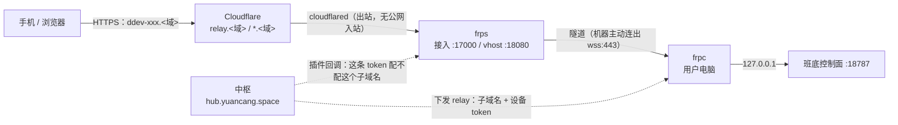

# 外网访问：中枢转发 + frp（机器侧已落地）

**日期**：2026-11-07 ｜ **状态**：两侧已实现，**已部署并端到端跑通**（见 §十一） ｜ **适用形态**：几个朋友 / 团队内部使用，暂不对外开放

---

## 一、要解决的事

用户在自己电脑上装了班底，想在手机（4G）上打开它。他的电脑在别人家路由器后面，没有公网地址，
外面无法主动连进来；他也不该被要求买域名、开端口、装 tailscale。

**唯一必须的东西是一个"公网上的中间人"，而他手机唯一一定会连的就是中枢。**
所以：中枢转发，机器出站连中枢，用户只做两件事——**装软件、登录**。

不做的事（明确排除，避免以后反复讨论）：

- 不打洞（对称 NAT / 公司网成功率不稳，兜底还是中继，等于两套都做）；
- 不要求用户配置域名/端口/证书/环境变量；
- 不做端到端加密（见 §六：Web 版做了也是假承诺，将来只会写"只转发、不落盘"）；
- 不做远程唤醒（电脑睡了就是连不上，界面上说清楚，别让用户以为坏了）。

## 二、拓扑



四个要点：

1. **连接方向永远是机器 → 中枢**，用户侧不开任何入站端口；
2. **TLS 在 Cloudflare 边缘终结**，frps 只处理明文 HTTP/WS（只听 127.0.0.1）；
3. 子域名 = `<subdomain>.<域>`，**一级通配** `*.<域>` 覆盖所有用户设备
   （不用 `*.d.<域>`：Cloudflare 免费证书只签一级通配，二级通配 HTTPS 会直接握手失败）；
4. 没有独立公网服务器也能跑：入口那台机器只要常开、能出网，`cloudflared` 就是它的公网腿。

## 三、契约（中枢 ↔ 机器）

沿用已有通道，**不新增轮询**：登录时给一次，之后每次心跳（60s）可以改派或撤销。

`hub.json` 增加一个可选字段：

```jsonc
{
  "baseUrl": "https://hub.yuancang.space",
  "deviceId": "dev_ab12cd",
  "deviceToken": "…",
  "relay": {
    "serverAddr": "relay.yuancang.space",   // frps 的地址（不是中枢地址）
    "serverPort": 7000,
    "subdomain": "dev-ab12cd",              // [a-z0-9-]，frps 的 subdomain
    "token": "…",                            // 设备级 frp 凭据，可单独吊销
    "publicUrl": "https://dev-ab12cd.d.yuancang.space"
  }
}
```

规则：

| 情形 | 含义 |
| --- | --- |
| 响应里**没有** `relay` 字段 | 中枢不管这件事（老版本中枢），机器沿用本地已存的 |
| `relay: {...}` | 开通 / 改派（换子域名、换 frps） |
| `relay: null` | **撤销**：机器立刻停隧道（判据是 `hasOwnProperty`，不是 `if (relay)`） |

机器侧对配置的容忍度是**缺一项就当没有**：宁可退化成"外网连不上、本机照常用"，
也不拿半份配置去连一个错的服务器（token 会发错地方）。

## 四、机器侧实现（本次落地）

| 文件 | 职责 |
| --- | --- |
| `apps/server/src/hub/relay.mjs` | 只读配置：`hub.json.relay` 优先，`<数据目录>/tunnel.json` 兜底（Spike / 自建 frps 用）；另外导出隧道域名给两道闸 |
| `apps/server/src/hub/tunnel.mjs` | 生成 `frpc.toml`、起停 / 重连 frpc、收尸；`apply()/stop()/status()` 三个动作就是将来换实现的那条缝 |
| `apps/server/src/http.mjs` | 隧道域名自动进 **Host 守卫**（`localAddresses()`）与 **写来源白名单**（`allowedOrigins()`） |
| `apps/server/src/server.mjs` | `listen` 之后 `tunnel.apply()`；心跳成功后回调 `apply()`，改派 60 秒内生效 |
| `apps/server/src/hub/join.mjs` | 心跳响应里的 `relay` 落盘（含 `null` = 撤销） |
| `apps/server/src/smoke-tunnel.mjs` | 六组断言（空转 / 崩了重连 / 幂等与改派 / 两道闸 / 收尸 / 没装 frpc） |

### 为什么不再需要 `httpHostHeader` 改写

frp 的 HTTP 代理默认把**原始 Host**（`dev-ab12cd.d.…`）交给本机。原方案要 frps 侧把 Host
改回 `127.0.0.1:18787`，否则第一道闸就 403 `E3002`。现在 `guardHost` 直接认得**中枢签发的
这一个域名**——放行的不是"任何域名"，DNS rebinding 的口子没开，用户也不用碰 `BANDI_ORIGINS`。

那条环境变量以前是唯一的坑：它只跟着"启动服务的那个终端"走，开机自启不带，**重启一次就变成
"页面能开、点一下全 403"**。现在这条路整个没有了。

### 三条生命周期边界（`lifecycle.mjs` 踩过的同一个坑）

| 场景 | 处理 |
| --- | --- |
| 服务正常退出 | `process.once('exit')` 收子进程 |
| 服务被强杀 / 断电 | `tunnel/frpc.pid` 收尸：下次启动只杀"命令行里有 frpc、且路径是本数据目录"的那个 |
| frpc 自己崩 | 退避重连 1s→2s→5s→10s→30s→60s；只认自己的 `child` 对象，避免旧进程的退出事件把新进程的状态改掉 |

最后一条不是理论：冒烟第一次就复现了"旧进程退出把新进程的 pid 清成 null、于是多起一条隧道、
两条抢同一个子域名"。修法是每个事件回调先认身份（`S.child !== child` 就返回）。

## 五、中枢侧实现（已落地，仓库 `bandi-hub`）

| 项 | 落地方式 |
| --- | --- |
| 下发 | `src/relay.mjs` 的 `relayFor()`：子域名从设备号**确定性派生**（重装/重登不变），设备 token = `HMAC(RELAY_TOKEN_SECRET, "relay:"+deviceId)` **不落库**，验的时候现算 |
| 吊销 | `devices.relay_enabled = 0` → 下发 `relay: null` → 机器下一次心跳自己停隧道；同时插件开始拒 |
| 名册 | `GET /v1/devices` 每台设备带 `publicUrl`（吊销时为 `null`），手机可"中转优先" |
| 鉴权插件 | `POST /v1/relay/auth`：`Login` 认「设备在名册 + 未吊销 + `metadatas.token` 对得上」，`NewProxy` 再加一条「子域名就是发给它的那个」 |
| 数据库 | `relay_sub` / `relay_enabled` 两列，老库跑 `migrations/002-relay.sql` |

frps 与入口在**部署侧**，不在仓库里，配置见 §十一。

## 六、隐私与信任（写进文案的就是这三句）

- **只转发，不落盘**：中枢只搬字节，请求体/响应体不进日志、不写盘、不缓存；
- **日志只记元数据**：设备、时间、路径、状态码、字节数，保留 7 天；
- **可吊销**：一键断开某台设备，隧道在下一次心跳内消失。

一条内部红线：**中枢永远不解析内容**——不做服务端全文搜索、不做消息预览、不做内容摘要。
这些一旦做了，将来要上端到端加密就得推翻架构；不做，那时只是在隧道里加一层。

**不要写"端到端加密"。** 手机壳加载的是远程页面，JS 由中枢下发，中枢随时能改——
Web 形态下这是做不到的承诺，懂行的人一试就知道。真正能做到的是"桌面端 + 原生手机端"，
那是以后的事。

## 七、先跑起来（中枢还没做时的手工版）

中枢侧还没动，机器侧已经可以单验。三步：

1. **拿 frpc**：解开 release 包（`frp_0.72.0_windows_amd64.zip`），把 `frpc.exe` 放到
   `<仓库>/vendor/frp/frpc.exe`（或设 `BANDI_FRPC=<路径>`）；
2. **写手工配置** `<数据目录>/tunnel.json`（Windows 是 `%APPDATA%\bandi\tunnel.json`）：

   ```json
   {
     "serverAddr": "你的 frps 地址",
     "serverPort": 7000,
     "subdomain": "dev-ab12cd",
     "token": "和 frps 的 auth.token 一致",
     "publicUrl": "https://dev-ab12cd.d.你的域"
   }
   ```

3. **重启服务**：日志出现 `[外网] 隧道已连（…）`；连不上先看 `<数据目录>/log/frpc.log`。

`tunnel.json` 只是 Spike 通道，**它不进任何界面**；中枢一旦下发 `relay`，以中枢为准。

## 八、Spike（半天，先验这条能不能用）

1. **SSE 必须能过**（验收主指标，不是细节）：跑一个长任务，面板逐行刷新；空闲 30 分钟回来还能接上。
   失败判定：卡在"还在跑"、或整段日志最后一次性刷出来（说明被缓冲了）。
2. **吊销要立刻生效**：中枢把某台踢掉 → 隧道应该在下一次心跳内断，而不是等 token 过期。
3. **孤儿进程**：任务管理器强杀服务 → 重启后 `frpc.pid` 能收掉旧进程，日志里出现"收掉上次没退干净的 frpc"，
   且手机上不会出现两台同名设备。

## 九、验收清单

- [ ] 新机器：装完 → 登录 → 手机浏览器打开 `https://<子域名>.d.<域>` → 能进面板、能改设置（写请求不 403）；
- [ ] 拔掉 Wi-Fi、切 4G，刷新页面 → 正常；
- [ ] 关掉那台电脑 → 手机提示"这台电脑没开或在睡眠"，不是转圈；
- [ ] 手机上"断开这台电脑" → 60 秒内隧道消失；
- [ ] 服务强杀重启 → 不出现"在线但点不动"（旧隧道没断）；
- [ ] 没装 frpc 的开发机启动 → 日志一行"仅本机/局域网可用"，其余一切正常。

## 十、已知代价

- 安装包每平台 +15~20 MB（frpc 二进制）；
- 流量过中枢，带宽成本在你这侧；先做单设备限额（同时是滥用处置手段）；
- 电脑休眠 = 连不上，无解，界面要说清楚；
- frp 是外置进程，比纯 Node 多一套日志与配置——但它换来的 SSE / 重连 / 多路复用，自己写得两周起。

## 十一、部署实况（2026-11-07 夜，已跑通）

### 落点

| 东西 | 在哪 | 说明 |
| --- | --- | --- |
| frps | `sea-ThinkPad-P15-Gen-1`（Ubuntu 22.04，`/opt/frps/frps`） | 没有公网入站，靠本机已装的 `cloudflared` 出网；systemd 单元 `frps.service` |
| 公网入口 | 同一个 `cloudflared` 隧道（`ubuntutunnel`） | 新加两条 ingress，DNS 两条 CNAME |
| 中枢 | `bandi-hub` Worker | vars 五项 + 两个 secret |

**原方案里的 Caddy 与泛域名证书被省掉了**：Cloudflare 既然已经在隧道这一侧终止 TLS，
源站就没必要再签一次证书、再维护一次续期。frps 只听 `127.0.0.1`，公网只认 Cloudflare。

### `/opt/frps/frps.toml`（要点）

```toml
bindAddr = "127.0.0.1"
bindPort = 17000            # 接入；cloudflared 把 relay.<域> 转到这里
vhostHTTPPort = 18080       # 面板；cloudflared 把 *.<域> 按 Host 转到这里
subdomainHost = "yuancang.space"

auth.method = "token"
auth.token = "<共享密钥，与中枢 RELAY_SERVER_TOKEN 同值>"   # 只挡随机扫描，不区分设备

[[httpPlugins]]
name = "hub"
addr = "https://hub.yuancang.space"   # frp 的插件回调支持 https:// 前缀
path = "/v1/relay/auth"
ops = ["Login", "NewProxy"]
```

`log.*` 那几行**别写**：v0.72 的 frps 配置解析会报 `unknown field "log"`（日志走 journald 即可）。
`transport.protocol` 也**别写**：v0.72 服务端没有这个字段，ws 由 bindPort 的嗅探器自动识别。

### cloudflared 的两条 ingress

```yaml
  - hostname: relay.yuancang.space
    service: http://127.0.0.1:17000
    originRequest:
      keepAliveConnections: 0     # 见下面第 4 个坑
      keepAliveTimeout: 1s

  - hostname: "*.yuancang.space"
    service: http://127.0.0.1:18080
```

DNS：`relay` 与 `*` 各一条 CNAME → `<tunnel-id>.cfargotunnel.com`（proxied）。
通配优先级低于精确记录，`hub` / `docs` / `bandi` 等既有子域不受影响。

### 中枢的五个变量与两个 secret

```
RELAY_SERVER_ADDR=relay.yuancang.space   RELAY_SERVER_PORT=443
RELAY_PROTOCOL=wss                       RELAY_BASE_DOMAIN=yuancang.space
RELAY_TOKEN_SECRET（secret）             RELAY_SERVER_TOKEN（secret，= frps 的 auth.token）
```

### 实测结果

- `frpc`（wss:443）→ `login to server success` → `new proxy [...] success`；
- `https://ddev-lzmzshaipmc4.yuancang.space/` → **200**，内容就是源站返回的页面；
- 换错 token / 陌生设备 / 抢别人子域名 → frps 侧 `reject`，隧道建不起来。

### 四个只有踩过才知道的坑

1. **放行必须回 `{ "unchange": true }`。**
   frps 拿到插件响应后会用其中的 `content` **替换**原消息（`pkg/plugin/server/manager.go`：
   `if !res.Unchange { content = retContent }`）。回 `{}` 等于把 Login 换成一份空对象，
   接着服务端比对 `privilege_key` 必然失败，报 `token in login doesn't match token from configuration`
   —— 看上去像 token 配错了，其实是"你把人家的消息清空了"。

2. **`NewProxy` 回调里的 `user` 是对象，`Login` 里的是字符串。**
   前者是 `{ user, metas, run_id }`，后者是扁平 Login 消息里的一个字段。
   按字符串取会得到 `"[object Object]"`，所有代理都开不起来。

3. **`privilege_key` 不能当设备凭据。** 它是 `md5(auth.token + 时间戳)`，
   只证明"知道 frps 那把共享钥匙"，反推不出设备号。设备身份走 `metadatas.token`。

4. **经过 Cloudflare 时 `transport.protocol` 必须是 `wss`，不能是 `websocket` + `tls.enable`。**
   frp 的 `websocket` 分支是**先发明文 ws 请求、再套 TLS**（`client/connector.go` 的 hook 优先级），
   443 上收到明文直接拒 —— frpc 报 `bad status`，而且请求连隧道都进不来（cloudflared 日志空白，
   看着像 DNS 或防火墙问题）。`wss` 才是"先 TLS 再 ws"。
   另外 cloudflared 的 `keepAliveConnections` 默认会预热连接池，
   空闲连接会被 frps 的协议嗅探器误判成 frp 通道，所以要显式设 0。

### 还没做的两件（属于客户端，不是基础设施）

- 手机壳的名册还是"只探局域网 IP"，要改成**中转优先**（先试 `publicUrl`，不通再探 `lanAddrs`）；
- 安装包里要带 `frpc` 二进制（`vendor/frp/` 或 `BANDI_FRPC`），否则机器侧 `status()` 是 `unavailable`。
