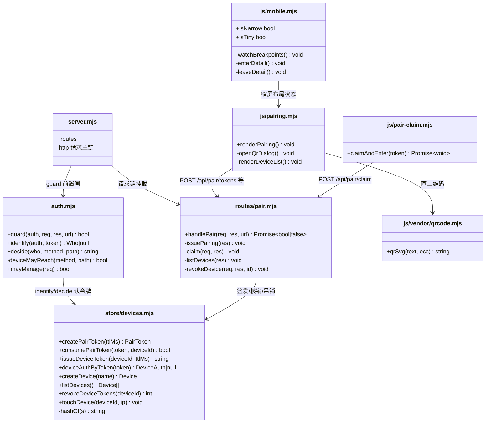
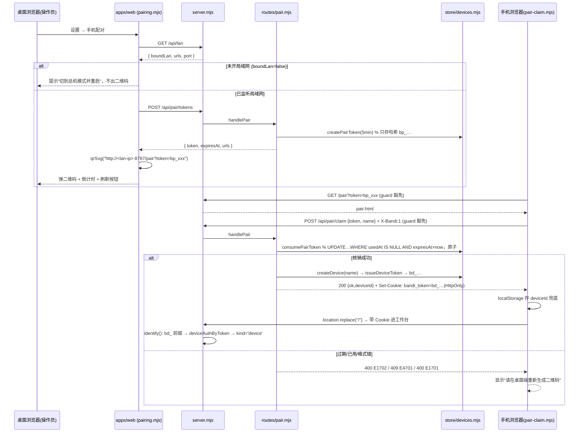
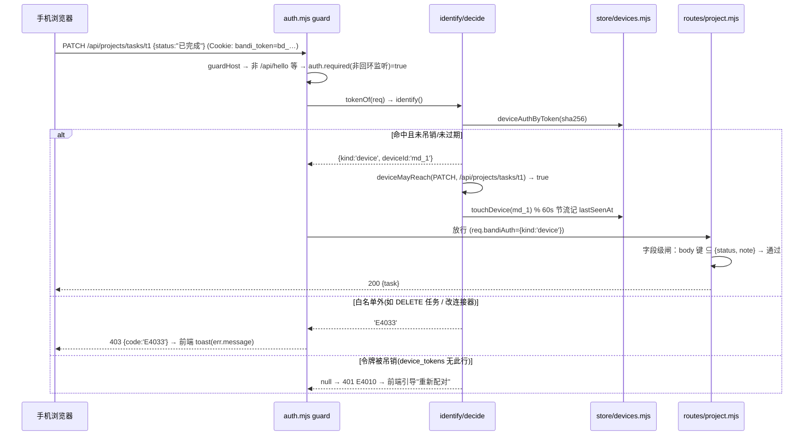

# 班底 · 手机端（PWA 响应式改造 + 扫码配对）· 系统设计

> 依据：`docs/mobile/pwa-prd.md` v0.1（增量 PRD）。
> 已定决策不推翻：不做原生 APP / 不做外网中继 / 不做推送；复用 `apps/web` 响应式改造；无构建步骤贯穿所有选型；手机端 = 受限视图，服务端按设备令牌区分权限。
> 本文所有引用的文件、函数名均为 2026-11 现仓库实际代码（已逐文件核实）。

---

## 1. 实现方案总述 + 技术选型

### 1.1 核心技术挑战

| 挑战 | 现状与对策 |
|---|---|
| **鉴权体系扩容** | `apps/server/src/auth.mjs` 已有三类身份（`identify()`：`operator` / `node`（`bn_` 前缀，`store.nodeAuthByToken`）/ `revoked`），闸门只看监听地址（回环免鉴权 / 非回环全要）。**方案：扩展而非并列** —— 在 `identify()` 里追加第四类 `device`（`bd_` 前缀，走新的 `store.deviceAuthByToken`），`decide()` 里加 `deviceMayReach()` 白名单（仿 `nodeMayReach()` 的写法）。这样"判定只有一处"的既有铁律不破。 |
| **SSE 不能带自定义头** | 会话流（`/api/events`、`/api/runs/:id/stream`）用 `EventSource`，设不了 `X-Bandi-Token` 头，只有 Cookie 一条活路。**设备令牌复用现有 Cookie 名 `bandi_token`**（`auth.mjs` 顶部的 `COOKIE` 常量），`tokenOf()` 一行不改 —— 三路取值（Cookie / 头 / 查询）原样生效。 |
| **一次性配对码** | `store/nodes.mjs` 的 `createInvite()/consumeInvite()` 已给出完整范式：只存 sha256 哈希、`UPDATE … WHERE usedAt IS NULL AND expiresAt > ?` 原子核销。配对令牌照抄这套（独立表，不混进节点表）。 |
| **二维码生成（无构建步骤）** | 选 **`qrcode-generator@1.4.4`**（Kazuhiko Arase，MIT）**vendored** 为 `apps/web/js/vendor/qrcode.mjs`（ESM 包装，约 10KB min）。理由：① 纯 JS 无 DOM/canvas 依赖，输出模块串可直接画 `<table>`/SVG；② 场景是局域网，**必须离线可用** —— 排除运行时 CDN 加载（手机/PC 都可能断外网）；③ 无构建步骤约束下，npm 引入不可行，vendored 单文件是唯一务实解；④ 该库是业界引用最广的二维码编码器之一，MIT 无传染。 |
| **主从结构折叠** | 全站骨架是"图标栏（`.rail`）→ 列表（`.list-panel`）→ 内容（`main`）"三级（`index.html` + `state.mjs setNav`）。`style.css` 仅 6 处零散 `@media`（860/900/1100px）。**方案：新建 `mobile.css` 追加加载**，900/600 两档断点，折叠状态用 `body` 上的状态类（`mb-detail-open` 等）由新模块 `js/mobile.mjs` 驱动，不改既有渲染函数的输出结构 —— 列表/详情 DOM 本来就常驻，窄屏只是换布局。 |
| **静态资源与更新** | 服务端静态文件每请求现读（`http.mjs serveStatic`，`Cache-Control: no-store`），前端改动刷新即生效；`/api/web-version` 指纹（`server.mjs`，覆盖 `app.mjs` + `js/*.mjs`）驱动"刷新页面"提示条（`misc.mjs startVersionWatch`）。P1 的 SW 必须与它共存：静态走 stale-while-revalidate、`/api/*` 一律不缓存（见 §8）。 |

### 1.2 架构模式

维持现状不变：**服务端** = 单进程 Node + SQLite（`store/` 按域拆分、SQL 收口在 `store/` 目录内），路由 = `server.mjs` 静态路由表 + `routes/*.mjs` 链式 handler；**前端** = 原生 ES modules 单页应用、无打包器。新增代码全部沿用这两套既有模式，不引入框架、不引入构建步骤。

配对模块遵循三条既有铁律：
1. **SQL 只出现在 `store/` 目录里**（`docs/形态决策.md` §十二）—— 新增 `store/devices.mjs`；
2. **判定只有一处** —— 设备身份判定只在 `auth.mjs identify()/decide()`；
3. **表里只存哈希，不存明文** —— 配对令牌、设备令牌均如此（对齐 `node_tokens` / `node_invites`）。

### 1.3 前置条件（重要）

- 扫码配对**只在总机形态可用**（监听非回环，`netmode.readNetMode().allowLan` / `BANDI_HOST`）：回环形态手机根本连不进来。桌面端配对弹窗打开前先 `GET /api/lan`（`routes/runtime.mjs:124`），`boundLan === false` 时提示"先在模式里切到总机并重启"，不生成二维码。
- CSRF 闸（`guardWrite`）要求写请求的 Origin 在 `allowedOrigins()` 里：手机页面 Origin 是 `http://<局域网IP>:8787`，`config.mjs selfLanOrigins()` 在 `allowLan` 开启时已自动把本机所有 IPv4 网卡地址放行 ✓（既有逻辑，无需改）。`BANDI_HOST` 显式指定的服务器部署仍需 `BANDI_ORIGINS` 显式声明（既有要求，文档里写明）。
- 手机端所有写请求照旧带 `X-Bandi: 1` 头（前端 `ui.mjs api()` 统一注入，配对落地页单独实现时也要带）。

---

## 2. 文件清单

### 服务端（`apps/server/src/`）

| 文件 | 新增/修改 | 用途 |
|---|---|---|
| `store/devices.mjs` | 新增 | 设备域存储：`mobile_devices` / `mobile_device_tokens` / `mobile_pair_tokens` 三表 DDL + 配对令牌签发/核销、设备令牌签发/认证/吊销、设备列表、最近活跃节流（仿 `nodes.mjs` 的 `touchNodeUsed` 60 秒节流）。**SQL 只在此文件。** |
| `store.mjs` | 修改 | 门面追加一行 `export * from './store/devices.mjs';` |
| `routes/pair.mjs` | 新增 | 配对与设备管理路由 handler：`POST /api/pair/tokens`、`POST /api/pair/claim`、`GET /api/pair/me`、`GET /api/pair/devices`、`POST /api/pair/devices/:id/revoke`、任务卡字段级权限闸（§3.3）。导出 `handlePair(req,res,url)`，返回 `false` 表示不归它管。 |
| `auth.mjs` | 修改 | ① `guard()` 顶部免鉴权清单加两条：`GET /pair`（及 `/pair.html`）、`POST /api/pair/claim`（对齐 `/api/nodes/join`、`/api/hello` 的既有写法）；② `identify()` 追加 `device` 身份（`bd_` 前缀 → `store.deviceAuthByToken`）；③ `decide()` 追加 `device` 分支走 `deviceMayReach()` 白名单；④ 命中设备令牌时 `store.touchDevice(deviceId)` 记最近活跃。 |
| `server.mjs` | 修改 | ① import 并挂 `handlePair`（放在 `handleConversation` 之前即可，它自己判路径）；② 非 `/api/` 分支里 `url.pathname === '/pair'` → 读 `apps/web/pair.html` 返回（不能依赖 `serveStatic`，它按路径找文件会 404）。 |
| `smoke-pair.mjs` | 新增 | 配对链路冒烟（跑法对齐 `smoke-auth.mjs`：临时 `BANDI_DATA` + 独立端口）。 |

### 前端（`apps/web/`）

| 文件 | 新增/修改 | 用途 |
|---|---|---|
| `js/vendor/qrcode.mjs` | 新增 | vendored `qrcode-generator` 的 ESM 包装，导出 `qrSvg(text, eccLevel)`（返回 SVG 字符串）。 |
| `js/pairing.mjs` | 新增 | 桌面端：设置页「手机配对」分节渲染 + 二维码弹窗（倒计时/刷新/候选地址列表）+ 已配对设备列表与踢出。 |
| `js/pair-claim.mjs` | 新增 | 手机端配对落地页逻辑（`pair.html` 专用，不进主应用模块图）：取 `?token=` → `POST /api/pair/claim`（带 `X-Bandi: 1`）→ 成功存 localStorage 兜底 → `location.replace('/')`。 |
| `pair.html` | 新增 | 手机扫码落地页（极简：校验中 / 成功跳转 / 失败提示，PRD §4）。独立页面，不加载整个 SPA —— 手机首屏只拉几 KB。 |
| `js/mobile.mjs` | 新增 | 响应式壳逻辑：`matchMedia('(max-width:900px)/(max-width:600px)')` 监听并置 `body` 状态类；主从折叠的"进详情/返回"与滚动位置保留；底部导航（P1）；键盘弹起处理（visualViewport）；关键弹窗转底部抽屉（P1）。 |
| `mobile.css` | 新增 | 全部移动端样式。断点 `@media (max-width: 900px)` / `(max-width: 600px)`；新组件类名一律 `mb-` 前缀（§8 命名空间）。 |
| `style.css` | 修改 | 极少量：仅"移动端必须有但写在原规则里更顺"的修正（如 `.composer` 定位改为可被 mobile.css 覆盖的写法）；新增规则一律不进这个文件。 |
| `index.html` | 修改 | ① `<link rel="manifest">`、`theme-color`、`apple-touch-icon`、`apple-mobile-web-app-*` meta、`viewport` 加 `viewport-fit=cover`；② 引 `mobile.css`（在 `style.css` 之后）；③ `<script>` 注册 SW（P1，功能开关内加）。 |
| `manifest.webmanifest` | 新增 | PWA manifest：`name/short_name: 班底`、`display: standalone`、`background_color: #08090a`、`theme_color: #08090a`、`icons` 192/512。 |
| `icons/icon-192.png` / `icons/icon-512.png` | 新增 | 从 `apps/desktop/icons/icon.svg`（index.html 里的 B 字母标同源几何）导出的 PNG。 |
| `app.mjs` | 修改 | import `./js/mobile.mjs`、`./js/pairing.mjs`（加进既有拓扑 import 序列）。 |
| `js/settings.mjs` | 修改 | `SETTINGS_SECTIONS` 追加 `['pairing', '手机配对', '扫码连接手机']`；`openSettings()` 加渲染分支。 |
| `sw.js` | 新增（P1） | Service Worker：静态资源 stale-while-revalidate 预缓存，`/api/*` 一律放行不缓存（§8）。 |
| `js/chat.mjs` | 修改（P1-4） | 富交互（任务卡、技能调用结果块）窄屏降级：渲染时若 `body` 带 `mb-narrow` 类，默认输出折叠摘要条（"📋 任务卡：xxx · 点击展开"），点击内联展开。 |

### 不改的

- `apps/desktop/`（Tauri 壳）：二维码由 `apps/web` 前端画，壳零改动。
- `http.mjs` / `config.mjs` / `netmode.mjs` / `lan-announce.mjs`：复用（`fail/readBody/guardWrite`、`netmode.lanUrls(port)` 直接调用）。

---

## 3. 数据结构与接口

### 3.1 数据表（DDL 落在 `store/devices.mjs`）

```sql
-- 已配对手机设备（PRD P0-3）
CREATE TABLE IF NOT EXISTS mobile_devices (
  id          TEXT PRIMARY KEY,          -- newId('md')
  name        TEXT NOT NULL,             -- 配对时自报（如 "张三的 iPhone"）
  pairedAt    TEXT NOT NULL,             -- ISO 8601 UTC（全库同口径 nowIso()）
  lastSeenAt  TEXT NOT NULL,             -- 最近活跃（60 秒节流更新）
  lastIp      TEXT                       -- 最近请求来源 IP（排查用）
);

-- 设备长期令牌：只存哈希（对齐 node_tokens）
CREATE TABLE IF NOT EXISTS mobile_device_tokens (
  tokenHash  TEXT PRIMARY KEY,           -- sha256(bd_…)
  deviceId   TEXT NOT NULL,
  createdAt  TEXT NOT NULL,
  expiresAt  TEXT                        -- NULL = 永久（见 §7 待确认 3）；列先建好，留旋钮
);
CREATE INDEX IF NOT EXISTS idx_mobile_dev_tokens ON mobile_device_tokens (deviceId);

-- 一次性配对令牌：5 分钟、单次使用（对齐 node_invites）
CREATE TABLE IF NOT EXISTS mobile_pair_tokens (
  tokenHash  TEXT PRIMARY KEY,           -- sha256(bp_…)
  createdAt  TEXT NOT NULL,
  expiresAt  TEXT NOT NULL,
  usedAt     TEXT,
  usedByDeviceId TEXT
);
```

### 3.2 API 一览（错误码分配见 §8）

| 方法 路径 | 鉴权 | 请求 | 响应 | 错误 |
|---|---|---|---|---|
| `POST /api/pair/tokens` | operator | `{}` | `{ token, expiresAt, urls: string[] }`（`urls` = `netmode.lanUrls(port)`，已按 192.168 > 10 > 172 排序） | `E3701` 非操作员（403）；`E5701` 落库失败（500） |
| `POST /api/pair/claim` | **免**（guard 豁免） | `{ token, name }`，Origin 必须合法 + `X-Bandi: 1` | 200 `{ ok, deviceId, name }` + `Set-Cookie: bandi_token=bd_…; HttpOnly; SameSite=Lax; Max-Age=31536000` | `E1701` 缺 token/格式不对（400）；`E1702` 已过期（400）；`E4701` 已被使用（409） |
| `GET /api/pair/me` | 任意已登录 | — | `{ kind: 'device', device: {id,name,pairedAt} }` 或 `{ kind: 'operator' }` | 401 走 `E4010` 既有闸 |
| `GET /api/pair/devices` | operator | — | `{ devices: [{id,name,pairedAt,lastSeenAt,lastIp}] }` | `E3701`（403） |
| `POST /api/pair/devices/:id/revoke` | operator | `{}` | `{ ok, revoked: <吊销的令牌数> }` | `E2701` 没有这个设备（404）；`E3701`（403） |
| `GET /pair?token=…` | **免** | — | `pair.html`（落地页；服务端不校验 token，校验在 claim） | — |

### 3.3 设备令牌权限边界 `deviceMayReach(method, pathname)`（`auth.mjs` 内，仿 `nodeMayReach`）

**白名单制**（不在名单 = `E4033` 403，沿用"手机端只有审批 + 对话两类写操作"的口径）：

| 方法 | 路径 | 对应手机场景 |
|---|---|---|
| GET | `/api/state`、`/api/projects`、`/api/tasks`、`/api/projects/tasks/:id`、`/api/projects/tasks/:id/comments`、`/api/conversations/:id`、`/api/pair/me` | 看状态 / 看卡详情 / 看会话 |
| POST | `/api/conversations/:id/messages` | 给员工发消息 |
| POST | `/api/projects/tasks/:id/comments`（仅 `mode:'note'`） | 驳回附一句理由 |
| PATCH | `/api/projects/tasks/:id` | 审批通过/驳回（改状态） |

PATCH 任务的**字段级闸**落在 `routes/project.mjs` 的 `taskOne` handler（`readBody` 在它手里，`auth.mjs` 看不见 body —— 与 `PUT /api/personas/:id` 的 model/runtime 字段闸同一模式）：`req.bandiAuth.kind === 'device'` 时只允许 `{status, note}` 两个键，多一个键 → `fail(res, 403, 'E3702', '手机端只能改卡票状态')`。

### 3.4 类图



---

## 4. 程序调用流程

### 4.1 扫码配对时序



### 4.2 手机端请求鉴权时序（以"审批一张卡票"为例）



**令牌失效的前端引导（PRD P0-3）**：`ui.mjs api()` 已把 401 的 `err.code='E4010'` 抛出；`js/mobile.mjs` 在 `body.mb-tiny`（手机形态）下拦 401，显示"请在桌面端重新扫码配对"全屏提示，不做裸登录页。

---

## 5. 任务列表（有序、按实现顺序）

> 粒度 = 一个工程师一次能独立完成并自测。P2 仅列标题。
>
> **验证注意事项（每个任务通用）**：
> - 服务端静态文件是**每请求现读**的：改前端（`apps/web`）刷新页面即生效；**改后端必须换进程**（杀掉重起，原地热改无效）。
> - 服务端隔离实例跑法：`BANDI_DATA=<临时目录> BANDI_PORT=8798 node apps/server/src/server.mjs`；冒烟脚本对齐 `smoke-auth.mjs` 的 spawn + 临时数据目录模式。
> - `POST /api/pair/claim` 测试时必须带 `X-Bandi: 1` 头（`guardWrite` 会拦）。

### T01 · 服务端：配对令牌、设备表与设备鉴权 【P0】

- **涉及文件**：`store/devices.mjs`（新）、`store.mjs`（改）、`routes/pair.mjs`（新）、`auth.mjs`（改）、`server.mjs`（改）、`smoke-pair.mjs`（新）
- **做什么**：
  1. `store/devices.mjs`：三表 DDL（§3.1）+ `createPairToken/consumePairToken/issueDeviceToken/deviceAuthByToken/createDevice/listDevices/revokeDeviceTokens/touchDevice`，全部照 `nodes.mjs` 既有范式（哈希落库、原子核销、`ensureColumn` 迁移习惯）。
  2. `routes/pair.mjs`：§3.2 全部端点；`/api/pair/tokens` 与设备管理两条用 `auth.mayManage(req)` 判操作员。
  3. `auth.mjs`：`guard()` 豁免 `GET /pair` 与 `POST /api/pair/claim`；`identify()` 加 `device` 身份；`decide()` 加 `device` 分支 + `deviceMayReach()`（§3.3）。
  4. `server.mjs`：挂 `handlePair`；非 `/api/` 分支加 `/pair` → `pair.html`（此时可先 404 占位，T02 建文件）。
  5. `routes/project.mjs` 的 `taskOne` PATCH handler 加设备字段级闸（E3702）。
- **验收标准**（`smoke-pair.mjs` 全绿）：
  - operator 签发配对令牌 → `claim` 换 `bd_` 令牌 → 带 `bd_` Cookie 读 `/api/state` 200；
  - 同一配对令牌第二次 `claim` → 409 `E4701`；篡改/过期令牌 → 400 `E1702/E1701`；
  - `bd_` 令牌 PATCH 任务改 status 200；改 title → 403 `E3702`；DELETE 任务 → 403 `E4033`；
  - `revoke` 后原令牌 → 401 `E4010`；`/api/pair/devices` 只对 operator 开（403 `E3701`）；
  - 回环形态（免鉴权）上述 operator 动作照常可用（单机自测不被自己的闸挡住）。
- **依赖**：无（第一个任务）。

### T02 · 扫码配对前端闭环 + PWA 壳 【P0】

- **涉及文件**：`js/vendor/qrcode.mjs`（新）、`js/pairing.mjs`（新）、`js/settings.mjs`（改）、`pair.html`（新）、`js/pair-claim.mjs`（新）、`index.html`（改）、`manifest.webmanifest`（新）、`icons/icon-192.png`、`icons/icon-512.png`（新）、`app.mjs`（改）
- **做什么**：
  1. vendored 二维码库（`qrSvg()` 导出）。
  2. `settings.mjs`：`SETTINGS_SECTIONS` 加「手机配对」分节；`pairing.mjs` 实现：先查 `/api/lan`，未监听局域网给引导；`POST /api/pair/tokens` 后弹二维码 dialog（复用既有 `<dialog>` 体系 + `wireDialogHead`），含倒计时、刷新按钮、多网卡候选地址列表（首选 `urls[0]` 画码，其余列出来可点复制 —— 复用 `ui.mjs copyPlainText`）。
  3. `pair.html` + `pair-claim.mjs`：极简落地页（PRD §4 线框），成功后 `location.replace('/')`。
  4. PWA：`manifest.webmanifest` + `index.html` 的 manifest/apple meta/`viewport-fit=cover`/`theme-color`；从 `apps/desktop/icons/icon.svg` 导出两张 PNG。
- **验收标准**：桌面端三步内出二维码；手机（同局域网）扫码 → 落地页校验 → 10 秒内进工作台（PRD 目标 3）；令牌过期显示错误 + "重新生成"提示；iOS Safari / Android Chrome「添加到主屏幕」后独立窗口 + 正常图标。
- **依赖**：T01。

### T03 · 响应式布局改造：三核心视图 【P0】

- **涉及文件**：`mobile.css`（新）、`js/mobile.mjs`（新）、`app.mjs`（改）、`index.html`（改，引 mobile.css）、`style.css`（极少量修正）
- **做什么**：
  1. `js/mobile.mjs`：两档 `matchMedia` 监听 → `body` 加/去 `mb-narrow`（≤900）/ `mb-tiny`（≤600）；主从折叠：列表占满屏、点行进详情（`body.mb-detail-open`），顶部「← 返回」栏，返回恢复滚动位置；`visualViewport` 监听处理键盘弹起。
  2. `mobile.css` 900px 档：`.rail` 收成顶部条或保留（按实现取简）、`.list-panel` / `main` 单列切换、列表行高 ≥48px；看板列（`projects.mjs` 的 `kb-*` 结构）改单列纵向堆叠，卡片收敛为"标题 + 状态色点/负责人/截止"两行；600px 档：对话页 `.composer` 吸底、消息区全高、`env(safe-area-inset-bottom)` 适配。
  3. `style.css` 只做被覆盖所需的最小修正；**新增规则一律进 `mobile.css`**。
- **验收标准**（PRD P0-1）：≤900px 下专家/成员列表、项目列表点进详情→返回回列表（滚动位置保留）；看板窄屏单列可读可拖；对话页键盘弹起不遮挡输入框；桌面窄窗口（半屏）体验同步改善；`<900` 与 `≤600` 两档各验一遍。
- **依赖**：无（与 T01/T02 并行，文件不相交；`app.mjs`/`index.html` 两处小改注意与 T02 的合并顺序）。

### T04 · 手机端受限视图、设备管理与交互优化 【P1】

- **涉及文件**：`js/mobile.mjs`（改）、`js/pairing.mjs`（改）、`routes/pair.mjs`（改，`/api/pair/me`）、`js/chat.mjs`（改，P1-4 降级）、`mobile.css`（改）、`index.html`（改，底部导航 DOM）
- **做什么**：
  1. 底部导航（PRD P1-1）：≤600px 显示「工作台 / 会话 / 我的」三 tab（映射 `setNav('plugins'|'messages'|'settings')`），列表一级页自动隐藏；「我的」= 设备信息 + 设置只读视图。
  2. 设备管理（PRD P1-2）：`pairing.mjs` 渲染已配对设备列表（设备名/配对时间/最近活跃）+ 踢出（确认后 `POST /api/pair/devices/:id/revoke`）。
  3. 401 引导：`mb-tiny` 下 `E4010/E4012` 换"重新扫码配对"全屏提示。
  4. 关键弹窗底部抽屉化（P1-1）、下拉刷新手势（对消息/看板列表，节流拉 `load()`）。
  5. P1-4 对话富内容降级：`chat.mjs` 渲染任务卡/技能结果块时按 `mb-narrow` 默认折叠摘要条、点击内联展开。
- **验收标准**：底部三 tab 切换正常且与左栏状态同步；踢出设备后手机端下一请求 401 → 引导重配对；富内容在窄屏默认一行摘要、展开后完整可读；P0 三场景各 ≤3 次点击回归通过。
- **依赖**：T01、T02、T03。

### T05 · Service Worker 缓存骨架 【P1】

- **涉及文件**：`sw.js`（新）、`index.html`（改，注册）、`mobile.css`（改，离线提示条样式，可选）
- **做什么**：SW 安装期预缓存核心静态（`/`、`/style.css`、`/mobile.css`、`/app.mjs`、`/js/**`、`/icons/**`、`/manifest.webmanifest`）；策略：静态 stale-while-revalidate，**`/api/*` 一律不缓存**（本地优先产品，数据以服务端为准，PRD P1-3）；与 `startVersionWatch` 共存 —— SW 更新静态后版本指纹自然变化，提醒条机制不动。
- **验收标准**：二次加载静态资源命中缓存（弱网局域网可感）；`/api` 请求永远走网络；前端改文件后刷新两次内拿到新版本（SW 更新不卡旧包超过一轮）。
- **依赖**：T02（PWA 壳先行）、T03。

### P2（只列标题，后续迭代另立设计）

- P2-1 离线只读快照（依赖 T05 的 SW 地基）
- P2-2 桌面事件的应用内提醒（页面内角标/横幅，非系统推送）
- P2-3 手机端发起轻量任务（先验证对话场景再扩展）
- P2-4 外网访问（复用总机/节点中继）

---

## 6. 依赖包列表

| 包 | 版本 | 引入方式 | 用途 |
|---|---|---|---|
| `qrcode-generator` | `1.4.4` | **vendored**：从 npm 包内 `qrcode.js` 拷出核心，包一层 ESM 导出，落 `apps/web/js/vendor/qrcode.mjs`（约 10KB，MIT）。**不进 package.json、不走 CDN** —— 无构建步骤 + 局域网离线硬约束。 | 桌面端画配对二维码 |

服务端、其余前端：**零新依赖**（Node 内置 `node:sqlite/crypto/os` 已覆盖全部所需；`os.networkInterfaces` 供 `netmode.lanUrls` 复用）。

---

## 7. 待明确事项（架构侧已给默认值，**待用户确认，先按默认实现**）

| # | 问题（PRD §5） | 架构默认 | 影响面 |
|---|---|---|---|
| 1 | 手机端写操作边界 | 放行"审批（PATCH 任务状态 + note 评论）+ 发消息"两类写，其余只读（§3.3 白名单已按此实现） | `deviceMayReach` / `project.mjs` 字段闸。若要收紧"哪些卡票类型可手机审批"，在字段闸加 `task.kind` 判断即可，不改架构 |
| 2 | 多手机/多用户 | 支持**多设备**（一人多机或多人各配各的），设备之间权限相同、都从属于这台 PC 的操作员；设备表天然支持 | 表结构已按 deviceId 维度建，无返工风险 |
| 3 | 令牌有效期 | **默认永久有效 + 手动踢出**（本期）；`expiresAt` 列已建好留作旋钮，若确认要 30 天上限，一行默认值改动 | `store/devices.mjs issueDeviceToken` |
| 4 | 多网卡 IP 选取 | 用 `netmode.lanUrls(port)` 既有排序（192.168 > 10 > 172，docker 的 172.x 沉底）；**首选画码 + 全部候选列出可复制**，用户扫不上自己换 | `pairing.mjs` 二维码弹窗 |
| 5 | iOS / Android 优先级 | **Android Chrome 先行验证**（SW/Add2HS 行为标准），iOS Safari 跟随；iOS 无安装提示、`apple-mobile-web-app-capable` 走 legacy 模式，均已在 T02 meta 里覆盖 | T02 验收顺序 |
| 6 | 配对令牌 TTL / 并发码数 | 5 分钟、单次使用（PRD 默认）；同时最多 3 个未用码（`createPairToken` 时清理过期 + 上限检查，防设置页反复点刷爆表） | `store/devices.mjs` |
| 7 | 设备可见数据范围 | 设备令牌能读 `/api/state` 等 = **与操作员同视野**（局域网家庭/个人场景默认可接受）。若要"手机只看部分项目"，需要在 `deviceMayReach` 之上加数据过滤层 —— 本期不做，列为后续选项 | 安全口径 |

---

## 8. 共享知识（跨文件约定，实现者必读）

1. **错误码**：沿用"按 HTTP 状态分段"（E1xxx=400 / E2xxx=404 / E3xxx=403 / E4xxx=409 / E5xxx=500，写在调用点上不集中登记）。手机配对模块分配各段内 **x7xx 子段**：`E1701/E1702`（配对令牌缺失/过期）、`E2701`（设备不存在）、`E3701/E3702/E4033`（非操作员/字段越权/设备白名单外）、`E4701`（码已用）、`E5701`（落库失败）。**理由**：不破坏既有分段语义（码的第一位仍等于 HTTP 状态/5 类），"7"这个百位是未被占用的空段（现有码散布在 x0xx/x2xx/x6xx），`grep E17` 只命中配对模块，排查直达。
2. **断点体系**：900px（主从折叠）/ 600px（底部导航 + 紧凑档）两档；JS 侧 `body.mb-narrow` / `body.mb-tiny` / `body.mb-detail-open` 状态类由 `mobile.mjs` 统一维护，CSS 侧 `mobile.css` 内 `@media` 与状态类**双轨并用**（纯样式走 media query，行为相关折叠走状态类）。
3. **CSS 命名空间**：移动端新组件类名一律 `mb-` 前缀（`mb-tabbar`、`mb-sheet`、`mb-backbar`…），全部规则只写进 `mobile.css`；`style.css` 不新增移动规则，只允许为可覆盖性做的最小改写。
4. **前端新模块命名**：`js/` 下小写单词（既有惯例：`chat.mjs`、`machine.mjs`），新模块 `mobile.mjs` / `pairing.mjs` / `pair-claim.mjs`；vendored 第三方放 `js/vendor/`（`/api/web-version` 指纹只扫 `js/*.mjs` 一层，vendor 不进指纹 —— 有意为之，vendored 文件不变就不用触发刷新提醒）。
5. **令牌体系**：设备令牌前缀 `bd_`（节点是 `bn_`、操作员无前缀），Cookie 沿用 `bandi_token`（`EventSource` 兼容），库里只存 sha256。配对令牌前缀 `bp_`、5 分钟一次性。新增令牌类型时 `identify()` 是唯一判定入口。
6. **请求纪律**：所有前端写请求带 `X-Bandi: 1`（`ui.mjs api()` 已统一；`pair-claim.mjs` 独立实现时必须自己带）；手机页面 Origin 依赖 `config.mjs selfLanOrigins()` 自动放行，勿在配对链路上绕过 `guardWrite`。
7. **时间/ID**：一律 `store/db.mjs` 的 `nowIso()`（ISO 8601 UTC）与 `newId('md'|'mp')`。
8. **验证**：见 §5 顶部的两条验证注意事项（前端热更 / 后端换进程 / 隔离实例跑法）。
